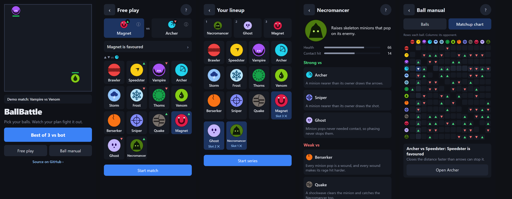

# BallBattle

[](https://github.com/Lyfe4/ball-battle/actions/workflows/ci.yml)

**Play it: [battle-ball.netlify.app](https://battle-ball.netlify.app/)**

A strategy game about building a lineup. Pick your balls, set their order and watch your plan
fight it out: balls with different abilities bounce around a square arena until one wins. There is
no control once a fight starts, so the decisions are all in the picking. Against a bot, a Best of 3
asks you to build and order three balls and read what the other side will play.

Built with TypeScript, Vite and plain Canvas 2D. No game engine, no physics library, no
framework.



The home screen plays a demo match behind the pitch. Its main button, **Best of 3 vs bot**, is the
game; **Free play** lets you choose both balls of one match, to try things out. Every screen is designed for a phone first and has a
URL, so Back works and any screen can be linked
([ADR 0020](docs/decisions/0020-screens.md)). Screens show little by default: symbols explained
once in a legend, details one tap away, and Back that undoes exactly one move
([ADR 0025](docs/decisions/0025-show-less-and-back.md)).

The **Ball manual** lists every ball with what it does and who it is strong and weak vs, each with
the reason, and a **matchup chart** of the whole counter map. Both are read from the ball
definitions and the counter map, so they never go stale.

Pick two balls and watch them fight. They collide elastically and deal damage scaled by how hard
they hit; the match ends by knockout or at a 60-second time limit.

| Ball        | Ability                                                                          |
| ----------- | -------------------------------------------------------------------------------- |
| Brawler     | None. Hits the hardest. The safe pick: even against every ball but Thorns.       |
| Speedster   | Fastest ball. Each wall bounce adds speed and bonus damage; a hit cashes it in.  |
| Vampire     | Heals for 40% of the damage it deals.                                            |
| Archer      | Lowest contact damage, but shoots an arrow where its enemy is heading every 2 s. |
| Storm       | Lightning every 2 s, landing 0.8 s later. Its strikes and touch cut healing.     |
| Frost       | Slowest and sturdy. Every hit slows its enemy for 3 s; poison wears off it fast. |
| Thorns      | Spiked: every contact hit it takes hurts the attacker back by 35%.               |
| Venom       | Light hits that poison its enemy for over 4 s, chipping away between contacts.   |
| Berserker   | The most health, hits harder the more it has lost, and can't be slowed.          |
| Sniper      | Locks onto its enemy with a laser, then fires one heavy shot down the line.      |
| Quake       | Every wall it hits sends out a shockwave that stops its enemy aiming for 3.5 s.  |
| Magnet      | Every 2 s it pulls its enemy in, forcing a brawl. Hits harder than all but one.  |
| Ghost       | Phases out every few seconds: contact hits pass through it, but shots don't.     |
| Necromancer | Raises a skeleton minion that pops on its enemy and draws aimed attacks.         |

Every ball is the same size and keeps its own speed through collisions; a hit's damage depends
on how directly it lands, not how fast.

### Counters

Picks matter: most pairs lean one way. A counter is _favoured_ (it wins roughly 58-70% of the
time), never decided, and each one comes from something you can watch happen:

- **Speedster is strong vs Archer**: it closes the distance faster than arrows can stop it.
- **Archer is strong vs Vampire**: arrows chip it from range, and the Vampire only heals off its own hits.
- **Vampire is strong vs Speedster**: it heals off every exchange and outlasts the burst.
- **Storm is strong vs Vampire**: lightning and its touch shock the Vampire, so it heals less.
- **Speedster is strong vs Storm**: the fastest ball outruns the lightning warnings.
- **Frost is strong vs Speedster**: slowed, it loses its speed and the wall bounces that build it up.
- **Storm is strong vs Frost**: the slowest ball can't leave a lightning warning in time.
- **Thorns is strong vs Brawler**: the hardest hitter hurts itself the most on the spikes.
- **Archer, Storm, Venom and Sniper are strong vs Thorns**: arrows, lightning, poison and shots never touch
  the spikes, so nothing is reflected.
- **Vampire is strong vs Venom**: lifesteal heals back what the poison chipped away.
- **Berserker is strong vs Speedster**: its huge health soaks the burst, and every wound makes it hit
  harder.
- **Vampire is strong vs Berserker**: the biggest health pool gives lifesteal the most to drink.
- **Speedster is strong vs Sniper**: it is off the locked line before the shot.
- **Quake is strong vs Speedster**: the shockwave's warning is too short to outrun.
- **Frost is strong vs Quake**: slowed, the Quake reaches the walls less often, and every shockwave needs
  a wall.
- **Venom is strong vs Berserker**: poison numbs its rage (its cracks fade while it is poisoned).
- **Berserker is strong vs Frost**: its rage burns off the cold, so it can never be slowed.
- **Frost is strong vs Venom**: the cold wears poison off sooner, and the Frost hits Venom hard.
- **Archer is strong vs Frost**: leading arrows land most often on the slowest ball.
- **Quake is strong vs Archer, Storm and Sniper**: a shockwave staggers whatever it hits, and a staggered
  ball can't aim, so it loses its next arrow, strike or shot.
- **Magnet is strong vs the balls weak up close** (Speedster, Archer, Storm, Venom, Sniper, Quake,
  Necromancer): its pull drags them into a brawl. **Thorns is strong vs the Magnet**: it drags the spikes
  into itself.
- **Ghost is strong vs Speedster**: the fastest ball runs through it most often, and its rush lands on
  nothing. **Archer, Storm, Sniper, Quake and Necromancer are strong vs the Ghost**: their attacks never
  needed contact, so phasing never stops them.
- **Necromancer is strong vs Archer and Sniper**: a minion nearer than its owner draws the arrow or shot.
  **Quake and Berserker are strong vs the Necromancer**: a shockwave clears the minion and its owner, and
  every minion pop feeds the Berserker's rage.

The **Brawler** is the safe pick: even against everyone except Thorns. Every other pair is even.
The map is checked by `pnpm balance` ([ADR 0010](docs/decisions/0010-counter-map.md),
[ADR 0016](docs/decisions/0016-counter-density.md),
[ADR 0026](docs/decisions/0026-magnet-ghost-necromancer.md)).

## Best of 3

Choose **Best of 3** on the home screen to play a series against a bot: pick three different
balls in order
(round 1 is your first ball against the bot's first, and so on), and the first to win two rounds
takes the series. A track shows every round at a glance, the winner ringed and the loser dimmed,
and a series left with Back (easy to do by accident on a phone) can be resumed where it was. The
bot's lineup stays hidden; each round reveals both balls as it starts. A
drawn round is replayed on a new seed, up to three times, then settled by sudden death. When the
series ends, the link holds both lineups, the series seed and the ruleset, e.g.
`?mode=bo3&la=frost,quake,venom&lb=sniper,archer,storm&seed=5&v=2`, and replays it exactly
([ADR 0017](docs/decisions/0017-best-of-3-series.md)). Before replaying, the page checks the link
with the same rule a server would use: the bot's lineup and picks must be the ones it would
choose, so an edited link opens the lineup instead
([ADR 0022](docs/decisions/0022-ruleset-version-and-verified-series.md)).

Choose the **rules** before a series ([ADR 0019](docs/decisions/0019-draft-formats.md),
[ADR 0021](docs/decisions/0021-reveal-take-turns.md)):

- **Blind**: as above, both orders set without seeing the other lineup.
- **Reveal**: both lineups are revealed, then the sides take turns showing first. Round 1 the bot
  shows its ball and you answer; round 2 you show first and the bot answers with its best counter;
  round 3 is what is left. Your choices are worth about 13 points of series chance
  ([measurements](docs/reveal-measurements.md)).
- **Loser picks**: after a round, the loser picks its next ball knowing the winner's next one; the
  winner keeps its order. The bot counter-picks from the counter map when it loses.

The link records the rules and every pick (`fmt=loser&picks=archer`, or Reveal's four), so these
series replay exactly too.

## Running it

Needs Node 24+ and pnpm 11 (`corepack enable` picks up the pinned version).

```bash
pnpm install
pnpm dev
```

Every match is in the URL, e.g. `?a=speedster&b=vampire&seed=42&v=2`: share or reload it to
replay the exact same fight. Unknown ball ids fall back to the defaults, and a missing seed gets a
fresh random one. `v` is the ruleset the fight was played under: balance changes bump it, and a
link from another version says so and offers to play under today's rules rather than silently
replaying a different fight
([ADR 0022](docs/decisions/0022-ruleset-version-and-verified-series.md)).

Two pages exist only under `pnpm dev`: `/styleguide.html` shows every ball design and the shared
UI parts, and `/brand.html` draws the icons and the link-preview image with the game's own
renderer.

The **Speed 1× / 2×** toggle under a match plays everything twice as fast (the fight,
hit-stops and effects alike) without changing the result; your choice is remembered in this
browser. Motion is drawn between simulation ticks, so it stays smooth on 90, 120 and 144 Hz
displays.

| Script               | What it does                                                                 |
| -------------------- | ---------------------------------------------------------------------------- |
| `pnpm dev`           | Vite dev server                                                              |
| `pnpm build`         | Typecheck and build to `dist/`                                               |
| `pnpm preview`       | Serve `dist/` with the production security headers, to check the CSP         |
| `pnpm test`          | Run the fast tests once (`pnpm test:watch` to watch)                         |
| `pnpm test:slow`     | Roster-wide tests that play every matchup (a separate CI job)                |
| `pnpm test:browsers` | Known match results and page flows in Chromium, Firefox, WebKit (own CI job) |
| `pnpm golden`        | Record the known match results again after a ruleset bump                    |
| `pnpm lint`          | ESLint                                                                       |
| `pnpm typecheck`     | `tsc -b` across all tsconfig projects                                        |
| `pnpm format`        | Prettier (`pnpm format:check` to only check)                                 |
| `pnpm balance`       | Matchup matrix, ability impact and sensitivity, on all cores (`--ball <id>`) |
| `pnpm balance:ci`    | The reduced balance check CI runs: 150 seeds, fails only on a clear miss     |

## Architecture

```
src/
  sim/      pure, deterministic simulation (no DOM, no time, no Math.random)
  render/   draws sim state on a canvas; never changes it
  sim/balls/        one file per ball definition
  sim/abilities/    runs ability hooks and applies the actions they return
  sim/series.ts     best-of-3 rules, pure so a server can re-run a series
  sim/series-verify.ts   whether a series setup is valid: the browser and a server use it
  sim/ruleset.ts    the ruleset version every link records (bumped with any balance change)
  golden/   known match results, checked in Node and in Chromium, Firefox and WebKit
  ui/       plain-DOM screens: home, ball grid and detail, setup steps, manual, scoreboard, HUD
  styles/   design tokens (a palette, then roles) and base styles; components' CSS sits beside them
  app/      browser-side helpers: clocks, playback speed, seed, routes, matchup and series links
  arena.ts  the match on screen and the requestAnimationFrame loop
  *-controller.ts, *-screens.ts, series-setup.ts, manual-screen.ts   each screen's wiring
  main.ts   wires the screens together
```

The rules, in brief:

1. **The simulation is pure and deterministic.** `src/sim` cannot touch the DOM, the clock,
   timers or `Math.random`. A separate `tsconfig.sim.json` without the DOM lib and ESLint rules
   enforce this; transcendental `Math` functions are banned too, because they can differ between
   browsers. 210 recorded matches are checked on every push to come out bit-identical in Node,
   Chromium, Firefox and WebKit
   ([ADR 0023](docs/decisions/0023-known-match-results-across-engines.md)).
2. **Fixed timestep.** The sim runs at exactly 60 ticks per second regardless of frame rate. The
   same balls and seed always produce the same match.
3. **Seeded randomness** comes only from a mulberry32 PRNG whose state is part of the world.
4. **Rendering only reads.** The renderer draws the current state and never writes to it.
5. **Balls are data.** Each ball is a definition file (plain data plus optional hooks) in
   `src/sim/balls/`.
6. **The sim reports, it doesn't listen.** Each tick returns events (collision, damage, heal,
   ability triggered, projectiles, zones, defeat, match end) for effects, sound and replays;
   nothing feeds back in.
7. **Abilities return actions.** Hooks get a read-only view and return plain-data actions
   (damage, heal, change velocity, update own state, fire a projectile, mark a zone); the sim
   applies them in a fixed order.

Why: [ADR 0001: Deterministic, fixed-timestep simulation](docs/decisions/0001-deterministic-simulation.md)
, [ADR 0002: Combat core](docs/decisions/0002-combat-core.md)
, [ADR 0003: Ability system](docs/decisions/0003-ability-system.md)
, [ADR 0004: Wall-bounce variance](docs/decisions/0004-wall-bounce-variance.md)
, [ADR 0005: Projectiles](docs/decisions/0005-projectiles.md)
, [ADR 0006: Hazard zones](docs/decisions/0006-hazard-zones.md)
, [ADR 0007: Presentation clock and battle feel](docs/decisions/0007-presentation-clock.md)
, [ADR 0008: Uniform size, directness, cruise speed](docs/decisions/0008-size-directness-cruise-speed.md)
, [ADR 0009: Status effects](docs/decisions/0009-status-effects.md)
, [ADR 0010: Counter map](docs/decisions/0010-counter-map.md)
, [ADR 0011: Roster scaling](docs/decisions/0011-roster-scaling.md)
, [ADR 0012: Slowed, poisoned, onDamageTaken](docs/decisions/0012-slowed-poisoned-damage-taken.md)
, [ADR 0013: Thorns, the Brawler's counter](docs/decisions/0013-thorns-brawler-counter.md)
, [ADR 0014: Venom, Thorns' counter](docs/decisions/0014-venom-thorns-counter.md)
, [ADR 0015: Berserker, Sniper, Quake](docs/decisions/0015-berserker-sniper-quake.md)
, [ADR 0016: Counter density](docs/decisions/0016-counter-density.md)
, [ADR 0017: Best-of-3 series](docs/decisions/0017-best-of-3-series.md)
, [ADR 0018: Aimed start (removed)](docs/decisions/0018-aimed-start.md)
, [ADR 0019: Draft formats](docs/decisions/0019-draft-formats.md)
, [ADR 0020: Screens](docs/decisions/0020-screens.md)
, [ADR 0021: Reveal takes turns](docs/decisions/0021-reveal-take-turns.md)
, [ADR 0022: Ruleset version and verified series](docs/decisions/0022-ruleset-version-and-verified-series.md)
, [ADR 0023: Known match results across engines](docs/decisions/0023-known-match-results-across-engines.md)
, [ADR 0024: Player-facing text stays in definitions](docs/decisions/0024-player-facing-text-stays-in-definitions.md)
, [ADR 0025: Show less, and Back](docs/decisions/0025-show-less-and-back.md)
and [ADR 0026: Magnet, Ghost, Necromancer](docs/decisions/0026-magnet-ghost-necromancer.md).
Full rules for contributors: [CLAUDE.md](CLAUDE.md).

Production bundle: 131.14 kB JS (43.28 kB gzipped), 20.80 kB CSS. First version baseline: 5.05 kB
JS (2.41 kB gzipped).

## License

[MIT](LICENSE)
