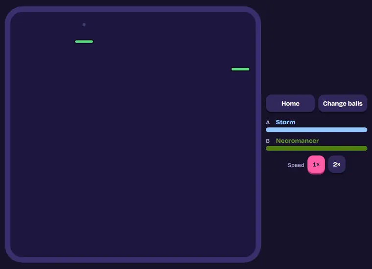
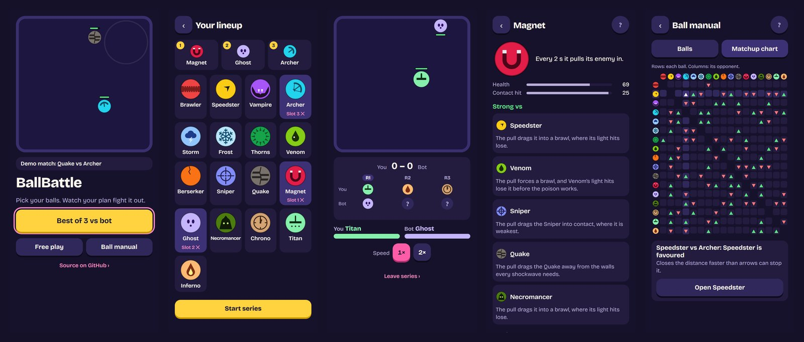
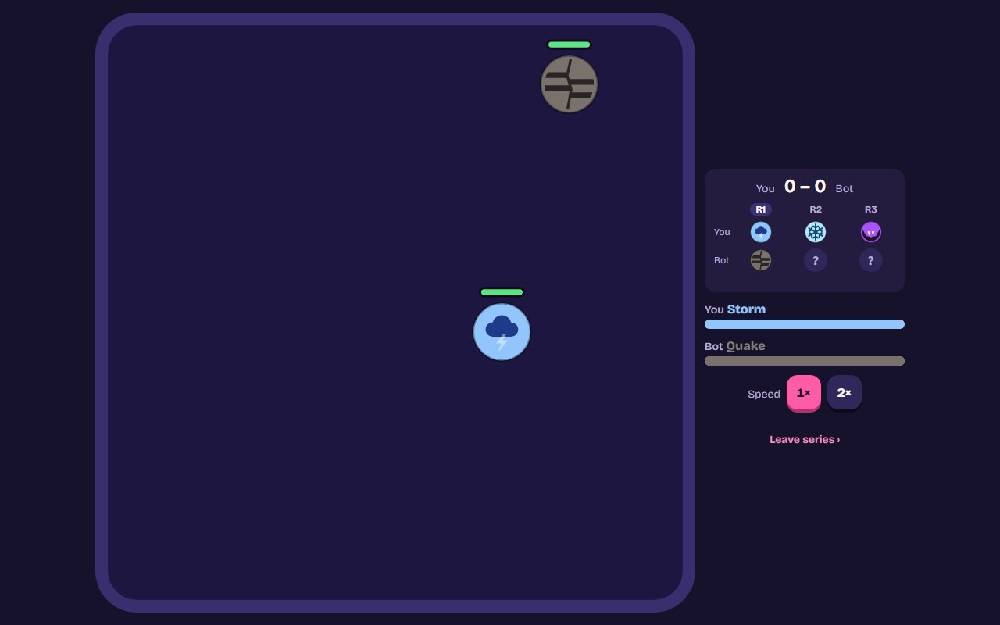
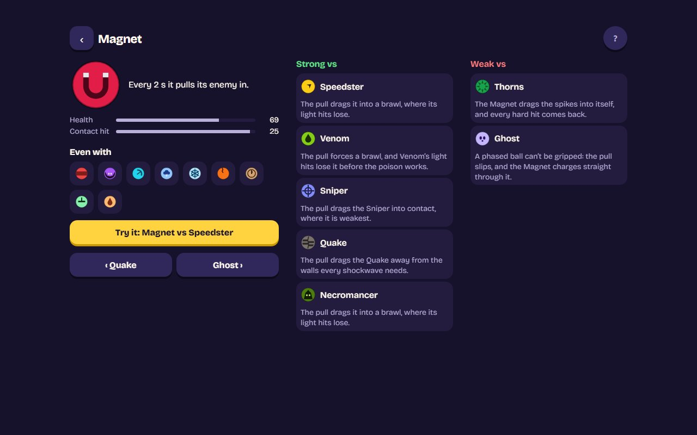

# BallBattle

[](https://github.com/Lyfe4/ball-battle/actions/workflows/ci.yml)

**Pick your balls. Watch your plan fight it out.**

A browser auto-battler about building a lineup: balls with different abilities bounce around an
arena until one wins, and every decision is made before the fight starts.

### ▶ [Play it at battle-ball.netlify.app](https://battle-ball.netlify.app/)



## Features

- **21 balls, each with one mechanic you can watch:** lightning, poison, lifesteal, a sniper's
  laser, a magnet's pull, a ghost that fades, a necromancer's skull minions, a boomerang, bombs,
  a shield and spear, and more.
- **Best of 3 against a bot** at three levels (Easy, Normal, Hard) in three draft formats: Reveal
  (take turns showing first, after a coin toss; the main mode, one tap from home), Showdown and
  Blind. **Best of 5** (five balls, first to three) is the longer, more skilful option on Other
  modes ([ADR 0048](docs/decisions/0048-best-of-5.md)).
- **Soft counters:** most pairs lean one way, so a pick matters, but no fight is decided before it
  starts.
- **Teaching in the arena:** a ready moment before a fight (both balls where they start, what to
  watch for a pairing you haven't met, then Fight!), a short label the first time you see each
  ball's ability, a chip in the attacker's colour for damage you can't see, and "How it was won"
  after every match, led by its result ([ADR 0036](docs/decisions/0036-teaching-in-the-arena.md),
  [ADR 0037](docs/decisions/0037-clarity-fixes.md)).
- **A ball manual and matchup chart**, read from the same data the game runs on, so they never go
  stale.
- **Every fight is a link.** A match or a whole series replays exactly from its URL.
- **Phone first**, with a deliberate desktop layout, reduced-motion support and smooth motion at
  60, 90 and 120 Hz.

## Tech stack

TypeScript (strict), Vite, plain HTML Canvas 2D and plain DOM. No game engine, no physics library,
no UI framework. Tested with Vitest, in Node and through Playwright in Chromium, Firefox and
WebKit. ESLint, Prettier, Husky and GitHub Actions. Deployed as a static site on Netlify with a
strict Content Security Policy.

## Engineering highlights

- **A deterministic simulation, checked across three browser engines.** The game logic is a pure
  function of the seed and the balls: fixed 60 Hz ticks, a seeded PRNG, and no `Math.sin`,
  `Math.pow` or other functions whose results can differ between engines (an ESLint rule bans
  them). 306 recorded matches must come out bit-identical in Node, Chromium, Firefox and WebKit on
  every push. That is what lets a link replay a fight exactly, and a future server verify a result.
- **Counters built from mechanics, held by an automated balance suite.** Stats can't make a ball
  beat one opponent without beating everyone (ADR 0010). So each favoured matchup needs a written
  mechanical reason, like "arrows never touch the spikes". `pnpm balance`
  plays every matchup headlessly across all CPU cores and checks it against its band. A reduced run
  gates every pull request in CI.
- **Ruleset versioning, so shared links never silently change.** Every link records the ruleset it
  was played under. A test fingerprints the game's behaviour, so any change that could alter a fight
  fails until the version is bumped. An older link says so instead of replaying a different fight.
- **Measure ideas before building them.** Letting players aim the launch was prototyped and
  measured across every matchup, three times. It either barely mattered or broke the counters, so
  it was dropped and the skill stays in the draft. The write-ups are kept:
  [aiming](docs/aiming-measurements.md), [bigger balls](docs/bigger-balls-experiment.md),
  [aiming v2](docs/aiming-v2-experiment.md).
- **Decisions are written down.** 34 short architecture decision records in
  [docs/decisions](docs/decisions/) explain why the code is the way it is, including what was tried
  and dropped.

## Screens



| A round on a desktop                                                 | A manual entry on a desktop                                                  |
| -------------------------------------------------------------------- | ---------------------------------------------------------------------------- |
|  |  |

## How it plays

The home screen plays a demo match behind the pitch. Its main button, **Play**, is the game: a Best
of 3 against the bot in Reveal, straight to choosing your lineup. **Other modes** holds every other
way to play: a Best of 3 or Best of 5 (remembered) in Reveal, Showdown or Blind, and **Free play**, where you choose both balls of one match to try
things out. While a series is held (left with Back, or after a reload), Play becomes **Resume
series**, with its format and score, and a quiet **New series** starts afresh ([ADR 0046](docs/decisions/0046-reveal-first-home-and-other-modes.md)). The **Ball
manual** sits beside it. Every screen is designed for a phone first and has a
URL, so Back works and any screen can be linked
([ADR 0020](docs/decisions/0020-screens.md)). Screens show little by default: symbols explained
once in a legend, details one tap away, and Back that undoes exactly one move
([ADR 0025](docs/decisions/0025-show-less-and-back.md)). A gear beside every `?` opens
**Settings**: speed, and whether ability hints and what-to-watch cards show
([ADR 0040](docs/decisions/0040-settings.md)). It keeps off the court, and where a phone is too
short for that the match waits while it is open
([ADR 0044](docs/decisions/0044-one-story-look-and-settings-off-the-court.md)). On a phone the court takes the whole width
whenever it shows ([ADR 0039](docs/decisions/0039-the-phone-arena-is-the-screen.md)).

The **Ball manual** lists every ball with what it does and who it is strong and weak vs, each with
the reason, and a **matchup chart** of the whole counter map. Both are read from the ball
definitions and the counter map, so they never go stale.

In a match, two balls collide elastically and deal damage scaled by how directly
they hit; the match ends by knockout or at a 60-second time limit.

| Ball        | Ability                                                                                          |
| ----------- | ------------------------------------------------------------------------------------------------ |
| Brawler     | None. The hardest plain bump. An even pick: beats only the Ghost, loses only to Thorns.          |
| Speedster   | Fastest ball. Each wall bounce adds speed and bonus damage; a hit cashes it in.                  |
| Vampire     | Heals most of what its bumps deal, on little health; nothing from a ball it never touches.       |
| Archer      | Lowest contact damage, but shoots an arrow where its enemy is heading every 2 s.                 |
| Storm       | Calls a big lightning strike on its enemy every 1.75 s, landing 0.9 s later.                     |
| Frost       | Slowest and sturdy. Every hit slows its enemy right down for a while.                            |
| Thorns      | Spiked: every bump it takes hurts the attacker back, the harder the bump the more.               |
| Venom       | Light bumps that poison its enemy: a few small poison hits follow each bump.                     |
| Berserker   | The most health. Every hit it takes builds rage (up to 3); its next bump lets it all out.        |
| Sniper      | Locks onto its enemy with a laser, then fires one heavy shot down the line.                      |
| Quake       | Every wall it hits sends out a small, wide shockwave, as often as five times a second.           |
| Magnet      | Every 2 s it pulls its enemy in, forcing a brawl. Hits harder than all but one.                  |
| Ghost       | Fades for a moment after a hit, and nothing hurts it while it is faded.                          |
| Necromancer | Keeps a skeleton out that bites its enemy and draws aimed attacks; a new one rises soon after.   |
| Chrono      | Rewinds a big hit (a shot, a strike, a blast or a knockout), then recharges for 10 s.            |
| Titan       | Grows bigger as the match goes on, and its bumps grow with it. The one ball that changes size.   |
| Inferno     | Leaves a trail of fire that burns whoever crosses it, one burn at a time, and burns up skulls.   |
| Boomerang   | Throws a boomerang that hits on the way out and on the way back, then catches it.                |
| Bomber      | Drops one big bomb every few seconds; it blows when an enemy runs into it, or its fuse runs out. |
| Spartan     | Plants its shield (half speed, every hit does half) for 2 s, then throws its spear.              |
| Bloom       | Always regrowing, about four times a second, but every hit it takes stops it for a second.       |

Every ball but the Titan is the same size and keeps its own speed through collisions; a hit's damage depends
on how directly it lands, not how fast.

### Counters

Picks matter: many pairs lean one way. A counter (▲ ▼) is _favoured_, never decided: it wins at
least 62% of the time and aims for 65-72%, and each one comes from something you can watch happen
([ADR 0045](docs/decisions/0045-roster-redesign.md),
[ADR 0047](docs/decisions/0047-spartan-and-bloom-pause.md)). No rule exists only where two abilities
meet: every ability works the same on any ball.

- **Bumps against spikes:** Thorns beats the Brawler, Magnet and Titan; the harder a ball bumps,
  the harder it is hurt back. The Archer and Sniper beat Thorns: they never touch it.
- **Lifesteal:** the Vampire beats the Berserker, whose big bumps it drinks back, and loses to
  what never touches it (Archer, Storm, Boomerang) and to the Spartan's shield, which halves its
  bumps and so what it drinks.
- **Rage:** every hit the Berserker takes builds rage, so many small hits feed it: it beats the
  Archer, Venom, Quake, Inferno and Boomerang. Regrowth (Bloom) and lifesteal heal its big bumps back.
- **Big hits against the rewind:** the Chrono rewinds a strike, a shot or a blast, so it beats the
  Storm, Sniper, Bomber and the Spartan's spear; Venom, Quake, Inferno and Bloom deal no hit big
  enough to rewind.
- **Shield and spear:** the Spartan's planted shield halves every hit, whoever deals it, so it
  only beats the Vampire; it is too slow behind its shield to leave the Storm's circle, and the
  Chrono rewinds its spear.
- **Regrowth:** the Bloom heals back damage that comes slowly (Frost, Berserker, Necromancer,
  Ghost, Chrono), but every hit stops its regrowth for a second, so a stream of small hits
  (Venom's poison, the Archer's arrows, the Boomerang's two hits a throw) keeps it from regrowing;
  the grown Titan's huge bumps outpace it.
- **The fade:** the Ghost fades after a hit, so a poison tick or a burn just after misses: it beats
  Venom and Inferno. The Brawler's and Frost's heavy bumps land whole.
- **The skull:** the Necromancer's skeleton draws arrows and throws (Archer, Boomerang); wide
  shockwaves, fire and regrowth deal with it (Quake, Inferno, Bloom).
- **Speed and the slow:** the Speedster outruns arrows, shots and throws (Archer, Sniper,
  Boomerang); the Frost slows it right down and the Bomber's blasts catch it.
- **One big hit:** the Storm's strike takes most of the Vampire's small health and catches the
  slowed Spartan; the Bomber's blast catches the Speedster; the growing Titan crushes the Bloom
  late.

Every other pair is even. Even pairs with a side between 58% and 62% sit in a grey zone, shown as
even and counted by `pnpm balance`.

Every ball has two to four counters each way, the two counts within one, except known gaps for
future balls to fill (listed in [docs/balance-summary.md](docs/balance-summary.md)): the Storm,
Titan, Bomber, Spartan, Sniper and Quake have one counter on a side, the Vampire one win to four
losses, and the Berserker and Bloom beat up to five balls. The **Brawler** and **Magnet** are the even picks: the Brawler beats only the Ghost and
loses only to Thorns, the Magnet loses only to Thorns.

The roster redesign ([docs/roster-redesign.md](docs/roster-redesign.md)) shipped in four groups:
the first removed the three rules between balls (shock, stagger and numbed rage) and the spark
that marked them; the second gave the Chrono, Guardian, Ghost, Bloom and Venom abilities that act
on a kind of hit (big or small; the Guardian has since been replaced by the Spartan, ADR 0047);
the third made the Inferno's fire never stack and tuned the Necromancer, Bomber, Frost and Thorns;
the fourth reworked the Berserker, Titan, Quake, Bomber and Vampire so their hits are a kind of
their own. Every heal shows as a green pulse sized by the heal.
The map is checked by `pnpm balance` ([ADR 0010](docs/decisions/0010-counter-map.md),
[ADR 0026](docs/decisions/0026-magnet-ghost-necromancer.md),
[ADR 0043](docs/decisions/0043-boomerang-bomber-guardian-bloom.md),
[ADR 0045](docs/decisions/0045-roster-redesign.md),
[ADR 0047](docs/decisions/0047-spartan-and-bloom-pause.md)).

## Best of 3

Tap **Play** on the home screen to play a series against a bot (Showdown and Blind are under
**Other modes**): pick three different balls in order
(round 1 is your first ball against the bot's first, and so on), and the first to win two rounds
takes the series. A track shows every round at a glance, the winner ringed and the loser dimmed,
and a series left with Back (easy to do by accident on a phone) can be resumed where it was. A
reload, a closed tab or Safari reloading it in the background puts the series back exactly where
it was; a fight under way starts again from its Fight! moment as the same match. The series is kept
on the device, not in the URL, and checked with the same rule as a link before it is put back
([ADR 0042](docs/decisions/0042-reload-safe-series.md)). The
bot's lineup stays hidden; each round reveals both balls as it starts. A
drawn round is replayed on a new seed, up to three times, then settled by sudden death. When the
series ends, the link holds both lineups, the series seed and the ruleset, e.g.
`?mode=bo3&la=frost,quake,venom&lb=sniper,archer,storm&seed=5&v=2`, and replays it exactly
([ADR 0017](docs/decisions/0017-best-of-3-series.md)). Before replaying, the page checks the link
with the same rule a server would use: the bot's lineup and picks must be the ones it would
choose, so an edited link opens the lineup instead
([ADR 0022](docs/decisions/0022-ruleset-version-and-verified-series.md)).

There are three sets of rules ([ADR 0019](docs/decisions/0019-draft-formats.md),
[ADR 0021](docs/decisions/0021-reveal-take-turns.md)):

- **Reveal**, the main mode (**Play**): both lineups are revealed, then the sides take turns
  showing first. A seeded coin toss decides who shows first in round 1 and the other side answers;
  in round 2 the other side shows first; round 3 is what is left. It has the most skill of the
  three: good play beats bad play by about 12 points of series chance at every bot level
  ([ADR 0029](docs/decisions/0029-reveal-coin-toss.md), [measurements](docs/reveal-measurements.md),
  [ADR 0046](docs/decisions/0046-reveal-first-home-and-other-modes.md)).
- **Showdown** (Other modes): both lineups are revealed, both sides open round 1 at the same time,
  then the winner shows first and the loser answers.
- **Blind** (Other modes): set your order, then watch. Both orders are set without seeing the
  other lineup, as above; there are no choices after that.

An older `?mode=bo3` link still opens the rules step, where the format and level are chosen.

In Reveal and Showdown, choose how the bot plays (**vs Normal bot ▾** above your lineup; the choice
is remembered): **Easy** picks at random, **Normal** usually
counters, and **Hard** plays the whole series and mixes its choices so it can't be read. The pick
screens never show the bot's move, only how each of your balls stands against each of its balls
([ADR 0035](docs/decisions/0035-bot-levels-and-showdown.md),
[measurements](docs/series-measurements.md)). The link records the rules, the level and every pick
(`fmt=showdown&bot=hard&picks=...`), so these series replay exactly too.

## Running it

Needs Node 24+ and pnpm 11 (`corepack enable` picks up the pinned version).

```bash
pnpm install
pnpm dev
```

Every match is in the URL, e.g. `?a=speedster&b=vampire&seed=42&v=2`: share or reload it to
replay the exact same fight. Unknown ball ids fall back to the defaults, and a missing seed gets a
fresh random one. `v` is the ruleset the fight was played under: balance changes bump it, and a
link from another version says so and offers to play under today's rules rather than silently
replaying a different fight
([ADR 0022](docs/decisions/0022-ruleset-version-and-verified-series.md)).

Two pages exist only under `pnpm dev`: `/styleguide.html` shows every ball design and the shared
UI parts, and `/brand.html` draws the icons and the link-preview image with the game's own
renderer.

The **Speed 1× / 2×** toggle under a match plays everything twice as fast (the fight,
hit-stops and effects alike) without changing the result; your choice is remembered in this
browser. Motion is drawn between simulation ticks, so it stays smooth on 90, 120 and 144 Hz
displays.

| Script                 | What it does                                                                                                |
| ---------------------- | ----------------------------------------------------------------------------------------------------------- |
| `pnpm dev`             | Vite dev server                                                                                             |
| `pnpm build`           | Typecheck and build to `dist/`                                                                              |
| `pnpm preview`         | Serve `dist/` with the production security headers, to check the CSP                                        |
| `pnpm test`            | Run the fast tests once (`pnpm test:watch` to watch)                                                        |
| `pnpm test:slow`       | Roster-wide tests that play every matchup (a separate CI job)                                               |
| `pnpm test:browsers`   | Known match results and page flows in Chromium, Firefox, WebKit (own CI job)                                |
| `pnpm golden`          | Record the known match results again after a ruleset bump                                                   |
| `pnpm lint`            | ESLint                                                                                                      |
| `pnpm typecheck`       | `tsc -b` across all tsconfig projects                                                                       |
| `pnpm format`          | Prettier (`pnpm format:check` to only check)                                                                |
| `pnpm balance`         | Matchup matrix, ability impact and sensitivity, on all cores (`--ball <id>`)                                |
| `pnpm balance:summary` | A full balance run that also writes each ball's shape to [docs/balance-summary.md](docs/balance-summary.md) |
| `pnpm balance:ci`      | The reduced balance check CI runs: 150 seeds, fails only on a clear miss                                    |

## Architecture

```
src/
  sim/      pure, deterministic simulation (no DOM, no time, no Math.random)
  render/   draws sim state on a canvas; never changes it
  sim/balls/        one file per ball definition
  sim/abilities/    runs ability hooks and applies the actions they return
  sim/series.ts     best-of-3 rules, pure so a server can re-run a series
  sim/series-verify.ts   whether a series setup is valid: the browser and a server use it
  sim/ruleset.ts    the ruleset version every link records (bumped with any balance change)
  golden/   known match results, checked in Node and in Chromium, Firefox and WebKit
  ui/       plain-DOM screens: home, ball grid and detail, setup steps, manual, scoreboard, HUD
  styles/   design tokens (a palette, then roles) and base styles; components' CSS sits beside them
  app/      browser-side helpers: clocks, playback speed, seed, routes, matchup and series links,
            the series saved across a reload
  arena.ts  the match on screen and the requestAnimationFrame loop
  *-controller.ts, *-screens.ts, series-setup.ts, manual-screen.ts   each screen's wiring
  main.ts   wires the screens together
```

The rules, in brief:

1. **The simulation is pure and deterministic.** `src/sim` cannot touch the DOM, the clock,
   timers or `Math.random`. A separate `tsconfig.sim.json` without the DOM lib and ESLint rules
   enforce this; transcendental `Math` functions are banned too, because they can differ between
   browsers. 306 recorded matches are checked on every push to come out bit-identical in Node,
   Chromium, Firefox and WebKit
   ([ADR 0023](docs/decisions/0023-known-match-results-across-engines.md)).
2. **Fixed timestep.** The sim runs at exactly 60 ticks per second regardless of frame rate. The
   same balls and seed always produce the same match.
3. **Seeded randomness** comes only from a mulberry32 PRNG whose state is part of the world.
4. **Rendering only reads.** The renderer draws the current state and never writes to it.
5. **Balls are data.** Each ball is a definition file (plain data plus optional hooks) in
   `src/sim/balls/`.
6. **The sim reports, it doesn't listen.** Each tick returns events (collision, damage, heal,
   ability triggered, projectiles, zones, defeat, match end) for effects, sound and replays;
   nothing feeds back in.
7. **Abilities return actions.** Hooks get a read-only view and return plain-data actions
   (damage, heal, change velocity, update own state, fire a projectile, mark a zone); the sim
   applies them in a fixed order.

Why: [ADR 0001: Deterministic, fixed-timestep simulation](docs/decisions/0001-deterministic-simulation.md)
, [ADR 0002: Combat core](docs/decisions/0002-combat-core.md)
, [ADR 0003: Ability system](docs/decisions/0003-ability-system.md)
, [ADR 0004: Wall-bounce variance](docs/decisions/0004-wall-bounce-variance.md)
, [ADR 0005: Projectiles](docs/decisions/0005-projectiles.md)
, [ADR 0006: Hazard zones](docs/decisions/0006-hazard-zones.md)
, [ADR 0007: Presentation clock and battle feel](docs/decisions/0007-presentation-clock.md)
, [ADR 0008: Uniform size, directness, cruise speed](docs/decisions/0008-size-directness-cruise-speed.md)
, [ADR 0009: Status effects](docs/decisions/0009-status-effects.md)
, [ADR 0010: Counter map](docs/decisions/0010-counter-map.md)
, [ADR 0011: Roster scaling](docs/decisions/0011-roster-scaling.md)
, [ADR 0012: Slowed, poisoned, onDamageTaken](docs/decisions/0012-slowed-poisoned-damage-taken.md)
, [ADR 0013: Thorns, the Brawler's counter](docs/decisions/0013-thorns-brawler-counter.md)
, [ADR 0014: Venom, Thorns' counter](docs/decisions/0014-venom-thorns-counter.md)
, [ADR 0015: Berserker, Sniper, Quake](docs/decisions/0015-berserker-sniper-quake.md)
, [ADR 0016: Counter density](docs/decisions/0016-counter-density.md)
, [ADR 0017: Best-of-3 series](docs/decisions/0017-best-of-3-series.md)
, [ADR 0018: Aimed start (removed)](docs/decisions/0018-aimed-start.md)
, [ADR 0019: Draft formats](docs/decisions/0019-draft-formats.md)
, [ADR 0020: Screens](docs/decisions/0020-screens.md)
, [ADR 0021: Reveal takes turns](docs/decisions/0021-reveal-take-turns.md)
, [ADR 0022: Ruleset version and verified series](docs/decisions/0022-ruleset-version-and-verified-series.md)
, [ADR 0023: Known match results across engines](docs/decisions/0023-known-match-results-across-engines.md)
, [ADR 0024: Player-facing text stays in definitions](docs/decisions/0024-player-facing-text-stays-in-definitions.md)
, [ADR 0025: Show less, and Back](docs/decisions/0025-show-less-and-back.md)
, [ADR 0026: Magnet, Ghost, Necromancer](docs/decisions/0026-magnet-ghost-necromancer.md)
, [ADR 0027: Phone play fixes](docs/decisions/0027-phone-play-fixes.md)
, [ADR 0028: The counter pass](docs/decisions/0028-counter-pass.md)
, [ADR 0029: Reveal's coin toss](docs/decisions/0029-reveal-coin-toss.md)
, [ADR 0030: Symbol tooltips and result fixes](docs/decisions/0030-symbol-tooltips-and-result-fixes.md)
, [ADR 0031: Desktop layouts](docs/decisions/0031-desktop-layouts.md)
, [ADR 0032: The Sticker Pop restyle](docs/decisions/0032-sticker-pop-restyle.md)
, [ADR 0033: Arena polish](docs/decisions/0033-arena-polish.md)
, [ADR 0039: The phone arena is the screen](docs/decisions/0039-the-phone-arena-is-the-screen.md)
, [ADR 0040: Settings](docs/decisions/0040-settings.md)
, [ADR 0041: The spark marks the counter](docs/decisions/0041-the-spark-marks-the-counter.md) (removed by ADR 0045)
, [ADR 0042: A Best of 3 survives a reload](docs/decisions/0042-reload-safe-series.md)
, [ADR 0044: One story look, settings off the court](docs/decisions/0044-one-story-look-and-settings-off-the-court.md)
, [ADR 0045: The roster redesign](docs/decisions/0045-roster-redesign.md)
and [ADR 0046: Reveal first, every other mode behind Other modes](docs/decisions/0046-reveal-first-home-and-other-modes.md).
Full rules for contributors: [CLAUDE.md](CLAUDE.md).

Production bundle: 205.75 kB JS (65.69 kB gzipped), 47.20 kB CSS (8.67 kB gzipped), and the
self-hosted font's Latin subset at 41.34 kB. First version baseline: 5.05 kB JS (2.41 kB gzipped).

## License

[MIT](LICENSE)
