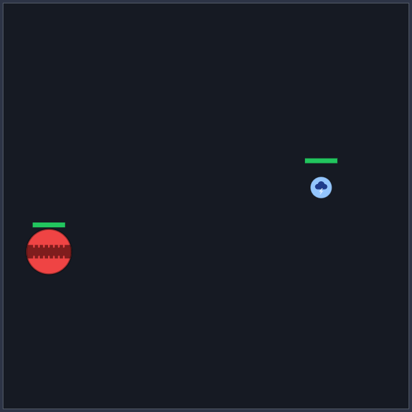
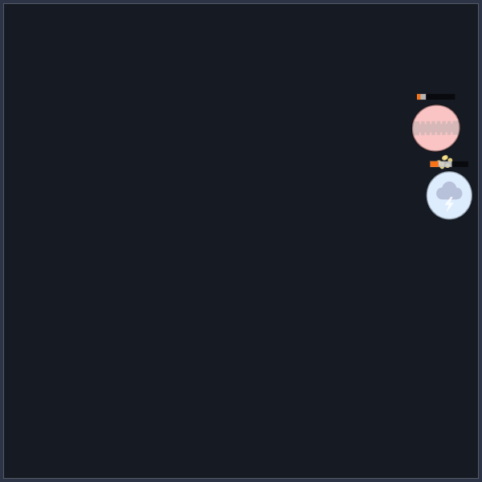
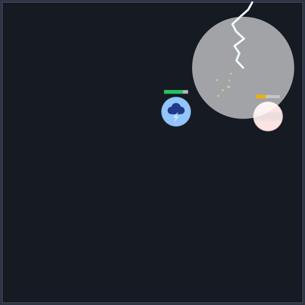
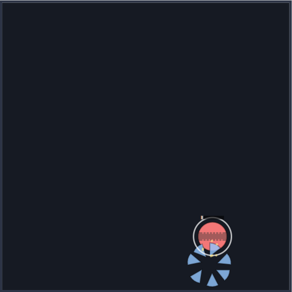
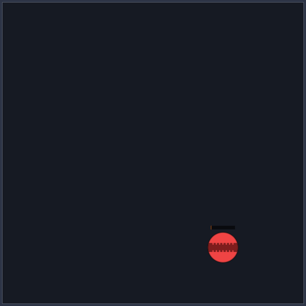

# Autorun report (2026-11-04)

Unattended run over four stages. Each stage has what was done, decisions made on your behalf
(with the alternatives), questions for you, and anything I'm unsure about.

## Starting state

1. **Balls (5, all radius 50):** Brawler (no ability, hardest hitter, 26 dmg / 64 hp / 740),
   Speedster (stacks speed and bonus damage off walls, 14 / 70 / 800), Vampire (40% lifesteal,
   22 / 60 / 760), Archer (leading arrow every 2 s, 6 / 50 / 780), Storm (telegraphed lightning
   zone every ~2.2 s, 13 / 74 / 720).
2. **Tick order (ADR 0008):** onTick → move + seeded wall turn → onWallHit → collide → contact
   damage (new contacts, scaled by directness, lethal tiebreak) → onHitBall → projectiles → zones
   → onDamageDealt → defeats → cruise speed → contacts and match end.
3. **Balance targets:** every ball 40-60% overall, no matchup worse than 20/80, draws < 5%,
   median match 12-30 s, ±5% health moves win rates ≤ 15 pts (warn) / 20 (fail), Vampire heals
   ≥ 25% of max health per match.
4. **Latest balance (500 seeds, re-run at 8fd9ac3):** all targets pass. Per ball 47.8-53.3%;
   worst matchup Speedster vs Archer 67.2/32.8; draws 0.3%; median 14.6 s; worst sensitivity
   7.3 pts; Vampire heals 32.6% of max.
5. **Counters:** Speedster > Archer (67/33), Vampire > Speedster (60/40), Speedster ≥ Storm
   (58/42), Archer ≥ Brawler and Vampire (57/43). No ADR 0007 exists yet; battle feel had no
   plan in the repo, so Stage 2 uses the spec from the run prompt.

## Stage 1: vision note

Plan: add `docs/vision.md` with the PvP mode, the soft-counter goal, the future targets and the
planned order; one-line pointer in `CLAUDE.md`. No code.

Done: `docs/vision.md` written as specified; `CLAUDE.md` points to it just under the intro.

Decisions on your behalf:

- Put the pointer under the project intro rather than in the ADR list, since it's not a
  decision record. Alternative: a "Docs" list at the end.
- Wrote the future targets as "not enforced today" so nobody tightens `pnpm balance` early.

Questions: none.

## Stage 2: battle feel

Plan: no battle-feel plan existed in the repo (and no ADR 0007), so I used the spec from the run
prompt. A pure presentation clock and frame driver in `src/app/`, effects on effect time in
`src/render/`, ADR 0007, no change to `src/sim`.

Done:

- `src/app/presentation-clock.ts`: intro (sim waits, effects play) → hit-stop (both frozen) →
  slow-mo (both scaled) → normal, spent in that order within each frame.
- `src/app/playback.ts`: `advanceFrame` runs whole ticks through `step`; a tick that asks for a
  hit-stop ends the frame and banks the skipped ticks' time. `main.ts` is wiring only.
- `src/render/impact.ts` (heavy hits, hit-stop, shake, wall bounces from consecutive worlds),
  `motion.ts` (squash, shake, health ghost, intro, winner ring curves), `particles.ts` (seeded
  particles and knockout shards), `draw-feel.ts` (drawing them); `effects.ts` holds the state.
- Hit-stop on heavy hits (26+ damage to one ball in a tick, 45-80 ms; 110 ms on a knockout);
  shake on knockouts only (≤ 7 world units); squash on contact hits and wall bounces; health ghost
  on canvas bars and HUD; 2-6 particles per hit (cap 40); knockout sequence (slow-mo 0.35 for
  500 ms real, shards, winner ring, result text after 950 ms); 1.1 s intro; no damage numbers.
- `prefers-reduced-motion`: no shake, squash, particles, slow-mo or shards; intro fades; steady
  winner ring; hit-stops kept. Read live.
- Strike bolt `shadowBlur` glow removed. All timings, sizes and colours in `theme.ts`.
- ADR 0007 written; CLAUDE.md gains rule 9 and the ADR; README updated (ADR link, bundle size
  35.36 → 44.96 kB JS, 13.04 → 16.24 kB gzipped).

Sim unchanged guard (baseline 0f50399, the head before this stage):

- `git diff -- src/sim` is empty.
- `pnpm balance` (500 seeds) output is identical to the baseline apart from the last line, the
  elapsed time `(77 s)` vs `(76 s)`, which can never match byte for byte. Stage 3 moves that
  line to stderr so stdout can be diffed exactly.

Tests: replay through `advanceFrame` with irregular frames (1-70 ms, 400 ms stalls), a hit-stop
on every damage tick and slow-mo every 200 ticks matches a headless run world-for-world and
event-for-event in three matchups (shown to fail when a hit-stop tick is dropped); effect lists
stay bounded over whole Storm, Archer and Brawler/Speedster matches and under 50 simultaneous
hits; unit tests for the clock, impacts, curves, particles and effects.

Decisions on your behalf:

- **Shake limited to knockouts** (pre-approved call). With shake on 28+ damage hits as well it
  fired on 32-44% of hit ticks in Storm matchups (every lightning hit). Alternative: keep it for
  lightning only, with a smaller amplitude.
- **Hit-stop threshold raised from 24 to 26.** At 24 it fired on 51% of non-knockout hit ticks
  in a Brawler mirror (64% counting knockouts). At 26: Brawler mirror 22%, Brawler vs Storm 31%,
  Storm mirror 32% (every lightning hit), Archer and Vampire mirrors 0%. Alternative: 28, which
  makes hit-stop lightning-only plus knockouts.
- Damage is summed per ball per tick, so a Speedster's hit plus its stack bonus is one impact.
- Slow-mo scales sim time as well as effect time. In practice it only runs after the match has
  ended (knockout), so this changes nothing visible today, but it keeps the clock simple and the
  replay test proves it is safe.
- Reduced motion keeps hit-stops (a pause is not motion) and the health ghost drain.
  Alternative: drop hit-stops too.
- A knocked-out ball is no longer drawn after breaking apart (it used to stay at 25% opacity).
  With reduced motion it still fades to 25% as before.
- The HUD's ghost uses a CSS transition (real time, not effect time); it doesn't freeze during
  a hit-stop. The canvas bars do.
- Particles for contact and arrow hits only; lightning already has its flash and bolt.

Screenshots (Brawler vs Storm, seed 8, rendered frame by frame through the real `advanceFrame`,
effects and `drawWorld` at 60 Hz; the result text itself is in the HUD, not the canvas):

| Moment                                                        | Frame                                             |
| ------------------------------------------------------------- | ------------------------------------------------- |
| Intro, 300 ms in: the Storm is still popping in               |          |
| Heavy hit, 5 frames after: flash, particles, ghost on the bar |  |
| Lightning strike hitting the Brawler (no glow)                |        |
| Knockout, 0.5 s in: Storm breaking apart, winner ring         |    |
| Result frame: "Brawler wins" appears in the HUD               |        |

Unsure / not verified:

- I could not watch it live: the browser pane was hidden, so `requestAnimationFrame` never ran
  there. The screenshots come from the same code driven with synthetic 60 Hz frames, and the
  replay test covers the loop, but the feel in motion (timings, how busy it is on a phone) needs
  your eyes. Every number is a theme token.
- The 85% white damage flash (unchanged) now sits on top of squash and particles; it may be
  worth toning down to let them show.

Questions:

1. Is shake on knockouts only right, or do you want it on lightning hits as well?
2. Keep hit-stops under reduced motion?

## Stage 3: groundwork for a bigger roster

Plan: parallel `pnpm balance` with a serial mode to prove identical output, a `--ball` mode, a
separate slow test suite and CI job, a picker that scales to about 25 balls, and top-aligned
layout on phones.

Done:

- **Parallel balance.** The script builds a job list (per pair: the base run and its four ±5%
  health runs; then each mirror), slices each job by seed, and plays the slices on worker
  threads (`scripts/balance-jobs.ts`, `balance-worker.ts`). Slices merge exactly (counts,
  whole-number sums, and lengths that are only used through the median). `--serial` runs on
  the main thread. The elapsed time moved to stderr.
  - Proof, 500 seeds: `node scripts/balance.ts --serial` and `node scripts/balance.ts` stdout are
    byte-identical (`cmp`), and both are byte-identical to the head-commit baseline (with its
    old trailing timing line removed).
  - Speed on this machine (Ryzen 7 5700X, 8 cores / 16 threads): 77 s serial → 24 s parallel.
    Seed slicing and tallying damage per tick instead of keeping every event didn't move it
    further; matches allocate a fresh immutable world every tick, so memory bandwidth, not cores,
    is the limit.
- **`pnpm balance --ball <id>`** plays only that ball's matchups and mirror and checks the
  targets for that ball only (worst matchup from its side, its own overall win rate; the Vampire
  healing line only when the Vampire is in focus). `--ball storm` at 200 seeds takes 5 s.
  Arguments are parsed by `node:util` `parseArgs` (strict: unknown options and a missing value
  are errors), with tests.
- **Slow suite.** `src/sim/balls/roster.slow.test.ts` holds the determinism-across-all-matchups
  test, the measured pass-through property (the frozen 0.6 margin and its comment moved
  verbatim) and every identity rule. Vitest has two projects, `unit` (`pnpm test`) and `slow`
  (`pnpm test:slow`); CI runs the slow suite as a second job, so both must pass. Unit suite:
  5.5 s → 2.3 s. Slow suite: 4.9 s. The analytic pass-through bound stays in the fast suite (it
  plays no matches).
- **Picker.** Two slot buttons (the real ball drawing, "Ball A", the name) and Start match. A
  slot opens a modal `<dialog>` with a grid of every ball: real drawing (via `drawBall`, the
  game's small-size design), name and one-line description. Arrow keys, Home and End move
  through the grid (roving tabindex, so Tab leaves it in one step), Enter or Space picks and
  returns focus to the slot, Escape or a click on the backdrop closes. As before, nothing
  changes until Start match. Phones get a one-column list that scrolls inside the dialog;
  desktop 3-4 columns. Checked with 25 cards (cloned in the live page): the dialog stays inside
  the screen and the grid scrolls. Production build: no CSP errors.
- **Phone layout.** The stage is top-aligned in the stacked (tall-screen) layout; the
  side-by-side layout stays centred.

Decisions on your behalf:

- **Picker as slot buttons plus a dialog**, instead of two always-visible grids. Two grids of 25
  would push the arena off a phone screen and don't fit the 16 rem sidebar. Alternatives: one
  inline grid with an A/B toggle; a native `<select>` with the grid only on wide screens.
- Cards are `<button aria-pressed>` in a `role="group"`, not radios: radios change selection on
  every arrow press, which doesn't fit "pick and close". Alternative: `role="listbox"`.
- One column on phones (cards with two-line descriptions are unreadable at two columns of
  ~150 px). 25 balls is a scrollable list there.
- Did not run the `frontend-playbook` skill: the picker is a contained component in an existing
  app, and the run was unattended.
- No DOM tests for the picker: there is no DOM test environment in the repo (Vitest runs in
  `node`) and adding jsdom is a new dependency. The keyboard logic is a pure function with tests
  (`src/ui/grid-nav.ts`); the rest was checked by hand in the browser (open, arrows, Enter,
  focus return, URL unchanged until Start).
- Slow suite naming: `*.slow.test.ts`. Any roster-wide test that plays whole matches belongs
  there (noted in CLAUDE.md).

Unsure:

- The match keeps running behind the open dialog. That matches the old selects (changing a pick
  never touched a running match), but pausing while the dialog is open may feel better.
- The balance speed-up is 3.2×, not 8-16×. The sim's per-tick allocation is the bottleneck;
  making the sim faster is out of scope here.

Questions:

3. Should the match pause while the ball dialog is open?
