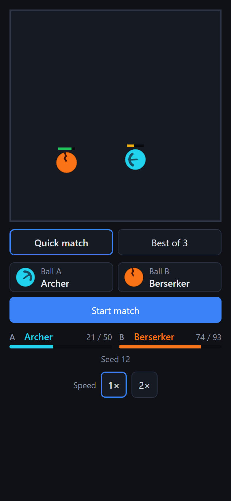
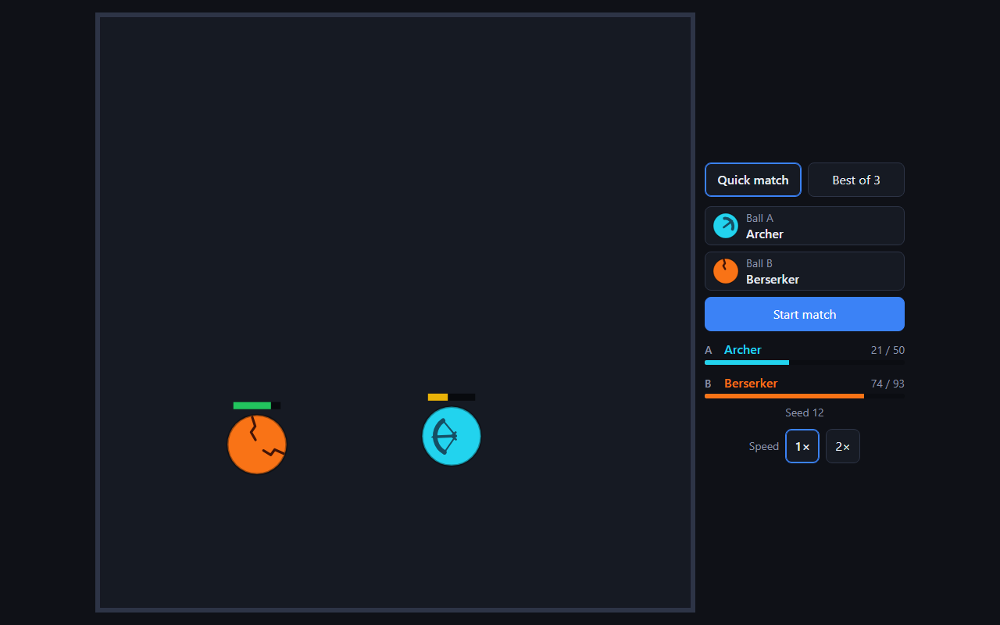
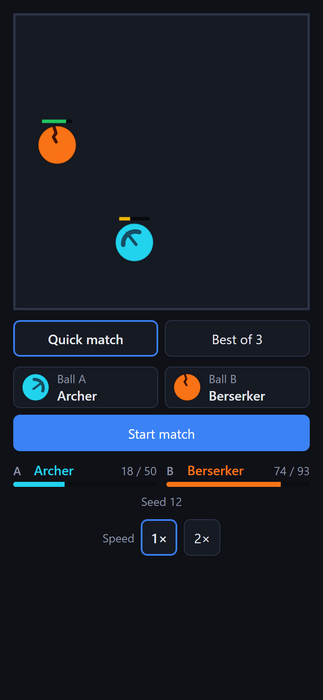
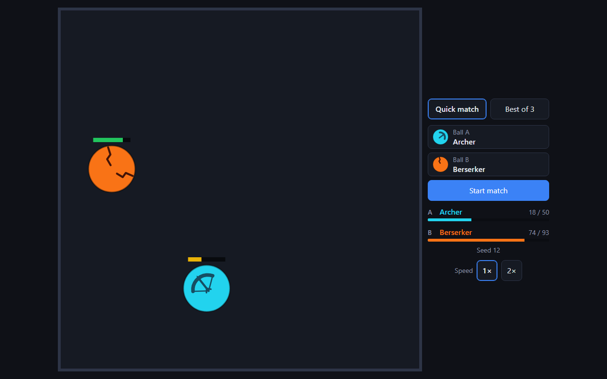
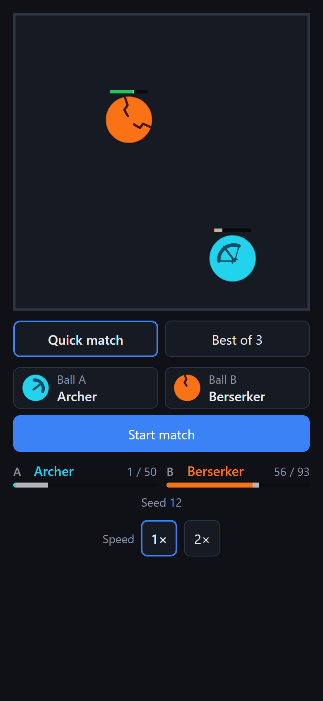
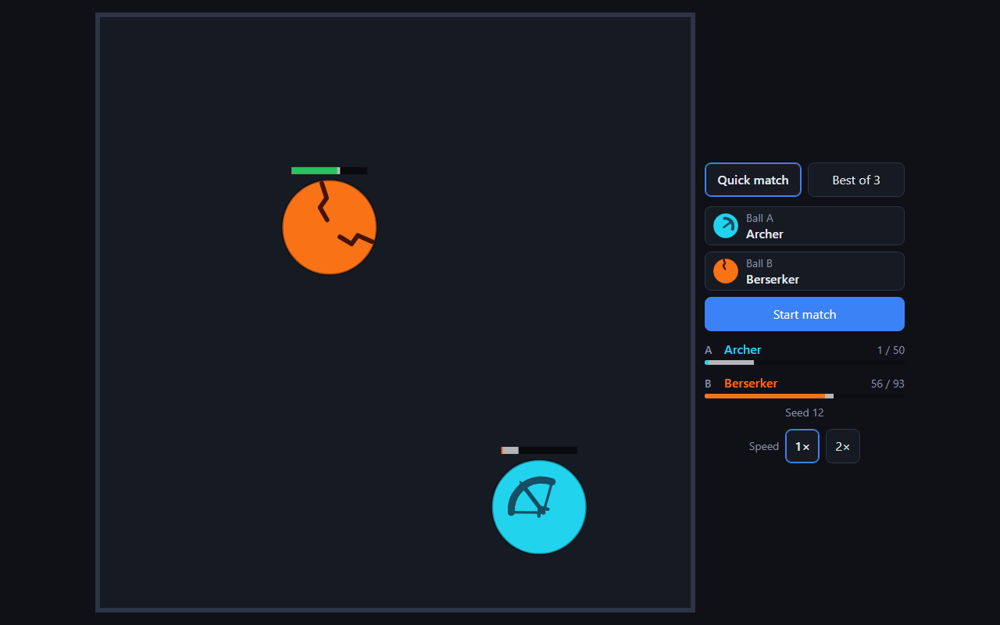

# Experiment: bigger balls

Measured 2026-11-05 on a throwaway branch, since deleted. **Decision: not adopted** (neither
size); the live game keeps radius 50. This document and the reusable scripts are what was kept.

## Question

Every ball uses `STANDARD_BALL_RADIUS` (50 world units in a 1000-unit arena, ADR 0008). Do bigger
balls make the game better to watch, and do they rescue aiming (`docs/aiming-measurements.md`,
which found that one side's launch direction barely matters)?

## What changed

Only `STANDARD_BALL_RADIUS`: 50 (today), 65 (+30%) and 80 (+60%). No stat, ability, zone,
projectile or arena value was retuned, so this is the raw effect. Everything that scales with
the radius in the sim (collision, contact, zone overlap, projectile hits, the aimed start's
spots) follows automatically.

## Method

For each radius, on the same machine and seeds:

- **Fight length and contact:** `scripts/fight-stats.ts`, every non-mirror pair on today's random
  start, seeds 0-499 in both slot orders (55,000 matches): match length percentiles, collisions
  per match and per second, the share of matches that reach the 60 s limit, and per ball the
  share of projectiles and zone strikes that hit.
- **Counter drift:** `pnpm balance 500` (random start, as today).
- **Aiming, at a reduced scale** (about 20 minutes per radius instead of several hours), with the
  aiming scripts unchanged except `AIM_DIRECTIONS=12`:
  - 12 directions (every 30°, folded to 7 angles: 0°, 30°, …, 180°) instead of 24;
  - fixed spots with random aim: seeds 0-299 (600 games per pair) instead of 500;
  - one side's directions against random aim: seeds 0-159 in two halves (320 games per direction
    before folding) instead of 300;
  - the direction matrix: 12 × 12 with 12 seeds per cell (48 games after merging mirror images)
    instead of 24 × 24 with 16;
  - held-out evaluation: seeds 10000-10399 (800 games per pair and profile) instead of 500.

  Radius 50 was re-run at the same reduced scale, so each size is compared like for like. Fewer
  angles means a coarser best angle and slightly smaller gains and spreads than the full run;
  fewer seeds means about ±1.8 points of noise per pair on the held-out profiles.

- **Safety:** `pnpm test` and `pnpm test:slow` at each radius (the slow suite holds the measured
  pass-through margin and the roster's identity rules).
- **Readability:** the dev build at each radius, captured with headless Chrome at phone (390 × 844,
  mobile emulation) and desktop (1280 × 800) sizes, about 4 s into the same match.

To reproduce one radius: set `STANDARD_BALL_RADIUS` locally, then run `pnpm balance 500`,
`node scripts/fight-stats.ts --out <dir>/fight.json` and the aiming steps from
`docs/aiming-measurements.md` with `AIM_DIRECTIONS=12` and the seed counts above. (A one-off script
that laid the three runs side by side was not kept; the tables below are its output.)

## 1. Fight length and contact

|                                 | r50       | r65      | r80      |
| ------------------------------- | --------- | -------- | -------- |
| Median match                    | 18.3 s    | 14.5 s   | 11.8 s   |
| 10th-90th percentile            | 10.1-32.1 | 8.0-24.3 | 6.3-19.4 |
| Collisions per match            | 4.3       | 4.5      | 4.6      |
| Collisions per second           | 0.22      | 0.29     | 0.37     |
| Matches reaching the 60 s limit | 0.2%      | 0.0%     | 0.0%     |

**Bigger balls don't make fights hit more; they make the same fight shorter.** Collisions per
match barely change (about four), but they come 35% (r65) and 70% (r80) faster, so the median
match falls by a fifth and by a third. At r80 it is 11.8 s, under the 12-30 s target. The spread
narrows with it. Today's readability complaint is that matches move too fast to follow (ADR 0007
addendum), and this makes it worse: each fight is over sooner at the same ball speed.

How often abilities land, per shot or strike:

| Ability            | r50   | r65   | r80   |
| ------------------ | ----- | ----- | ----- |
| Archer's arrows    | 72.8% | 77.0% | 80.1% |
| Sniper's shots     | 15.8% | 20.1% | 25.0% |
| Storm's lightning  | 14.2% | 16.9% | 19.6% |
| Quake's shockwaves | 13.4% | 13.6% | 13.9% |

## 2. Counter drift (today's random start)

Per ball overall (`pnpm balance 500`):

| Ball      | r50  | r65  | r80  | r65 − r50 | r80 − r50 |
| --------- | ---- | ---- | ---- | --------- | --------- |
| Brawler   | 46.7 | 51.5 | 56.7 | +4.8      | +10.0     |
| Speedster | 49.3 | 49.3 | 45.6 | +0.0      | −3.7      |
| Vampire   | 50.1 | 56.9 | 60.6 | +6.8      | +10.5     |
| Archer    | 50.7 | 35.7 | 23.9 | **−15.0** | **−26.8** |
| Storm     | 51.6 | 49.1 | 48.1 | −2.5      | −3.5      |
| Frost     | 50.7 | 56.8 | 60.8 | +6.1      | +10.1     |
| Thorns    | 46.8 | 52.1 | 57.8 | +5.3      | +11.0     |
| Venom     | 49.0 | 43.1 | 36.9 | −5.9      | −12.1     |
| Berserker | 51.1 | 55.9 | 62.1 | +4.8      | +11.0     |
| Sniper    | 47.9 | 48.5 | 50.4 | +0.6      | +2.5      |
| Quake     | 53.0 | 47.5 | 43.2 | −5.5      | −9.8      |

| Counter map (55 pairs)      | r50  | r65  | r80  |
| --------------------------- | ---- | ---- | ---- |
| ok / WARN / NEAR            | 55   | 27   | 18   |
| **MISS**                    | 0    | 28   | 37   |
| Mean shift from r50, points | 0    | 7.3  | 12.9 |
| Largest shift, points       | 0    | 22.4 | 35.3 |
| Worst side of any matchup   | 31.3 | 17.5 | 11.0 |

At both sizes every balance target fails except draws, sensitivity and Vampire healing: overall
win rates leave 40-60% (Archer 35.7 at r65, 23.9 at r80), the 20/80 and 25/75 limits break (Archer
vs Berserker 29.3 at r65, 13.1 at r80), and at r80 the median length leaves 12-30 s. Every pair's rate is in
the `pnpm balance 500` output for each radius.

**Who moves, and why.** Bigger balls favour **contact**. Contact damage arrives 35-70% faster;
damage that comes on a timer does not.

- **Archer (−15 / −27): hit hardest.** Its arrows fire on a 2 s cooldown and land a little more
  often (73 → 80%), but fights are a fifth to a third shorter, so it fires fewer of them, and it
  has the weakest contact hit in a game that is now more about contact (ability share of its damage
  82 → 75%). Every one of its counters breaks. Its favoured pairs reverse: Archer vs Frost 57.6 →
  39.0 / 24.2, Archer vs Thorns 64.7 → 49.8 / 29.4, and the Vampire now beats it (Vampire vs Archer
  38.8 → 61.2 / 73.9). Speedster vs Archer goes from 67.2 to 82.4 / 88.7.
- **Venom (−6 / −12):** its poison chips over 4 s between contacts, and there is less time between
  contacts. Venom vs Berserker falls from 60.2 to 54.2 / 36.6 (reversed at r80), and Thorns stops
  being its prey (Thorns vs Venom 35.6 → 48.3 / 64.1).
- **Quake (−5.5 / −10):** shockwaves need walls and land 13-14% of the time at every size, so as
  contact speeds up the share of its damage from shockwaves falls (40 → 34 → 30%). At r80 that
  breaks an identity rule (section 5). Its favoured pairs over the Speedster and the Storm miss.
- **Storm (−2.5 / −3.5) and Sniper (+0.6 / +2.5) hold up overall**: a bigger target is easier to
  hit with lightning (14 → 20%) and down a laser line (16 → 25%), which roughly offsets the faster
  contact. Their counters still drift (Storm over Frost and over Thorns both miss).
- **Speedster (0 / −3.7):** less open space between hits means fewer wall bounces, so fewer stacks
  (ability share 38 → 33%); it falls further behind its predators (Speedster vs Frost 35.2 → 27.4 /
  21.2, vs Berserker 41.1 → 31.2 / 23.4) and its edge over the Storm shrinks (60.2 → 55.7 at r80).
- **Brawler, Vampire, Frost, Thorns, Berserker (+5 to +11):** the contact and sturdy balls win. The
  Brawler stops being the safe pick: it leaves the even band against four balls at r65 (Speedster,
  Archer, Venom, Quake: 57.7-60.6) and five at r80 (up to 75.1 against the Archer).

## 3. Aiming (reduced scale, like for like)

All three sizes at 12 directions and the reduced seed counts above, so r50's numbers differ a
little from the full run in `docs/aiming-measurements.md` (which found a median gain of +1.7).

| Measure                                             | r50                | r65                | r80                |
| --------------------------------------------------- | ------------------ | ------------------ | ------------------ |
| Gain over random aim: median                        | +0.7               | +1.5               | +2.6               |
| Gain +5 or more (of 121 matchups)                   | 21                 | 31                 | 32                 |
| Max gain                                            | +10.9              | +14.4              | +15.2              |
| Spread over 15 / over 20                            | 14 / 6             | 13 / 9             | 18 / 8             |
| Exploiting a habitual angle: median / over 15 / max | +10.4 / 14 / +46.5 | +10.0 / 21 / +54.5 | +13.7 / 26 / +50.9 |
| Exploiting the solved mix: median / max             | +1.7 / +8.8        | +1.1 / +9.4        | +2.2 / +11.3       |
| Straight at the opponent (0°) is the best angle in  | 16                 | 29                 | 28                 |
| 0° mean gain / median rank of 7                     | −0.3 / 4           | +0.5 / 3           | +1.0 / 3           |
| Best angle the same on both seed halves             | 32                 | 36                 | 43                 |
| Counter map MISS, fixed spots, random aim           | 6                  | 27                 | 36                 |
| Counter map MISS, both sides solved                 | 14                 | 30                 | 36                 |

Against the four criteria:

1. **Aim matters (about +5 in most matchups): no, at either size.** Aim matters more as balls grow
   (median gain +0.7 → +1.5 → +2.6, and the best angle is more stable across seeds), but only about
   a quarter of matchups reach +5.
2. **Aim isn't dominant: no, and slightly worse.** Reading an opponent's habitual angle is worth
   over 15 points in 21 (r65) and 26 (r80) of 55 pairs, against 14 at r50; a single wrong angle still
   costs over 20 points in 8-9 matchups.
3. **No single best direction: still passes, but drifting towards "straight at them".** 0° becomes
   the most common best angle (29 and 28 of 121, about a quarter, against 16 at r50) with a median
   rank of 3 of 7, but its average gain is only +0.5 / +1.0, and at r80 180° is best almost as often
   (26). It becomes a decent default, not the obvious answer.
4. **Counters survive good aiming: no, but not because of aiming.** With good aim on both sides the
   map misses 30 (r65) and 36 (r80) pairs; with random aim from the same spots, 27 and 36. The
   radius breaks the counters; aiming adds little on top.

**Bigger balls do not rescue aiming.** They make one side's angle matter a little more, at the cost
of a pull towards "straight at them" and a larger guessing layer, while breaking the counters the
aiming criteria are measured against.

## 4. Readability

| Radius | Phone (358 px arena)          | Desktop (768 px arena, 1280 × 800) |
| ------ | ----------------------------- | ---------------------------------- |
| 50     | 17.9 px: simplified design    | 38 px: full design                 |
| 65     | 23.3 px: **still simplified** | 50 px: full design                 |
| 80     | 28.6 px: **full design**      | 61 px: full design                 |

Radius in CSS pixels on screen. Designs switch to their simplified version below 24 px
(`theme.simpleDesignBelowPx`), so only r80 gives phones the full-detail designs; r65 sits just
under the line.

Archer vs Berserker, seed 12, about 4 s in:

| Radius | Phone                                           | Desktop                                             |
| ------ | ----------------------------------------------- | --------------------------------------------------- |
| 50     |  |  |
| 65     |  |  |
| 80     |  |  |

The bigger balls are clearly easier to see, and at r80 the Archer's bow and the Berserker's cracks
read on a phone. The same frame shows the balance problem: at r80 the Archer is down to 1 of 50
health four seconds in, against 21 at r50.

## 5. Safety checks

| Check                                                  | r50  | r65  | r80         |
| ------------------------------------------------------ | ---- | ---- | ----------- |
| `pnpm test` (427 tests)                                | pass | pass | pass        |
| `pnpm test:slow` (17 tests)                            | pass | pass | **1 fails** |
| Pass-through margin (closing speed < 0.6 of the limit) | pass | pass | pass        |

- **The pass-through margin only improves.** The detection limit is `(rA + rB) / DT`, so it grows
  with the radius while speeds stay the same: the closing-speed ratio scales by 50 / r (0.77 and
  0.63 of today's).
- **The r80 failure is an identity rule, not a safety one:** "Quake gets at least 30% of its damage
  from its shockwaves" measures 29.3%, because contact does more of its work (section 2).

## Verdict

**Radius 65: not worth it.**

- Watchability: balls are easier to see on desktop, but phones still get the simplified designs
  (23.3 px, under the 24 px line), and matches are a fifth shorter at the same speed, the opposite
  of what today's "too fast to follow" problem needs.
- Rebalance: large. 28 of 55 counter pairs leave their bands, the Archer falls to 35.7% overall,
  the 25/75 hard limit breaks, and the Brawler is no longer the safe pick. It is not a stat nudge:
  the Archer's counters reverse, so its mechanics would need revisiting, and every contact ball
  would come down. Estimate: a retune touching most of the roster plus at least one mechanic
  change, on the scale of ADR 0010 and 0016 together.
- Aiming: not rescued (section 3).

**Radius 80: not worth it.**

- Watchability: the one real gain is full-detail designs on phones. Against it: a median match of
  11.8 s (below the 12-30 s target), the shortest and fastest fights yet.
- Rebalance: very large. 37 MISS, the Archer at 23.9% overall (13.1% against the Berserker), every
  target but draws, sensitivity and Vampire healing failing, and a Quake identity rule broken. In
  effect a new balance pass for the whole game.
- Aiming: not rescued; "straight at them" becomes the most common best angle.

**If phone readability is the goal**, cheaper levers sit in the renderer, not the sim: lowering
`theme.simpleDesignBelowPx` (presentation only: no replay or balance changes), or a larger arena on
phones. If bigger balls are wanted for their own sake, they would need to come with slower cruise
speeds and less contact damage to keep fight length and the contact-versus-timer balance where they
are, which is the "slower balls, harder hits" retune proposed in the ADR 0007 addendum, worth its
own experiment.
