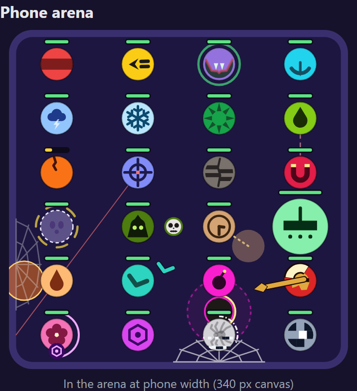
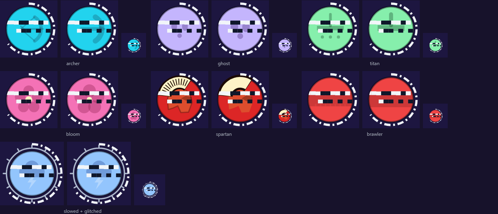
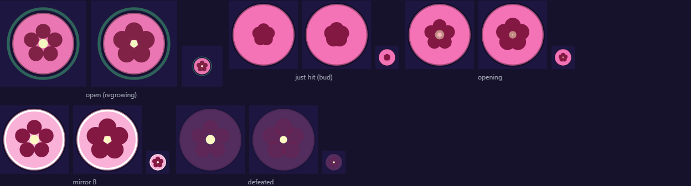

# Proposal: the Bloom's patient regrowth and the Glitch

- Status: Proposal (prototype on `proto/bloom-glitch`, ruleset 13, not merged)
- Date: 2026-11-14
- Harness: `scripts/bloom-glitch/` (variants built in the worker, so no file changes during a run;
  pairs that involve neither ball are read from one 500-seed baseline of ruleset 13). Logs are in
  `scripts/bloom-glitch/runs/`. Scans ran at 200 to 300 seeds; every number below is at 500 seeds
  unless it says otherwise.

## Summary

- **The Bloom nerf works, but not cleanly.** Patient regrowth at 52 health, speed 780, bump 21 is
  49.2%. It beats the Frost, Berserker, Ghost and Chrono and loses to the Archer, Venom, Inferno and
  Boomerang. The Titan pair sits at exactly 62.0%, so either the Bloom has 5 losses or the Titan has
  no win, depending on noise. The last session's config (53, speed 800) breaks an identity rule (the
  Speedster must be the fastest ball), so it can't ship as it was.
- **The Glitch doesn't fit the roster.** No config reached 45-55% with 2-4 counters each way without
  pushing other balls off their shape. Switching an ability off turns out to be a stat check: the
  Glitch beats light balls that live on their trick and loses to every heavy bumper (Brawler,
  Magnet, Frost, Thorns, Titan). It never beats the Ghost.
- **Recommendation:** ship the Bloom nerf on its own with the Bloom's exception narrowed from "up to
  7 wins" to "up to 5 losses". Park the Glitch. Keep the glitch engine work (the ability clock)
  on this branch for a later ball.

## 1. The Bloom: patient regrowth

The Bloom regrows only after 2 s untouched. Any hit, of any kind, starts the wait again. Then it
regrows 1 health every 12 ticks (5 a second). Its petals close into a bud on a hit, stay shut for
the whole wait, and open over the last third of a second.

The last session's config (53 health, speed 800, bump 21) reproduced exactly at 500 seeds: 50.6%,
4-4, with the Titan at 58.7%. Speed 800 ties the Speedster, though, and "Speedster is the fastest
ball at base speed" is an identity rule. At speed 790 the Bloom goes 5-5. Its pairs with the
Speedster and the Vampire both cross 62%, and they move in opposite directions. I scanned 53
configs at 780-790: health 52-54, bump 20-21.5, regrowth every 11-13 ticks, wait 110-130 ticks.

| Config (health, speed, bump, every, wait) | Overall | Shape | What breaks                        |
| ----------------------------------------- | ------: | ----- | ---------------------------------- |
| 53, 800, 21, 12, 120 (last session)       |   50.6% | 4-4   | Speedster no longer fastest (rule) |
| 53, 790, 21, 12, 120                      |   50.5% | 5-5   | 5 wins, 5 losses                   |
| **52, 780, 21, 12, 120 (proposed)**       |   49.2% | 4-5   | Titan pair exactly 62.0%           |
| 53, 780, 21, 12, 130                      |   47.9% | 4-4   | Titan 0-1 (60.5%, 300 seeds)       |
| 53, 780, 21.5, 12, 130                    |   49.2% | 4-4   | Titan 0-1 (58.2%, 300 seeds)       |

**Proposed Bloom: 52 health, speed 780, bump 21, 1 health every 12 ticks after 120 ticks untouched.**

| Bloom beats |      | Why                                                                         |
| ----------- | ---: | --------------------------------------------------------------------------- |
| Berserker   | 72.0 | Big, rare bumps leave long gaps: it regrows between them                    |
| Frost       | 70.6 | The slow keeps the Frost's bumps rare too; the Bloom heals in the gaps      |
| Ghost       | 68.5 | Phasing makes fights stop-start; every quiet stretch is regrowth            |
| Chrono      | 64.8 | Bumps only, no stream of small hits: the Bloom gets its 2 s again and again |

| Bloom loses to |      | Why                                                               |
| -------------- | ---: | ----------------------------------------------------------------- |
| Archer         | 73.8 | An arrow every second or so keeps restarting the wait             |
| Boomerang      | 73.1 | Two hits per throw, out and back: never 2 s alone                 |
| Inferno        | 72.6 | Burning patches tick every half second: the bud never opens       |
| Venom          | 67.9 | Poison ticks keep restarting the wait                             |
| Titan          | 62.0 | Late bumps grow bigger than anything it regrows (on the 62% line) |

Removed wins compared with today: the Hex, Spider and Necromancer (all now even). The Spider and Hex
were the ADR 0049 balls the old Bloom beat.

Other effects: the Speedster pair falls from 58.9% to 58.6% for the Bloom (no longer thin), the
Vampire pair is 39.0% for the Bloom (even), and the Bomber pair is 38.8% for the Bloom (the Bomber stays
under 62%, so it stays 2-1). Bloom vs Thorns, 59.5%, is in the grey zone. Thin pairs unchanged: Frost > Berserker 62.2%, Hex > Inferno 62.2%.

**Exceptions:** today's "Bloom: up to 7 wins, within 3" closes. The Titan pair at 62.0% leaves one
ball off its shape either way: the Bloom at 4-5, or the Titan at 0-1 (needs 1 win). A Titan nudge
doesn't help. Its only win (the Bloom) and its only loss (the Thorns, 62.5%) move together: 79
health drops both below 62% (0-0), and 80 health or a 14.8-15 bump wins the Bloom but loses the
Thorns loss (1-0 or 2-0). The narrowest rule that passes is **"Bloom: up to 5 losses"**, in place of
the 7-win one.

## 2. The glitch, one rule

Its bump switches the other ball's ability off for the glitch's length. The rule, as built in
`src/sim/glitch.ts`:

- **From the tick after the bump.** The bump that glitches lands in full on both sides, so a Vampire
  still drinks it and Thorns still answer it. Applying it on the same tick made the Vampire never heal
  against the Glitch at all (it lost 86-95%, far past the 78% ceiling). The bump then visibly lands
  first and the static comes after.
- **None of its hooks run.** It lays nothing new, fires nothing, heals nothing.
- **Its ability's effects on its own body fall back to the plain ball's:** base speed, base bump, no
  shield, no phasing, no status resistance.
- **Its body stays as it is:** a growing ball keeps its size and the bump of its size. Without this
  the Titan loses to the Glitch (46%); with it the Titan beats it (67%). It is the one place I had to
  choose (switch `glitchProto.keepSizeHit`).
- **Every ability timer pauses.** Each ball has an ability clock, the match tick less the ticks it
  spent glitched. Its hooks read time on it, so cooldowns, rhythms and countdowns pick up where they
  stopped, and the renderer reads the same clock so paused timers draw paused.
- **What is already out in the world carries on:** shots in flight, zones, bombs, fire patches, skulls,
  and statuses on other balls (poison, slow).
- **No new contact rules.** A phased Ghost can't be glitched: the bump passes through, like every
  on-touch effect.

The engine change is invisible without a Glitch: all 552 recorded fights replay identically except
the 46 Bloom ones (`scripts/bloom-glitch/golden-diff.ts`).

### Cases that don't fit your examples

- **The Hex's curse and the Spider's webs pause.** Both live in their owner's own state and are
  resolved by its own hooks, not by the world. So under one rule a curse already ticking stops
  counting down, and webs stop catching and ageing, while their owner is glitched. To make them carry
  on they would have to become world effects (a curse status like poison, webs as wall zones). That
  is a refactor with no other gameplay change.
- **The Chrono's rewind goes stale.** It records no moments while glitched, so straight after a
  glitch its oldest moment can be from before it, up to the glitch's length back (4 s), not half a
  second.
- **The Bloom's wait isn't restarted by hits during a glitch.** Its hit-reaction is a hook, and hooks
  are off. It still can't regrow while glitched, and the wait runs on from where it paused.

### What "ability off" means for every ball

| Ball        | Glitched                                                                             | What you see                    |
| ----------- | ------------------------------------------------------------------------------------ | ------------------------------- |
| Brawler     | Nothing changes: it has no ability                                                   | Static only                     |
| Speedster   | Gains no stacks on walls, spends none on bumps; cruises at base speed, stacks kept   | Slows down; its streaks fade    |
| Vampire     | Its bumps don't heal it                                                              | No heal pulse                   |
| Archer      | Shoots nothing; its reload pauses; arrows in flight still hit                        | Faded bow; reload frozen        |
| Storm       | Calls no lightning; a circle already marked still strikes                            | Faded cloud; no new circles     |
| Frost       | Its bump doesn't slow; slows already on balls run out as normal                      | No new slow rings               |
| Thorns      | Spikes off: bumps on it aren't reflected                                             | No spike damage on the attacker |
| Venom       | Its bump doesn't poison; poison already on carries on                                | No new poison rings             |
| Berserker   | Gains no rage; stored rage neither adds to its bump nor is spent                     | Cracks stay; bumps hit plain    |
| Sniper      | No charge, no shot; a charge in progress freezes and fires after                     | Laser frozen                    |
| Quake       | Wall bounces send no shockwave; one already marked strikes                           | No new shockwaves               |
| Magnet      | No pull; a pull in progress stops and finishes after                                 | Pull line gone                  |
| Ghost       | Can't phase: solid, takes every hit, no spectral hit; its rhythm pauses              | Solid, faded face               |
| Necromancer | Summons nothing; skulls already out keep hunting                                     | No new skulls                   |
| Chrono      | Records no moments, can't rewind (even from a knockout); recharge pauses             | Faded clock; no rewinds         |
| Titan       | Stops growing; keeps its size and the bump of its size                               | Stays the same size             |
| Inferno     | Drops no fire; patches already down keep burning                                     | No new patches                  |
| Boomerang   | Throws nothing; one in flight still comes back                                       | No new throws                   |
| Bomber      | Drops no bombs; bombs down still blow                                                | No new bombs                    |
| Spartan     | No shield (full damage, full speed), no spear; rhythm pauses; a spear in flight hits | Shield gone, helmet faded       |
| Bloom       | Can't regrow; its wait pauses                                                        | Bud stays shut                  |
| Hex         | Lays no curse; a curse already laid pauses its countdown                             | Curse ring stops emptying       |
| Spider      | Spins no webs; its webs stop catching and stop ageing                                | Webs stay, no catches           |

Every glitched ball shows the same three things: its markings fade to 30%, bands of static cross it
(jumping a few times a second, still with reduced motion), and a broken pale ring outside it empties
as the glitch wears off.

## 3. The Glitch on its own and together

I scanned about 60 configs: health 51-104, bump 13-27, glitch 1.5-5 s, speed 770-780.

| Config (health, bump, glitch)  | Overall | Shape | Main problems                                                    |
| ------------------------------ | ------: | ----- | ---------------------------------------------------------------- |
| 66, 18, 2 s (first guess)      |   24.5% | 1-19  | Far too weak                                                     |
| 66, 24, 2 s                    |   45.6% | 0-5   | Beats nobody; Thorns 4-2, Hex 5-3, Bloom 5-5; Titan only 61.7%   |
| **62, 24, 4 s (closest)**      |   50.4% | 4-5   | 5 losses; Thorns 4-2, Sniper 1-3, Speedster 3-5, Magnet beats it |
| 62, 24, 5 s (200 seeds)        |   54.2% | 9-5   | Far too many wins                                                |
| 88, 16, 2 s, tanky (200 seeds) |   27.1% | 0-15  | Low bump loses everywhere                                        |
| 51-52, 24-24.5 (200 seeds)     |  35-42% | 1-8+  | Two Brawler bumps kill it, but so does nearly everything else    |

**Closest Glitch: 62 health, bump 24, speed 770, 4 s glitch** (one-liner "Its bump switches the
enemy's ability off for 4 s.", which fits two lines at 375).

| Glitch beats |      | Why                                                          |
| ------------ | ---: | ------------------------------------------------------------ |
| Inferno      | 72.8 | Its fire is nearly all it has (bump 7): off, it barely hurts |
| Sniper       | 71.9 | A long charge, paused and restarted; its bump is 9           |
| Spartan      | 65.7 | No shield and no spear on 45 health                          |
| Speedster    | 65.4 | No stacks: a 14 bump at base speed                           |

| Glitch loses to |      | Why                                                               |
| --------------- | ---: | ----------------------------------------------------------------- |
| Thorns          | 71.3 | 80 health and the first bump reflects; it barely needs its spikes |
| Frost           | 69.7 | 80 health and a 22 bump; its first slow is already on the Glitch  |
| Brawler         | 67.9 | Nothing to switch off; the hardest plain bump (designed)          |
| Titan           | 67.4 | The glitch only pauses its growth; it still gets big (designed)   |
| Magnet          | 66.5 | 68 health and a 25 bump: with its pull off it is a Brawler        |

Even: the Ghost (Ghost 54.9%). The glitch can't land while it is phased, and solid it is a 65/22
ball, about the Glitch's match. Getting the Ghost to lose needs more Glitch stats, and then the Glitch
beats everything light.

Against today's Bloom (no nerf) the same Glitch is 51.0% and 5-5: it beats the old Bloom 62.5% but
does nothing for the Bloom's exception.

**Why it can't fit.** The glitch doesn't create matchups on its own. It turns each fight into
plain stats against plain stats, so the Glitch beats whoever is light and loses to whoever is
heavy. The intended losses (the Brawler, the Titan) come with three unwanted ones. The Magnet
(68/25) is a near twin of the Brawler (66/26) once its pull is off, so "the Brawler beats it, the
Magnet doesn't" can't be held: every config had them within 3 points. The Thorns (already 3-2) and
the Berserker (already at its 5-win cap) also win, and the Sniper gains a third loss. Raising the Glitch's
stats to win those back makes it win too much (9+ wins at 54%+).

| Goal                                        | Result                                                                                      |
| ------------------------------------------- | ------------------------------------------------------------------------------------------- |
| Remove the Bloom's "up to 7 wins" exception | Yes, replaced by "up to 5 losses" (or the Titan at 0-1)                                     |
| The Titan back in shape (a Glitch win)      | Titan beats the Glitch 67.4%, but the Glitch doesn't ship                                   |
| The Brawler's designed win                  | Brawler beats the Glitch 67.9%, but so does the Magnet                                      |
| The Ghost's second loss                     | No: Ghost 54.9% against the Glitch                                                          |
| No new exceptions                           | Bloom alone: one narrowed exception. With the Glitch: Thorns, Sniper, Speedster, Magnet off |
| Thin pairs at 62% or more                   | Frost > Berserker 62.2%, Hex > Inferno 62.2% (unchanged)                                    |

### Gates at 500 seeds

| Gate                     | Bloom alone            | Bloom + Glitch (closest)                             |
| ------------------------ | ---------------------- | ---------------------------------------------------- |
| Each ball 45-55%         | 45.8-53.1              | 45.3 (Speedster)-52.9                                |
| Weakest side of any pair | 23.8 (Sniper v Chrono) | 23.8                                                 |
| Highest counter (78%)    | 76.1                   | 76.1                                                 |
| Median fight (12-30 s)   | 16.2 s                 | 16.3 s                                               |
| Draws (under 5%)         | 0.5%                   | 0.5%                                                 |
| Comebacks (10-20%)       | 18.7%                  | 18.3%                                                |
| Shape                    | Bloom 4-5 (Titan 62.0) | Speedster, Thorns, Sniper, Magnet, Bloom, Glitch off |
| ±5% health, CI balance   | Not run                | Not run                                              |

I didn't run the ±5% sensitivity runs or `pnpm balance:ci`, because neither candidate passes the shape
gate. The Ghost's existing "one loss" exception is unchanged in both.

## 4. Looks

The Glitch is TV static in a round window: dark and white blocks on slate, with the middle row torn
sideways. It is fixed, so the ball itself never flickers. A glitched ball fades its markings, wears
moving bands of static (still with reduced motion) and a broken ring that empties as the glitch wears
off. The Bloom's bud stays shut through its whole wait and opens over its last 20 ticks.

| Phone arena (390 wide, 2x)        | Glitch (large, phone tiles)        | Glitched balls                       | Bloom's wait                      |
| --------------------------------- | ---------------------------------- | ------------------------------------ | --------------------------------- |
|  |  |  |  |

Phone-width versions: [Glitch](bloom-glitch/glitch-phone.png),
[glitched](bloom-glitch/glitched-phone.png), [Bloom](bloom-glitch/bloom-phone.png). All are drawn by
the game's renderer in the style guide (each tile: large, large simplified, and 30 px across as on a
phone). In the phone arena the Spider (bottom row) is glitched and the Glitch is bottom right. Both
one-liners fit two lines at 375 wide (`manual-text.touch.browser.test.ts` passes in all three
engines).

## 5. Recommendation

1. **Ship the Bloom nerf on its own:** 52 health, speed 780, bump 21, 2 s untouched, then 1 health
   every 12 ticks. Replace "up to 7 wins, within 3" with "up to 5 losses". It is still the roster's
   only regrower, it now reads clearly (bud while waiting), and it no longer beats both ADR 0049
   balls. The Titan keeps its Bloom win on the 62% line; if a later run puts it under, the Titan is
   0-1 instead and needs its allowance widened. That is the same kind of call, so pick one now.
2. **Don't ship the Glitch.** An ability switch can't stay the same on every ball and also lose only
   to the Brawler and the Titan. The intended Titan and Brawler counters do appear, but so do
   Thorns, Frost and Magnet counters, for the same reason.
3. **Keep the ability clock.** It adds nothing to fights without a glitch, pauses every timer in one place, and
   would suit a future ball that stuns or silences. The Titan's win and the Ghost's second loss stay
   gaps in `docs/vision.md`, for a ball whose mechanic beats regrowth-free, phasing or slow-growing
   balls directly.

Shipping step 1 needs: a `RULESET_VERSION` bump with a new fingerprint, `pnpm golden`, the counter-map
labels for the Bloom pairs, the identity lists, the balance summary and an ADR. None of that is done
here: `pnpm test` currently fails the ruleset, golden, counter-map, identity and design-list tests on
this branch, as expected for a roster change.
