# 0033: Arena polish: a plain floor, the way out last, the Winner sticker at full brightness

- Status: Accepted
- Date: 2026-11-06
- Amends: ADR 0032 (§4 the court, the Winner sticker), ADR 0025 (where "Leave series" sits)

## Context

Three things looked wrong after the Sticker Pop restyle:

1. **The centre circle.** The court's tonal disc (`#251c4b` on the `#1d1640` floor, 32% of the
   arena) read as something lying on the floor, partly see-through, not as part of the floor. It
   was the biggest shape in the arena and competed with the balls.
2. **"Leave series"** sat between the scoreboard and the health bars while a round played, so it
   read as part of the match rather than a way out.
3. **The Winner sticker was dimmed.** It lands 750 ms before the result. In a series the result
   is also the moment the round screen takes over: on a desktop it dims the arena to 30%, on a
   phone it removes it. So the card's 480 ms pop and the confetti's 650 ms burst were dimmed or cut
   off as they finished. After a time-limit win the sticker and the round screen arrived on the
   same frame, so the celebration played already faded.

Presentation only: `src/sim`, URLs, Back and `RULESET_VERSION` are unchanged.

## Decision

### 1. The floor has no markings

The centre circle is removed, not just toned down. Every circle on the floor already means
something: a Storm warning, a Quake shockwave, a heal ring, and soon the Inferno's burning patches
(batch 4). A decorative disc competes with those signals however faint it is, and a court line
(a thin ring) would look even more like a zone warning. The chunky rounded rim carries the court's
character on its own.

- A frame now costs two rounded rectangles.
- `arena-contrast.test.ts` checks every ball against the one floor tone. The weakest ball, the
  Necromancer, goes from 3.12:1 (on the old disc) to 3.39:1. A marking added later must be listed
  in its `FLOOR_TONES`.

### 2. "Leave series" is last in the panel

It now has its own slot, `#series-exit`, after the health bars and the speed toggle. During a round
the panel reads: the score, the fight's health bars, speed, then the way out. Between rounds the
bars and speed are hidden, so it still sits under the round screen's own buttons, as before. It's
a DOM slot rather than a CSS `order` trick, so focus order follows what you see.

### 3. The celebration plays out before the arena dims

`createEffects` now knows two moments after a match ends:

- `stickerVisible`: when the sticker lands. This is the same moment as before: 750 ms before the
  result after a knockout, and at once for a time-limit end. Never for a draw.
- `celebrationOver`: the result is showing **and** `winnerCelebrationMs` (1400 ms) has passed
  since the sticker landed. That covers the pop, the confetti and a beat to read the name. For a
  draw, it is the result itself.

The series waits for `celebrationOver`, not the result, before it shows the round screen
(`ArenaHost.drawn` passes both). The HUD's result and a quick match are unchanged. The frame loop
keeps drawing until the celebration ends, so the round screen appears on time without waiting for
some other redraw.

| End of a round    | Sticker lands        | Round screen before | Round screen now |
| ----------------- | -------------------- | ------------------- | ---------------- |
| Knockout          | 200 ms after the hit | 950 ms after        | 1600 ms after    |
| Time limit, a win | at once              | at once             | 1400 ms after    |
| Draw              | none                 | at once (replay)    | at once (replay) |

Once the moment is over, on a desktop the dim now eases in over 0.4 s and the sticker fades out
with it: the panel says who won, and a greyed-out sticker read as a mistake. With reduced motion
the sticker still appears without its pop and holds for the same time, and the dim and the
sticker's exit happen at once. On a phone the arena still makes way for the round screen, only
later.

I chose to delay the dim over keeping the sticker above it. On a phone the arena is removed
rather than dimmed, so a sticker "above the dim" would still be cut off there.

## Verification

- **Unit:** `effects-feel.test.ts` covers when the sticker lands, that the celebration outlasts
  the result after a knockout and after a time-limit win, and that a draw has none. Both tests
  failed with the celebration end set back to the result time.
- **Browsers:** the existing flows that play series to their result (`series-result`,
  `series-link`, `series-resume`, `winner-sticker`) pass in Chromium, Firefox and WebKit with the
  later round screen.
- **Screens.** Captured with Playwright on the same Blind series link and the same quick match: a
  phone at 375 × 812 (2×) and a desktop at 1280 × 800. The sticker frames are 900 ms after the
  sticker lands, which is after the old round screen arrived.

| What                         | Before                               | After                                 |
| ---------------------------- | ------------------------------------ | ------------------------------------- |
| Match, phone                 | 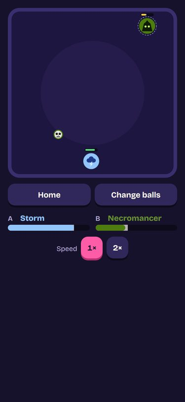     | 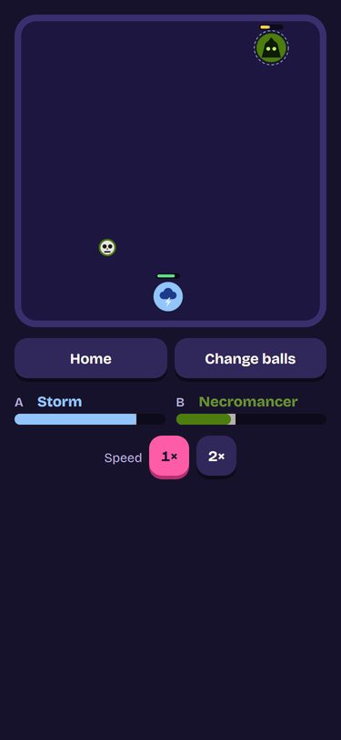       |
| Match, desktop               | 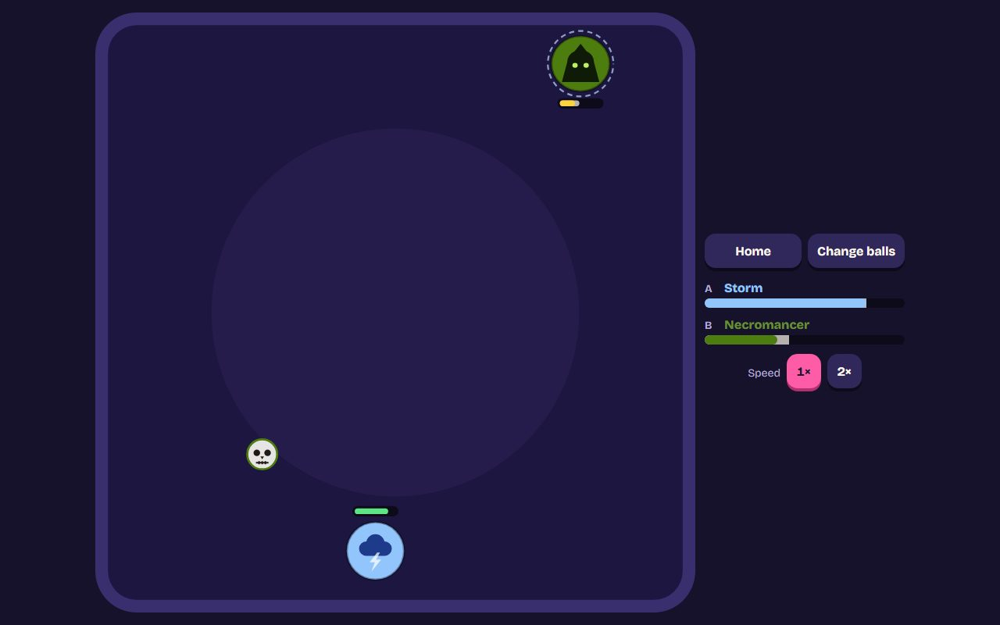   | 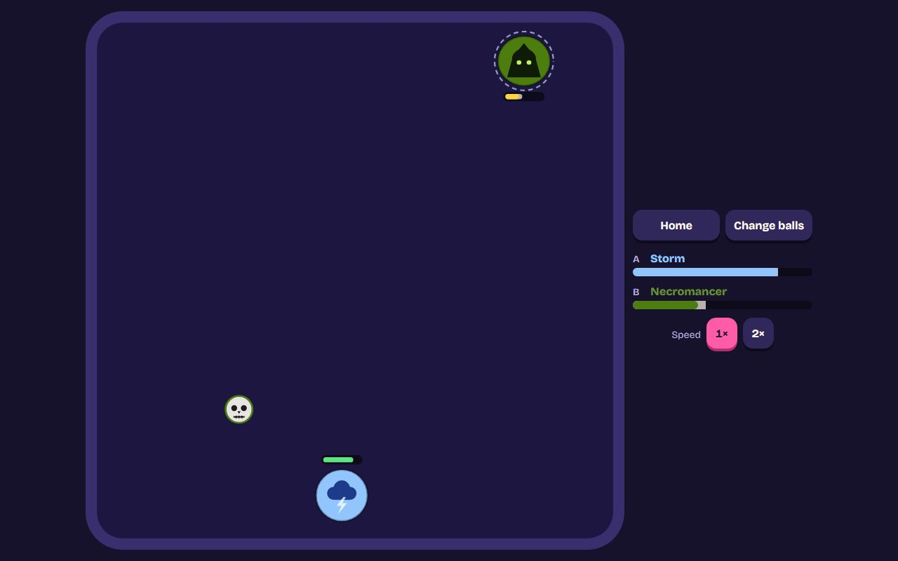     |
| A round, phone               | 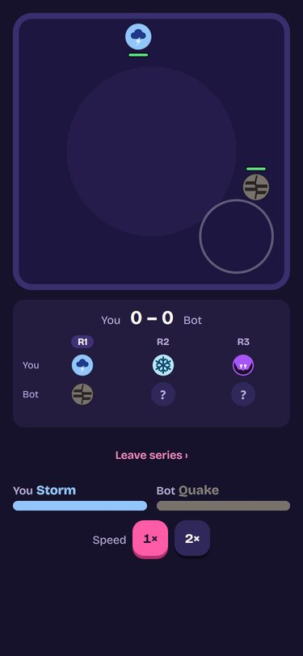     | 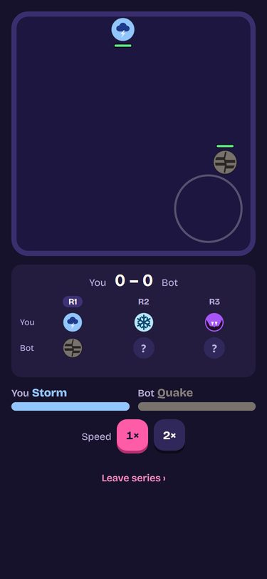       |
| A round, desktop             | 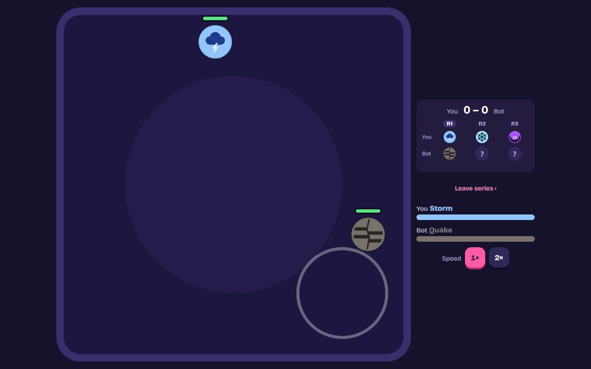   | 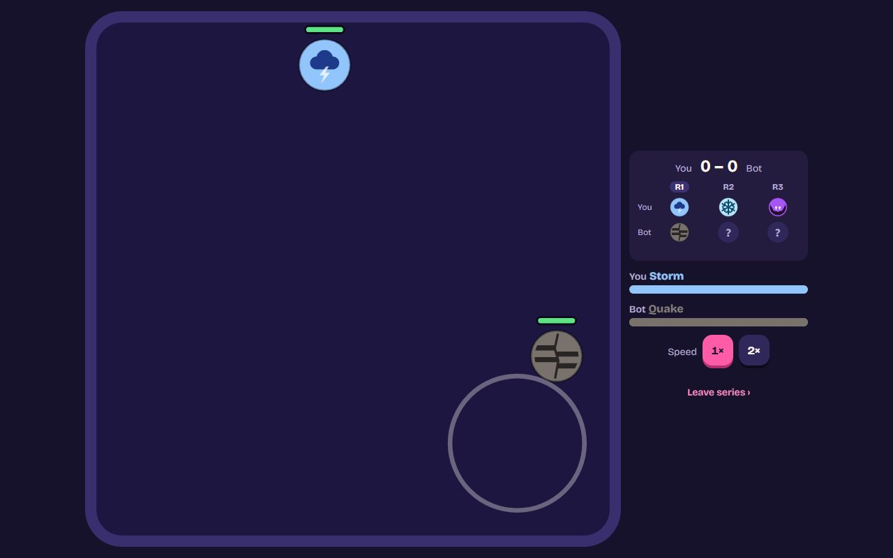     |
| Sticker +900 ms, phone       | 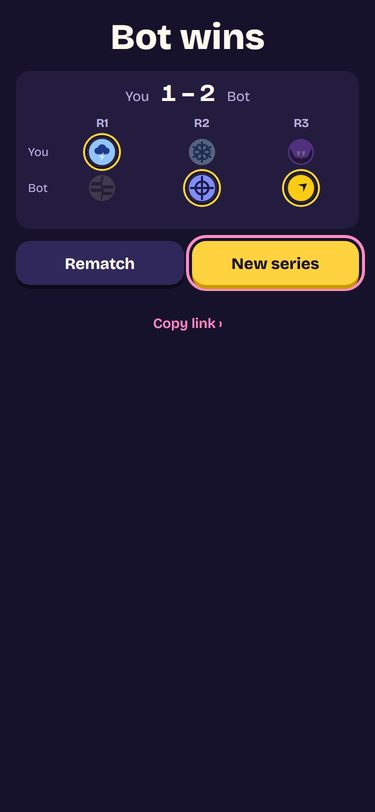   | 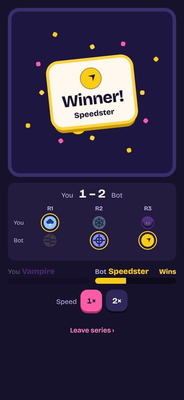     |
| Sticker +900 ms, desktop     | 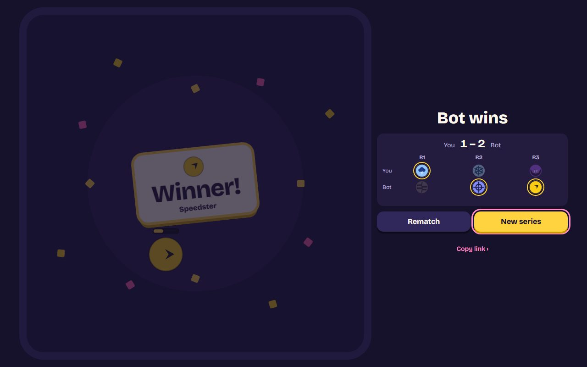 | 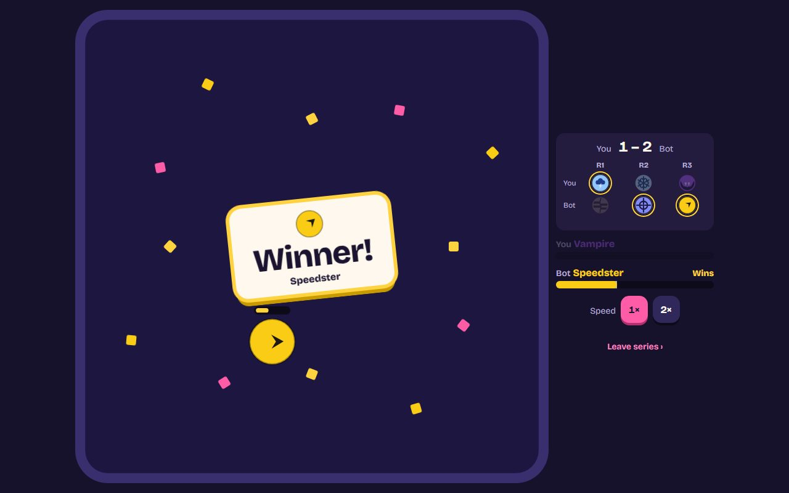   |
| Reduced motion, phone        |                                      |    |
| Reduced motion, desktop      |                                      | 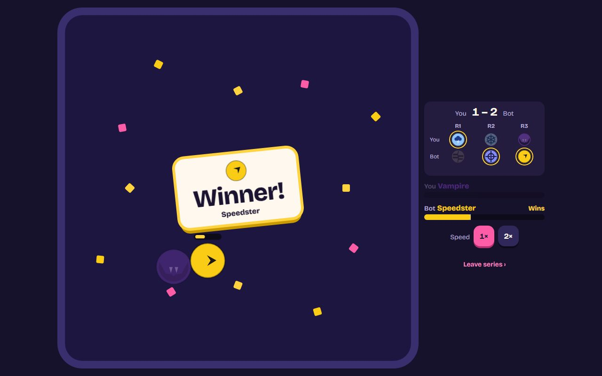 |
| The result after it, desktop |                                      | 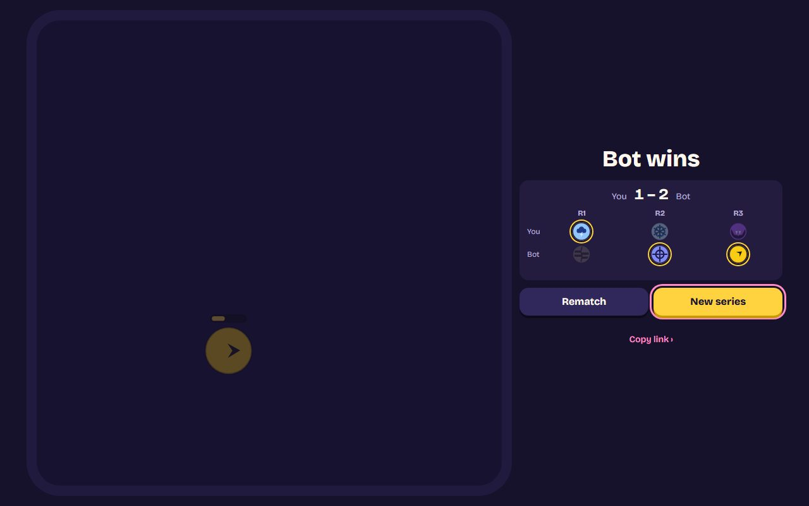    |

## Consequences

- **Positive:** the balls are the only thing on the floor besides the game's own signals. The
  match's big moment always plays in full, at every width and end.
- **Positive:** the way out of a series sits where a way out is expected.
- **Negative:** a series' round screen comes 0.65 s later after a knockout and 1.4 s later after a
  time-limit win. Between rounds that is a short wait before the next button. It is the
  celebration the restyle added, so it's worth the time.
