# 0036: Teaching in the arena

- Status: Accepted
- Date: 2026-11-07
- Amends: ADR 0007 (the intro can run longer for the versus card), ADR 0025 (show less: tips are
  one-time, and the match story is closed by default)
- Amended by: ADR 0040 (tips are two switches in settings), ADR 0041 (a rule gets a one-time hint)
- Amended by: ADR 0037 (clarity fixes: whose edge a mark shows, sentence prompts, a ready moment, a
  story led by its result)
- Amended by: its addendum of 2026-11-22 (the hint is a caption in a fixed place and a ring)
- Amended by: its addendum of 2026-11-23 (the tip's own look: a cream ring and tag where the
  ball's definition says, a longer caption card)

## Context

A new player who hadn't read the manual was confused during a fight about how damage was happening
and what else was going on. The sim emits an event for everything that happens, but a newcomer was
told none of it. The goal is that a first-time player understands what each ball is doing and why
someone is winning, mostly without reading anything mid-fight. Teaching happens in the arena, at
the moment things happen; reading stays optional, and experienced players are never slowed down or
nagged.

## Decision

Everything shown is read from sim events, the definitions and the counter map, so it can't
disagree with the fight. The arena's size is unchanged.

### 1. Damage events say what delivered them

Ability damage events gain an output-only `via`: `projectile`, `zone`, `zonePulse` (a lasting
zone's pulse), `minion`, `poison`, or the hook whose `damage` action dealt it (`onHitBall`,
`onDamageTaken`). Contact damage has none.

- **Why in the sim.** Reading the kind from the order of neighbouring events would misattribute
  poison that lands right after a zone's damage, which is the kind of disagreement the goal rules
  out.
- **No fight changes.** The ruleset fingerprint is unchanged. The known match results, which hash
  events, were recorded under ruleset 6 (ADR 0035) with the field already in place.
- **Not feel.** It isn't feel work in ADR 0007's sense: sim time and the fight are untouched, and
  the field only describes damage that already happened.

### 2. A source chip for damage you can't see

When poison, a burning patch's pulse or reflected spikes land, a small disc in the attacker's
colour, outlined like the health pill, pops beside the hit ball's pill and fades over 650 ms of
effect time (`source-chips.ts`). With reduced motion it only fades.

- Arrows, lightning, skulls and contact hits already show their cause, so they get no chip.
- No floating numbers (ADR 0007).

### 3. Ability hints, once per ball per device

Each definition with something to point at names its ability and the event that first shows it
(`ability: { name, shownBy }`, ADR 0024: player-facing text lives in definitions). Examples: the
Storm's `zoneSpawned` ("Lightning"), the Venom's poisoning ("Poison"), the Thorns' reflected damage
("Spikes"). The Brawler, the Berserker and the Titan have nothing discrete to point at, so they
have none.

- **When it shows.** The first time this device sees that event, a cream label ("Lightning!") pops
  above the ball's health pill for 1.6 s and follows the ball. It is a DOM overlay positioned from
  the drawn world, since the canvas draws no text.
- **One at a time.** Labels queue, so two never overlap.
- **Remembered.** Seen balls are kept in `localStorage` (`ballbattle.hintsSeen`), so a player sees
  at most 14 labels ever. If storage throws, hints show once per page load.
- **Is it annoying?** I judged not. A label is two words, appears only the first time, and never
  covers the ball.

### 4. A versus card for a player's first three matches

Over the intro, a small sticker shows both balls, the favoured ball's ▲ and the counter map's
one-line reason for the pair (a mirror says so).

- It holds the intro 1.3 s longer. That is presentation time only (ADR 0007): the same ticks run.
- A tap skips it (`skipIntro`) and the match starts at once.
- It shows for the first three matches on a device (`ballbattle.versusSeen`), then never again.
- The home screen's demo shows neither the card nor hints.

### 5. "How it was won" with key moments, instead of a live battle log

Under a finished quick match, and under each round in a series, a closed `
` expander:

- **Damage by source:** one stacked bar per ball, winner first. The ability is in the ball's colour
  and contact hits are paler, scaled to the larger total, with words under it ("Lightning 31 ·
  Hits 41").
- **Heals:** how much each ball healed, and how many heals shock cut.
- **Key moments:** up to four, with match times. The first time each rule acted, a rewind, the
  biggest hit (20 or more), and the knockout or "Time up".

It is computed only when opened, by replaying the match headlessly from its opening world
(`match-story-data.ts`), so it costs nothing until someone looks and is the fight itself.

**A live battle log was not built.** A scrolling list during a fight pulls the eyes off the arena,
and on a phone it either covers controls or pushes them down. The chip and the hints cover the
moment, and the key moments cover the story.

### 6. Tips can be turned off

The legend sheet (the `?` on any screen with symbols) ends with "Tips in the arena: Turn tips off ·
Show tips again". Off means no hints and no versus card. "Show tips again" also suits a device
several people share.

## Consequences

- Positive: a newcomer sees what each ball does and where damage comes from as it happens. An
  experienced player sees at most 14 hints and three versus cards, ever, and can turn them off.
- Positive: "How it was won" explains a result on request, with no extra cost or clutter.
- Negative: damage events carry one more field, and the known results had to record it.
- Negative: a player who clears site data sees the tips again.

Screenshots in `docs/images/teaching/`:

- `phone-versus-card.png`;
- `phone-hint-and-chip.png`: "Poison!" with a Thorns chip by the Venom's bar;
- `phone-how-it-was-won.png` and `desktop-how-it-was-won.png`;
- `phone-series-story-and-tips.png`: a series round's story, and the legend with the tips line.

## Addendum (2026-11-18): a hint says it is a tip

The owner once took an ability hint for a bug: a cream label popping up mid-fight with one word
on it ("Poison!") looked like something gone wrong, not like the game teaching. Each hint now
carries a small "Tip" over the ability's name, in the sticker's quiet colour (the ready card's
`--color-on-sticker-muted`), so it reads as the same kind of thing as the tips in settings ("Show
all tips again") at a glance. The sticker, its colours and its pop are unchanged; it is two short
lines, about 73 × 39 px, so it fits by a ball at 375 px wide.

| Before                                           | After, phone                                             | After, desktop                                                          |
| ------------------------------------------------ | -------------------------------------------------------- | ----------------------------------------------------------------------- |
| 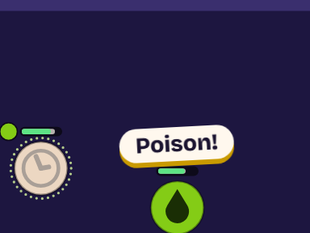 | 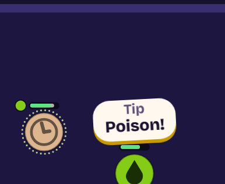 | 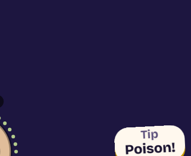 |

## Addendum (2026-11-22): a caption in a fixed place, and a ring

The 2026-11-18 "Tip" label still didn't teach. It followed a moving ball for 1.6 s with one word
("Bombs!"), so a player watching the fight saw a sticker fly past and couldn't say what it was, and
a phone player had to find it on a court as wide as the screen. The UX pass (approved 2026-11-22)
replaces it.

- **One caption, in a fixed place, for 4 s.** The ball and its ability ("Bomber: Bombs") over the
  ball's own one-line description ("Drops a big bomb now and then: it blows when touched."), in the
  frame tip's quiet box (one look, ADR 0063). Phone: under the speed row. Beside a phone's court
  turned sideways: the panel's last row (the panel scrolls inside itself there, ADR 0067
  addendum). Desktop: under the panel. On the phone and the desktop it floats, so showing it never
  moves the court or the panel.
- **A ring on the thing it is about.** A soft ring pulses three times (2.4 s) where a zone
  appeared (the bomb, the lightning's mark, the fire), else on the ball. With reduced motion it
  shows still and fades.
- **The sentence is the definition's `description`**, one source, already shown in the manual
  (owner's decision; a per-ability sentence only if playtests say it reads wrong). Where a
  description said what the ball is rather than what the moment shows, it was rewritten, still
  within the manual's two lines at 375 px (`manual-text.touch.browser.test.ts`): the Frost ("Every
  hit slows its enemy right down; it is slow itself."), the Hex (the "it" that read as the Hex:
  "3 s later the ball loses 27% of its health"), the Kraken ("Tentacles grab its enemy and crush
  it; more on big balls.") and the Spartan ("Plants its shield to halve hits, then throws its
  spear."). Text only: no ruleset bump.
- **Nothing slows.** No slow-mo or hold: sim and presentation time are untouched (ADR 0007), so a
  live fight stays in step with the other phone.
- **Heard once.** The caption is a polite `role="status"`, written as it starts, so a screen reader
  reads it once; the sticker was hidden from them. The ring stays `aria-hidden`.
- Unchanged: once per ball per device (`ballbattle.hintsSeen`), one at a time, a hint whose ball
  is gone waits for next time, never in the home demo, the Ability hints switch (ADR 0040).

The rules for the ready card's "What to watch" line are in `docs/what-to-watch.md`; the existing
reasons are rewritten to them later.

Tests: `arena-tips.browser.test.ts` reads the caption; `arena-tips.wide.browser.test.ts` waits for
"Venom: Poison" with the Venom's description, its status role and the ring, and checks the court
and the panel didn't move.

| Before                                                             | After                                                                      |
| ------------------------------------------------------------------ | -------------------------------------------------------------------------- |
| 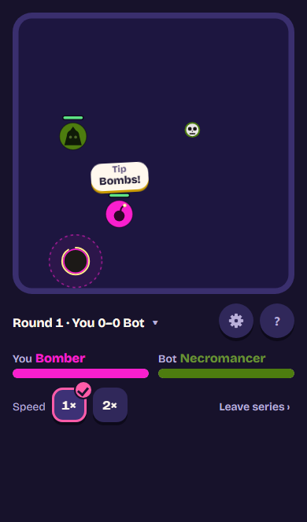  | 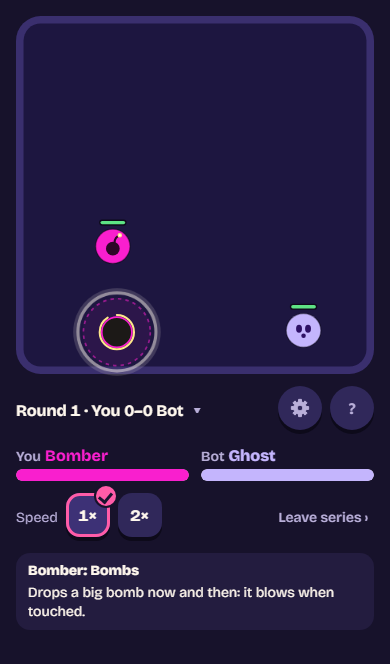      |
| 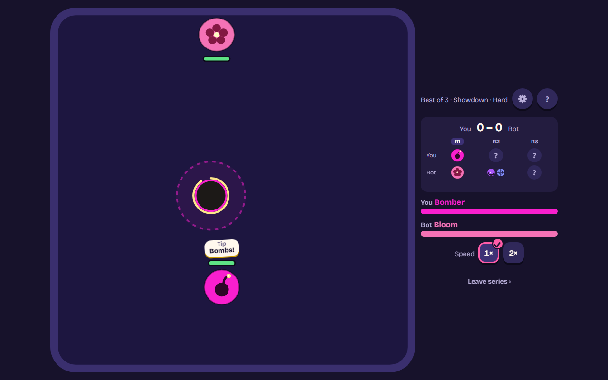 | 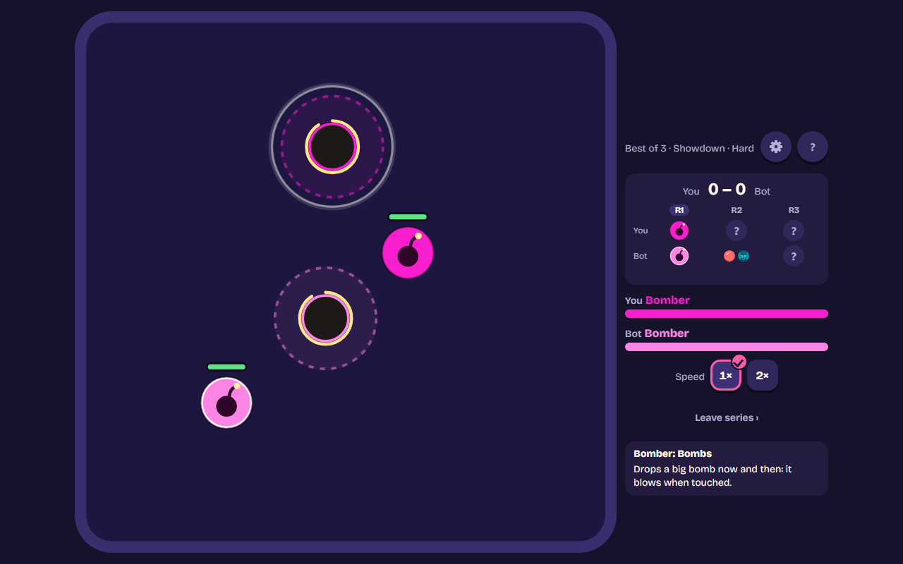 |

## Addendum (2026-11-22): the ring and the caption, together

On a real iPhone the owner didn't notice the ring at all: a thin sticker-cream ring pulsing three
times, in a different place from the caption, with nothing tying the two together.

- **The ring in the ball's colour**: a 4 px stroke in the caption title's shade of the ball's
  colour (`readableTextOn` the caption's box, which also lifts a dark ball, the Necromancer, off
  the dark floor), a 1 px page-coloured edge each side and a soft halo of the same colour.
- **One link from ball to words.** Ring and caption appear on the same frame; the caption's title
  is in that shade, beside a 20 px drawing of the ball (the mirror's second ball lighter, as on
  the court).
- **Calm motion, once.** The ring settles from 1.3x over 360 ms, holds still, then fades over its
  last 360 ms (2.4 s in all); the caption fades up 6 px over 320 ms. No pulse, bounce or flash.
  With reduced motion both only fade.

- **A title never repeats its ball's name.** The Boomerang's ability was "Boomerang", so its
  caption read "Boomerang: Boomerang"; it is "Comes back" (text only). No other ball repeats its
  own name (`balls.test.ts`); "Sniper: Sniper shot" stays, since "Sniper shot" is the game's word
  for that shot in the What to watch reasons.

Tests: `small-landscape.landscape-small.browser.test.ts` checks the ring shows with the caption,
its colour is the title's and not the text colour, and the ball's drawing is beside the title;
`arena-tips.wide.browser.test.ts` is unchanged.

| Before                                                             | After                                                                         |
| ------------------------------------------------------------------ | ----------------------------------------------------------------------------- |
| 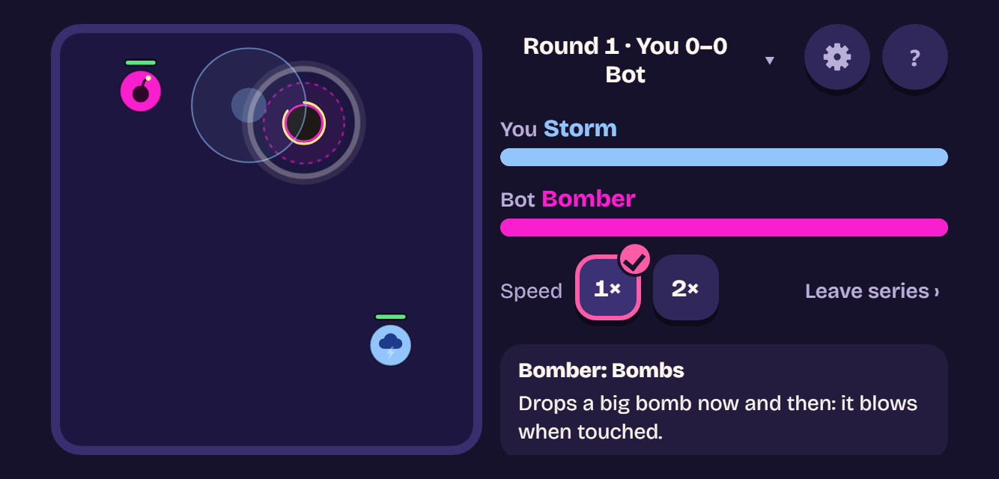 | 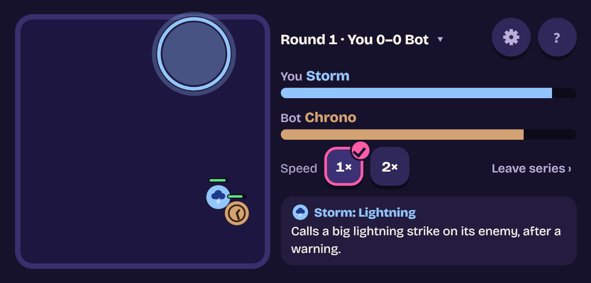 |
| 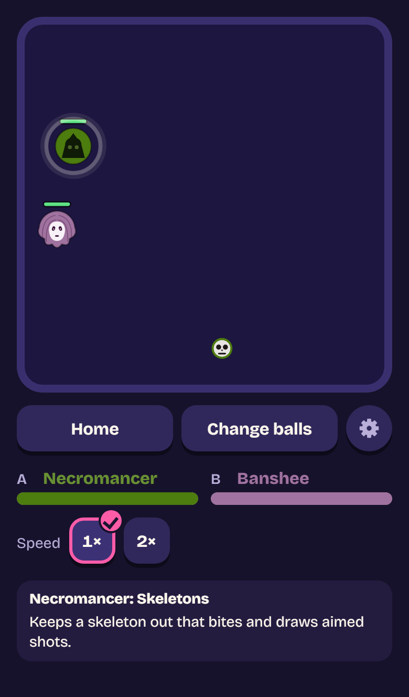       | 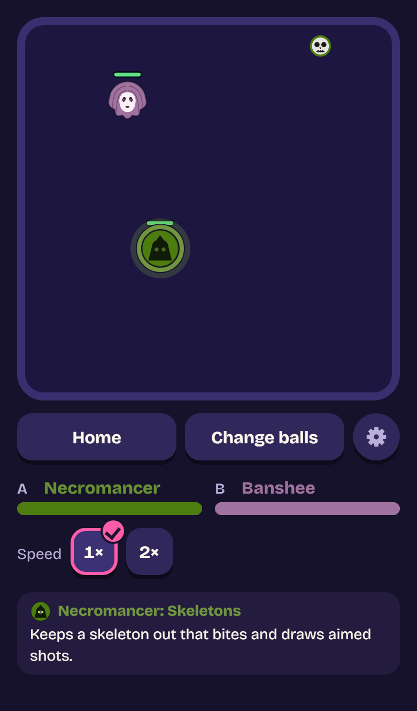   |

## Addendum (2026-11-23): the tip's own look

The ring in the ball's colour still read as part of the fight: on a real iPhone the owner took it
for an effect and looked for the words late. Two rounds of prototypes (`proto/tips-in-the-arena`,
looks compared in clips at 390 x 664, 667 x 320 and 1280 x 800) settled the "middle ground": the
tip gets a look of its own that no ball wears, and stays a little longer. Nothing pauses (the
first-tip pause was prototyped and left out; a live match never waits, ADR 0054).

- **In the arena, a dashed cream ring and an "i" tag.** A 3 px dashed ring in `--color-tip` (the
  palette's cream, worn by no ball), a page-coloured edge each side so it reads on a light ball and
  on the floor, and beside it a tag: an "i" and the ability's own name ("Bombs"), dark on cream. It
  settles from 1.3x over 360 ms, holds still, and fades over its last 600 ms: 3 s in all.
- **Where it goes is data.** Each ball's `ability.tipOn` says what the tip is about: `zone` (the
  Bomber, the Inferno, the Storm), `minion` (the Necromancer), `struck`, the ball the ability
  landed on (the Frost, the Venom, the Kraken, the Hex, the Spider), `copy` (the Mirage's copy
  while there is one) or `self` (every other ball, the Banshee's wail included). A shot's tip is on
  the ball that fired it: every shot crosses the court in well under a second (the Spartan's spear
  1500 units a second, the Archer's arrows 1650, the Boomerang 1700, the Sniper 2400; each lives
  under 0.6 s at the median), too fast for the eye to follow a label, where a skeleton (640, about
  4 s) is easy to follow. The render code has no ball names in it. `tip-target.test.ts` fails when a
  ball with an ability declares none, or one its `shownBy` can't point from, and plays every ball
  until its tip shows to read back the rule it followed. Text only: no fight changes.
- **The ring goes with its thing.** A zone's ring fades as soon as the zone strikes or ends, a
  minion's as soon as it is gone; a Slime's ring moves to the surviving half.
- **The tag's place.** One of the ring's four diagonal corners, scored: any part outside the court
  costs most, then covering another ball or any ball's health bar (its own included), then a mild
  preference for above right. It keeps its corner until another is clearly better (a margin of
  0.5), and only its offset from the ring eases (140 ms), so it rides exactly on the fastest ball in
  play (a Slime half just after a split, 1506 units a second) and never jumps. Its box is clamped
  inside the court. With reduced motion nothing glides or scales; the ring and tag only fade.
- **The caption, a card.** The quiet box with a faint 1 px cream outline (25%), no stripe; the
  same "i", the ball's drawing, its title in the ball's colour and its sentence. About 7 s, or until
  the next tip but never before 4 s, then a 600 ms fade. On a desktop it sits at the top of the
  panel, above its first row, nearer the fight; on a phone under the speed row; on a phone turned
  sideways the panel's last row, as before. A screen reader hears it once (a polite status written
  once per tip). Once per device, the settings switch and "Show all tips again" are unchanged.

Tests: `tip-target.test.ts` (the data check, each rule in a real fight, shots on the shooter, the
zone's and minion's ring going), `tip-place.test.ts` (inside the court, clear of balls and health
bars, no flip-flop, smooth at 1506 units a second, reduced motion moves at once),
`arena-tip-look.browser.test.ts` (3 s ring, 7 s caption, the next tip after 4 s, a struck zone's
ring fading), `arena-tips-motion.test.ts` (with reduced motion the stylesheet only fades) and the
flow `tips-arena-flow.ts` at 390 x 664, 667 x 320, 812 x 375 and 1280 x 800 (the dashed cream ring
and tag inside the court on every frame, the card's parts, written once, where it sits).

The Bomber's first bomb, 0.9 s after its tip shows:

| Before                                                                                   | After                                                                                           |
| ---------------------------------------------------------------------------------------- | ----------------------------------------------------------------------------------------------- |
| 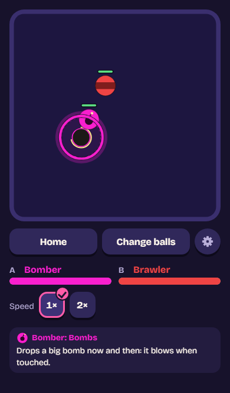          | 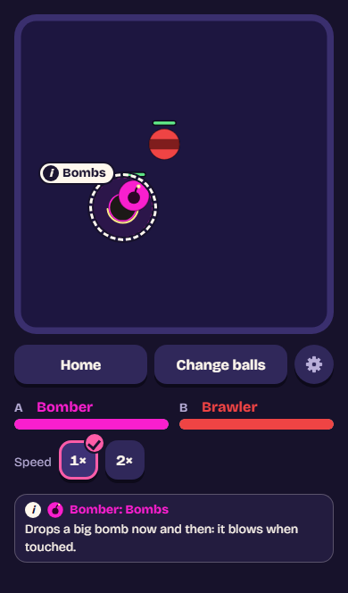                   |
| 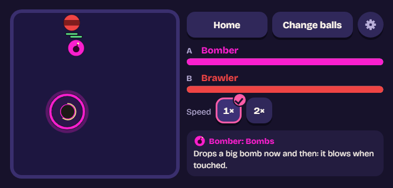 | 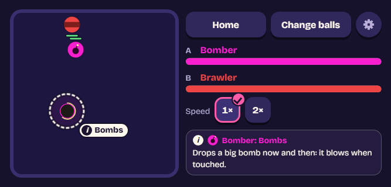          |
| 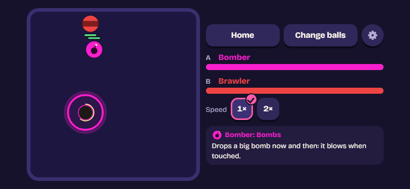       | 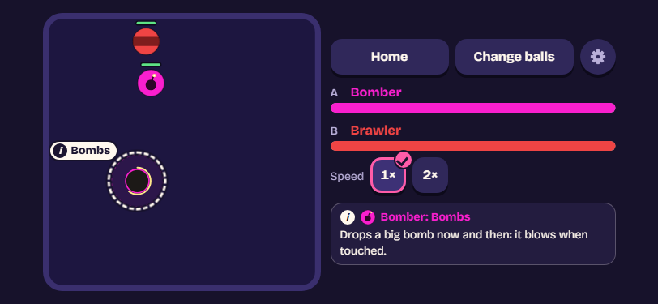                |
| 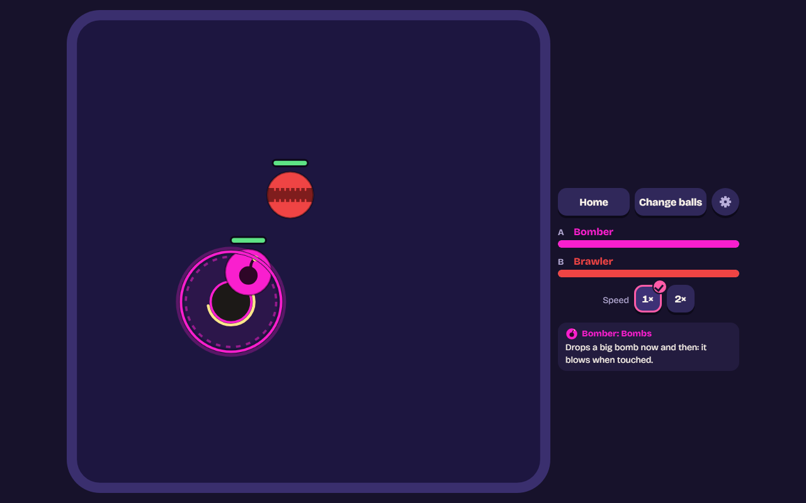       | 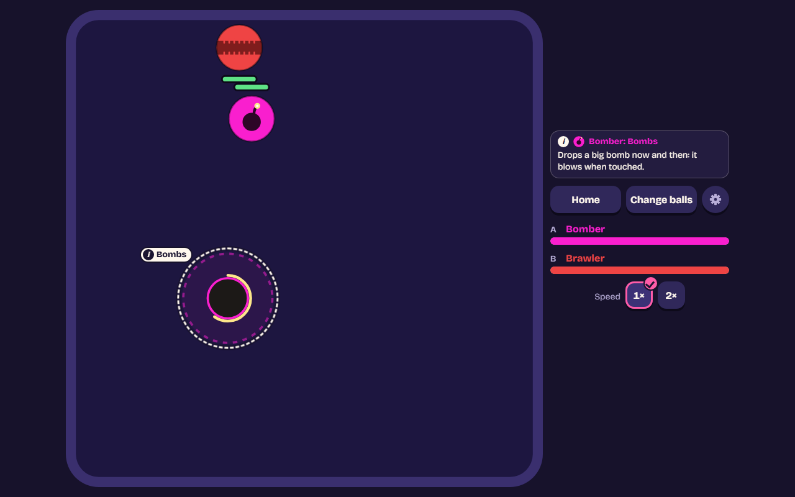 |
