# 0046: Reveal first on home, every other mode behind Other modes

- Status: Accepted
- Date: 2026-11-12
- Amends: ADR 0020 (§5 home), ADR 0027 (§3 Best of 3 leads home; Free play moves to Other modes),
  ADR 0035 (Reveal is the main mode, see its addendum; the level is also chosen on the lineup step)

## Context

Home's main button, **Best of 3 vs bot**, opened the rules step: three format cards, a level
choice, then **Choose lineup**. That is a decision a newcomer can't make well before playing, and
one the measurements have already made. The Best of 5 measurements (ADR 0035's addendum,
`docs/best-of-5-measurements.md` on `measure/best-of-5`) show Reveal has the biggest skill gap at
Best of 3 (12.5 points at Normal, against Showdown's 9.9 and Blind's 0), the most reads (half its
decisions answer a shown ball) and the most different bot levels. Free play, a test bench, sat as
one of home's two secondary buttons.

Presentation and routing only: `src/sim`, the bots, `RULESET_VERSION`, links already written and
`verifySeries` are unchanged.

## Decision

### 1. Home: Play, then Other modes and the manual

- **Play** (the primary button, focused on arrival) starts Best of 3, Reveal, against the bot in one
  tap. It goes straight to the lineup step (`?mode=bo3&fmt=reveal&step=lineup`), skipping the
  rules step. Under the word, one quiet line says what it plays: "Best of 3 · Reveal · vs bot".
  Its accessible name is "Play Best of 3, Reveal, against the bot".
- **Other modes** and **Ball manual** share the row under it. The live demo match, the pitch, the
  roster strip (desktop) and the gear stay as they were.
- The level is not on home. It is shown where it is used, on the lineup step (§3). Home stays one
  decision: play, or look at something else.

### 2. Other modes (`?view=modes`)

A screen of its own, with a header (‹, "Other modes", the gear; no `?`, as it shows no symbols)
and titled sections of cards. Each card is the mode's name, one line on how it plays and, where the
bot makes choices, the remembered level as a tag ("vs Normal bot"):

| Section          | Card      | Line                                        | Level |
| ---------------- | --------- | ------------------------------------------- | ----- |
| Best of 3 vs bot | Showdown  | Open together. Winners show, losers answer. | yes   |
|                  | Blind     | Set your order, then watch.                 | no    |
| One match        | Free play | Pick both balls and watch.                  | no    |

- A tap goes straight to that mode's setup: Showdown's or Blind's lineup step, or Free play's setup
  with the demo's pair (as home's Free play did, ADR 0020).
- **Showdown leads** Best of 3: it keeps the most skill after Reveal. **Blind** stays as it is, as
  the casual series; its line now says so plainly everywhere (the rules step's card too).
- **Built for Best of 5.** The screen renders `OTHER_MODE_SECTIONS` (`src/app/modes.ts`), a list of
  titled sections of modes. A Best of 5 is one more section ("Best of 5 vs bot") with its formats,
  plus a length on a series mode. On a phone sections stack; on a desktop each section spans one
  column per card in a three-column sheet, so Best of 3 and One match share a row and a third
  section starts the next.
- Reveal is not repeated here: it is home's Play. A card that duplicates the primary button would
  make the player wonder how they differ.

### 3. The lineup step says what it is for and shows the level

Home's one tap skips the rules step, so the lineup step now has a row under its header:
"Best of 3 · Reveal" on the left, and the level on the right as **vs Normal bot ▾**.

- The level is a disclosure. A tap opens Easy / Normal / Hard in place under the row (the same
  segmented control as the rules step); a choice saves it (`ballbattle.botLevel`), closes it and
  returns focus to the toggle. The toggle and Escape close it too (Escape only closes, ADR 0038).
- It is part of the screen, not a screen: no history entry, no URL change, so the Back rules are
  untouched and the player never leaves the flow.
- Blind shows the row without the level (no bot choices, ADR 0035).
- **Why a disclosure, not the segmented control always shown:** the lineup screen's job is the
  lineup (show less, ADR 0025); the level is a one-off choice most players make once, and its
  current value is still always visible. **Why not "vs Normal bot ›" to a screen of its own:** that
  would be a history step and a dead-end-shaped detour for a three-way choice. The ▾ says "opens
  here", where › means "goes somewhere".
- The rules step keeps its level choice. Both edit the one remembered level.

### 4. Back, and where each screen's parent is

All moves go through `navigation.go` and the one Back rule (ADR 0025); new keys and parents:

| From                                          | Browser Back / ‹ (came from in-app) | ‹ arriving from a link |
| --------------------------------------------- | ----------------------------------- | ---------------------- |
| Reveal lineup (from Play)                     | home                                | home                   |
| Other modes                                   | home                                | home                   |
| Showdown or Blind lineup (from Other modes)   | Other modes                         | Other modes            |
| Free play (from Other modes)                  | Other modes                         | home (unchanged)       |
| Any lineup reached from the rules step (link) | the rules step                      | as above               |

`lineupParentOf(format)` gives a lineup's parent: home for the main format, Other modes for the
rest. Other modes is a screen key of its own (`modes`), so moving into a mode and back is one push
and one return.

### 5. Old links and saved series

- `?mode=bo3` with any `fmt` and no step still opens the **rules step**, with that format chosen
  (`fmt=loser` still means Showdown, ADR 0035). It is now reached only from links.
- **A lineup URL's format is the URL's.** The setup used to keep the format on screen when a URL
  named none, so going from Reveal's lineup to Blind's (`?mode=bo3&step=lineup`, Blind has no
  `fmt=`) would have stayed in Reveal. Now no `fmt` means Blind, as everywhere else. Leave series,
  arriving from a link, now writes the series' format into the lineup URL it falls back to, so
  that path is unchanged.
- **The series URL clears `view=`.** `writeSeriesModeParams` deleted every match and series key but
  not `view`, so a series step written over Other modes' URL kept `view=modes` and reopened Other
  modes. Found by the new flow test before it shipped.
- Saved series and Resume (ADR 0042) are untouched: Resume shows on the lineup step, which is now
  one tap from home, and on the rules step for links.

### Options considered

- **The rules step with Reveal preselected.** Rejected: still a screen of choices between the
  player and their first lineup, with the format already decided.
- **The level on home** (a chip beside Play). Rejected: a second decision on the front door, and
  the level means nothing until the player is about to play.
- **A Resume button on home** when a series is held. Not added at first; added the same day (see
  the addendum).

### Browser and library behaviour relied on

- `history.pushState` / `popstate` through `navigation.go` (ADR 0025): unchanged; the new screen
  only adds a key.
- `localStorage` for the level: read through `loadBotLevel`'s try/catch (private windows, blocked
  storage fall back to Normal); written with `saveBotLevel`, which swallows a failure. Other modes
  reads it each time it opens, since the lineup step may have changed it.
- The `hidden` attribute is overridden by any `display` rule, so `.segmented` (display: flex)
  needs an explicit `[hidden] { display: none }` for the level options; `HTMLElement.hidden` is
  typed `boolean | 'until-found'`, so the code compares with `=== true`.
- WebKit's Back skips history entries a script added without user activation. Browser test files
  share a tab, so the flow makes its first entry with a real click, as a visitor's own visit is;
  otherwise its last Back skipped home and left the page. `history.length` is capped (50 in
  Chromium), so the flow checks history by where Back lands, never by counting entries.
- WebKit does not focus a button on click, so Escape is listened for on the document while the
  level choice is open (as the legend does), not on the toggle.
- `grid-column: span var(--modes-count)` and `repeat(var(--modes-count), …)`: a custom property
  set by script through `style.setProperty` (CSSOM, allowed by the page's CSP like the settings
  panel's placement).

## Tests

Each was seen failing on the code before the change.

- **`src/flows/home-modes-flow.ts`**, through the real page in Chromium, Firefox and WebKit at
  375 × 812 and 390 × 664 (touch), 1280 × 800 and 1920 × 1080 (`home-modes.*.browser.test.ts`):
  - one tap from home reaches Reveal's lineup with the remembered level (Hard), one history step;
  - the level opens in place, Easy is chosen, remembered, the URL and history unchanged, focus back
    on the toggle, and Escape closes it; round 1's bar then says "Best of 3 · Reveal · Easy";
  - Other modes shows its sections and cards, the level only on Showdown, side by side on a
    desktop, and reaches Showdown's lineup, Blind's lineup and Free play, each one step in and
    one Back (browser or ‹) out, then home;
  - every stop has one gear, an enabled control that moves on, and no sideways scroll;
  - old links: `?mode=bo3` (Blind), `fmt=showdown`, `fmt=loser` (Showdown) and `fmt=reveal` open
    the rules step; a lineup link with no format is Blind after Reveal's; a lineup reached by a
    link goes back to Other modes (Showdown) or home (Reveal);
  - a Reveal series left with Back is resumed from the lineup Play leads to.
- **Unit:** `modes.test.ts` (the main format and its URL, parents, every other mode exactly once,
  their order and sections, where the level applies), `modes-text.test.ts` (the words, lines of at
  most 7 words, Blind's line), `route.test.ts` (`?view=modes`), `history-rules.test.ts` (the key,
  home ⇄ Reveal lineup, Other modes ⇄ each mode).
- **`consistency-flow.ts`** now also stops on Other modes: its header sits where every setup
  screen's does, and its gear opens and closes four ways.
- Unchanged and passing: `no-dead-end.test.ts`, the reload flows (ADR 0042), the resume flow and
  the series link flow.

## Screenshots

Before and after, phone (375 × 812) and desktop (1920 × 1080), in `docs/decisions/0046/`:

| Screen                     | Before                                         | After                                                                           |
| -------------------------- | ---------------------------------------------- | ------------------------------------------------------------------------------- |
| Home, phone                | 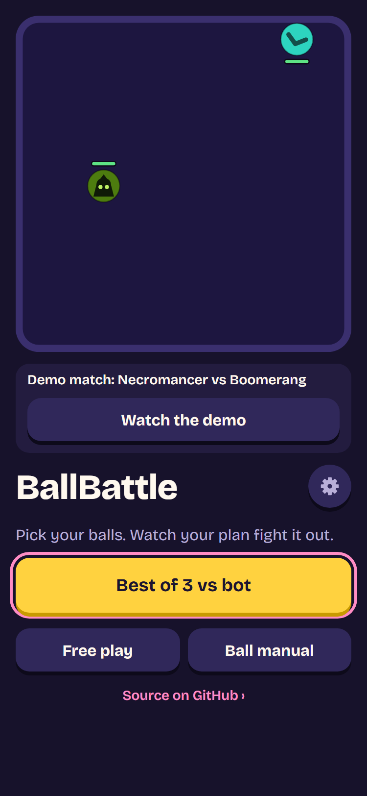                | 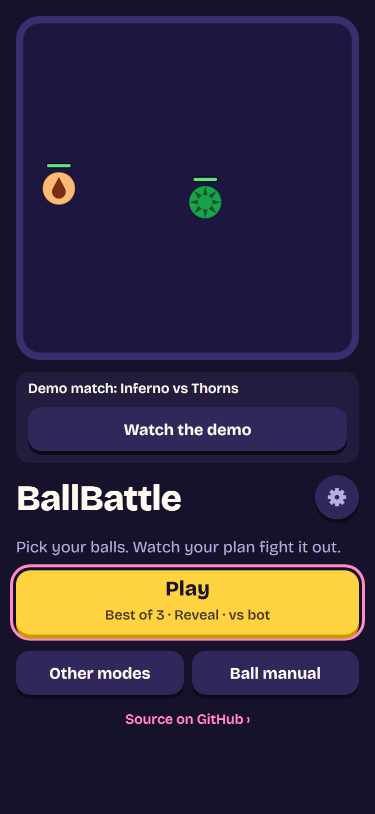                                                  |
| Home, desktop              | 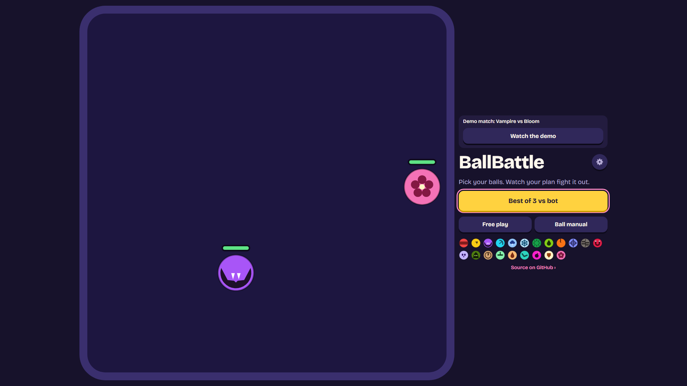              | 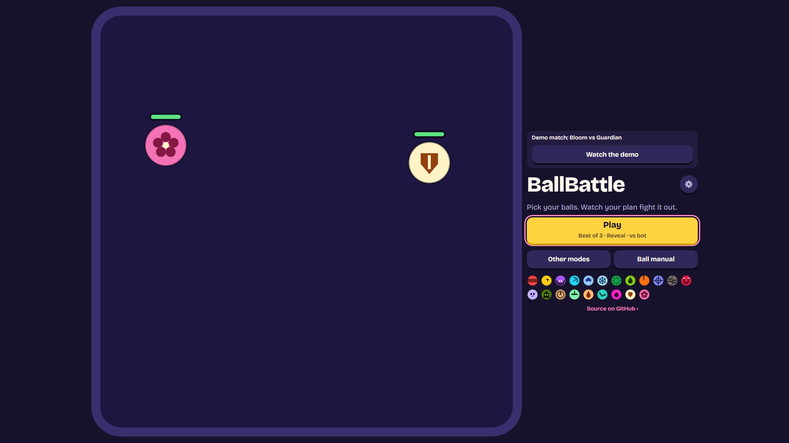                                                |
| Second screen, phone       | Rules step: 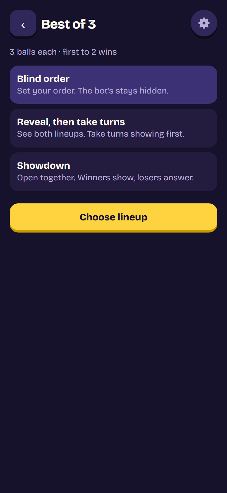   | Other modes: 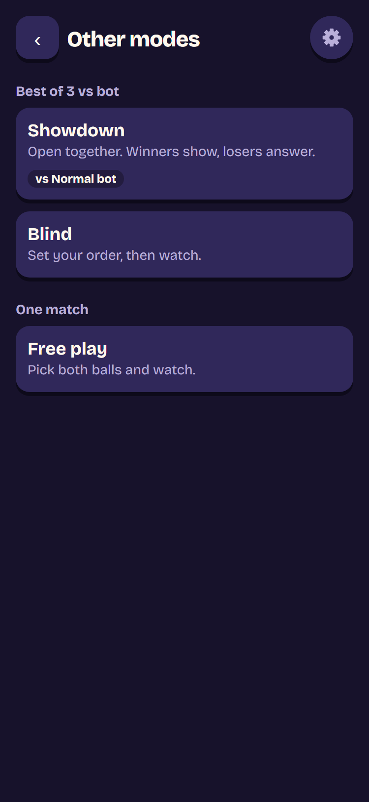                                    |
| Second screen, desktop     | Rules step: 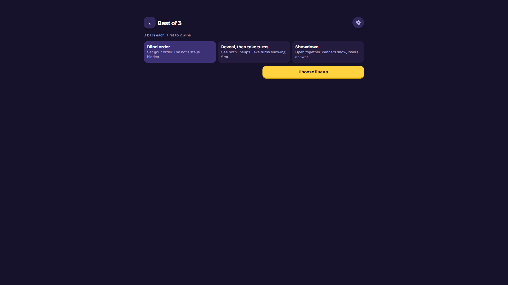 | Other modes: 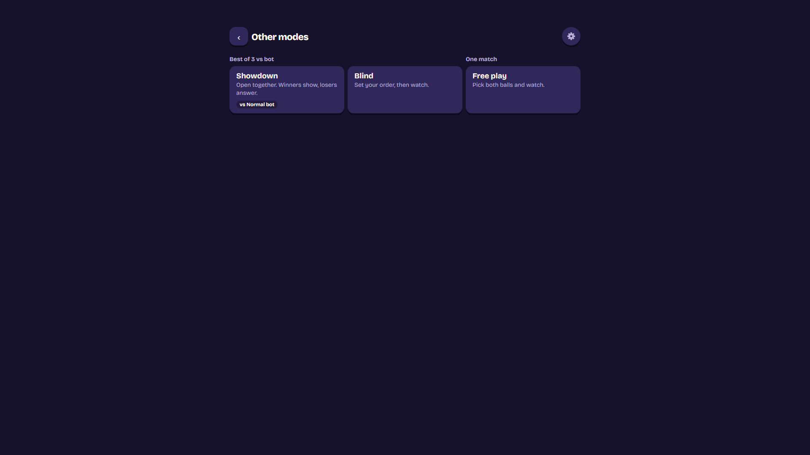                                  |
| Lineup, phone              | 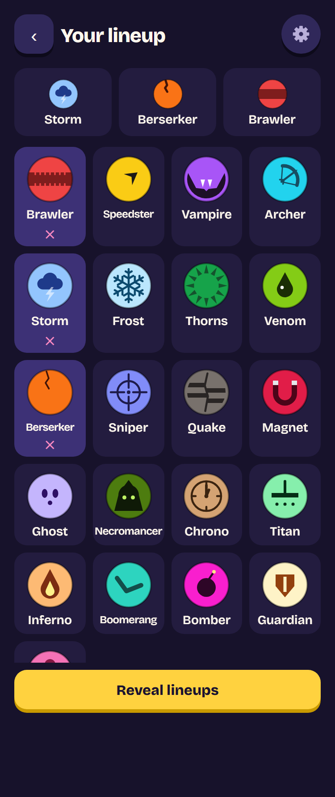              | 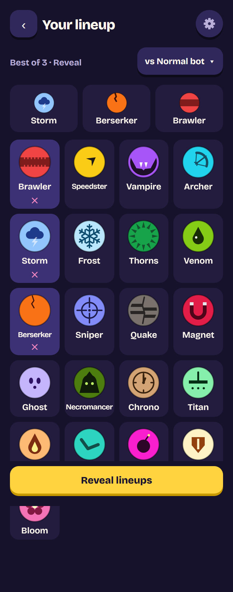                                                |
| Lineup, desktop            | 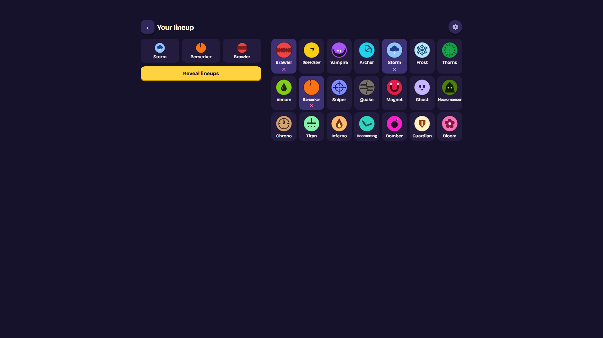            | 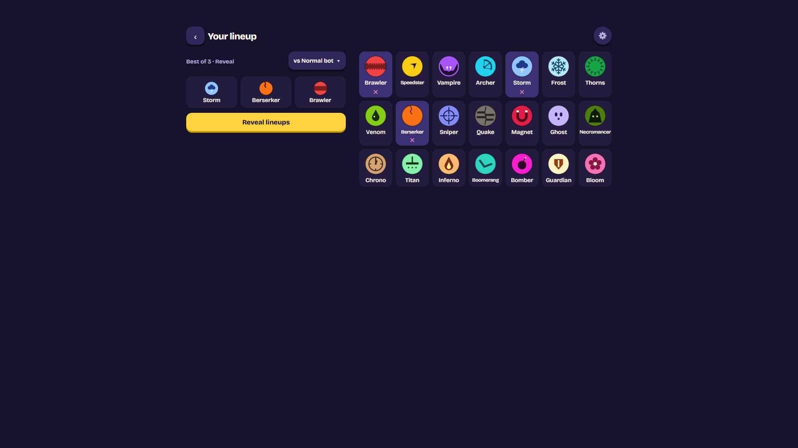                                              |
| Lineup with the level open | (none)                                         | 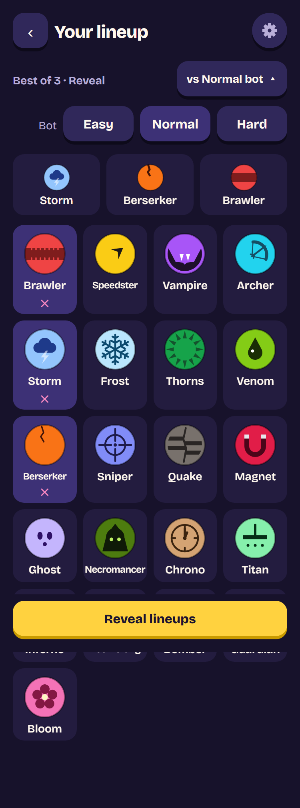 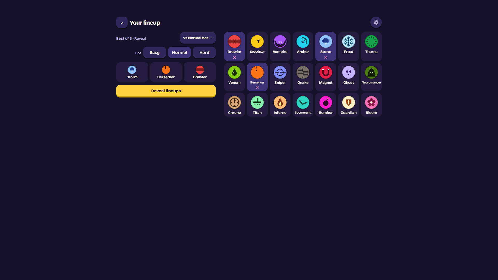 |

## Consequences

- Positive: a newcomer is one tap from building a lineup in the mode with the most skill, against a
  level they can see and change without leaving.
- Positive: every other way to play is one tap further, described in a line each, and the screen
  takes a Best of 5 as data.
- Positive: two latent URL bugs are fixed (a lineup URL's format, `view=` under a series URL).
- Negative: Showdown, Blind and Free play are one tap further from home than before.
- Negative: the lineup step on a phone is one row taller, so the grid starts about 60 px lower.
- Negative: the rules step is now reached only from older `?mode=bo3` links; it stays for them.

## Addendum (2026-11-12): home resumes a held series

A series left with Back, or put back after a reload (ADR 0042), was one tap further away than a new
one: Play, then Resume on the lineup.

- **While a series is held, home's main button is Resume series**, with the series' format and
  score under it ("Best of 3 · Reveal · You 1–0 Bot"; to a screen reader "Resume series: Best of
  3, Reveal, you 1, bot 0"). One tap carries on where it was, as the lineup's Resume does (the
  same `resume` in `series-screens.ts`). It takes focus, like Play.
- **A quiet "New series" link** sits under the button's end. It forgets the held series (as Leave
  series does, ADR 0042: a deliberate exit clears the save) and opens Reveal's lineup with nothing
  to resume. It is not asked twice: unlike Leave, it never sits by the in-fight controls, it is a
  small link apart from the big button, and the series lost is against the bot.
- **Held means undecided.** It is the controller's `held()`: an undecided series off screen,
  whether left with Back or saved before a reload. A decided series has nothing to resume, so home
  says Play.
- **Why under the button, not beside it:** beside it, the button would lose about a quarter of its
  width on a phone, and its line of format and score would wrap. Under its end it reads as the
  button's alternative without competing with it.
- **Tests** (`home-resume-flow.ts`, a framed page it can reload, in Chromium, Firefox and WebKit at
  375 × 812 and 1280 × 800), seen failing first (home said Play): with nothing held, Play and no
  New series; after round 1 of a Reveal series and two Backs, Resume series with the format and
  the score round 1 left, its spoken name, New series, and focus on it; one tap resumes between
  rounds with the same score, and Back returns home; after a reload the same, and Resume still
  carries on; New series clears the save, opens the lineup with no Resume card, and home says
  Play again, also after a reload. Unit tests cover the words.

| Phone                                 | Desktop                                 |
| ------------------------------------- | --------------------------------------- |
| 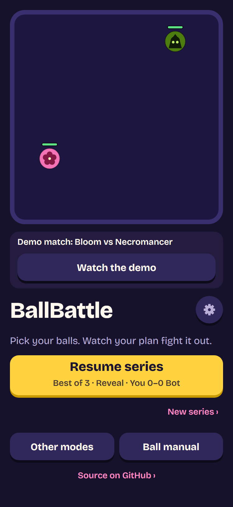 | 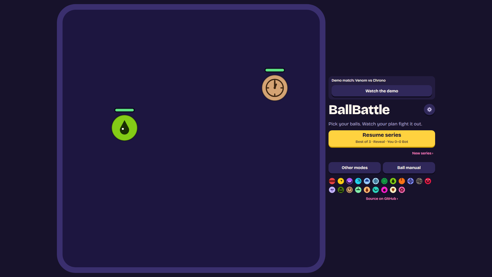 |
