# 0048: Best of 5, a longer series beside Best of 3

- Status: Accepted
- Date: 2026-11-13
- Amends: ADR 0017 (a series' length is part of its setup), ADR 0035 (Hard plays any length),
  ADR 0046 (§2: Other modes lists every format under a length choice)

## Context

The Best of 5 measurement (`docs/best-of-5-measurements.md`) found that a series of five balls,
first to three, roughly doubles what good drafting is worth (Reveal's skill gap goes from 11-12 to
20-23 points, Showdown's from 6-10 to 15-20), spreads the bot levels further apart (Reveal against
a random player: 3.6 to 6.4 points) and gives every lineup pair choices that matter, at about 2 min
45 s a series against 1 min 40 s. It recommended building it as a longer option, not a replacement:
Best of 3 stays the quick default on a phone.

## Decision

### 1. The rules: the same three formats, five balls, first to three

- **A series' length is part of its setup**: `SeriesSetup.bestOf` is `3 | 5`, and absent means 3,
  so every setup, link and save from before this ADR is a Best of 3 without a change. A Best of 3
  setup never writes the field. `LINEUP_SIZE` and `WINS_NEEDED` are gone; `bestOfOf(setup)` and
  `winsNeededOf(bestOf)` replace them.
- **Lineups of five, first to three.** The series stops the moment a side has three wins, so a 3-0
  never plays round 4 and a 3-1 never plays round 5. Draws replay on a new seed and three draws go to
  sudden death, in any round, exactly as before.
- **Blind:** both orders set before round 1, played in order.
- **Reveal:** the seeded coin toss (ADR 0029) picks who shows first in round 1, then the sides
  alternate: the toss winner shows first in rounds 1 and 3, the other side in rounds 2 and 4. Each
  side shows first twice, so it stays even. Round 5 is the ball each side has left (forced).
- **Showdown:** round 1 both pick at once; in rounds 2 to 4 the winner of the round before shows
  first and the loser answers; round 5 is forced.
- **Why five, not four:** every round uses a fresh ball and the last round is forced exactly as
  round 3 is now; four balls would need a repeat for a 2-2 decider (the measurement's reasoning).

### 2. The bots: Easy and Normal unchanged, Hard from the measurement

Easy and Normal choose the same way at any length. **Hard is the bot the measurement played**
(`scripts/best-of-n-bot.ts`), moved into the sim with two changes from the old Hard, nothing else:

- **Wins needed come from the series**: the bot's view carries `bestOf` (absent for a Best of 3,
  as before), and the Hard model's `Position` carries `winsNeeded`.
- **Positions are memoised for one choice** (`Memo` in `bot-model.ts`). A five-ball series meets
  the same position by many orders of play, too many to search afresh. The memo lives only as long
  as one choice: nothing is kept between series or shared between callers, so a server process that
  verifies many series holds no growing cache.
- **Showdown's opener solves the 5 × 5 game exactly** (`maximin.ts`): every square support of rows
  and columns. Up to 3 × 3 it keeps the exact small solver Best of 3 always used, so its choices are
  unchanged.

The bot's Best of 5 lineup is its Best of 3 lineup and two more draws from the same seeded stream.

**No `RULESET_VERSION` bump.** No fight, no Best of 3 bot choice and no Best of 3 series changes:
`ruleset.test.ts`'s fingerprint (every match, every bot's every kind of Best of 3 choice, a series
in every format) is still ruleset 12's. A first version derived the wins needed from the balls left
and the score, which moved the fingerprint: its synthetic views (three balls left after a round)
are not real Best of 3 positions. Passing the length explicitly is both exact and robust, and
the fingerprint came back unchanged. `scripts/best-of-n-bot.test.ts` checks the game's Hard against
the measured bot at Best of 5 (every role, scores 0-0 to 2-2).

### 3. verifySeries, links and saves

- `verifySeries` accepts Best of 3 or 5 and nothing else, checks both lineups have that many
  different balls, the bot's lineup at that length, every bot pick, and no pick missing or left over.
- **Links:** `mode=bo5` names a Best of 5 (`mode=bo3` is unchanged). A decided Best of 5 records 6
  to 8 picks (two for every round but the last, at least three rounds); a link with more is read as
  incomplete before replaying.
- **Saves:** a save carries `bestOf` only for a Best of 5; one without it restores as a Best of 3,
  and one whose length was changed is dropped (`verifySeries` refuses the series it describes). The
  lineup tray saves up to five slots.

### 4. Where it lives: a length choice on Other modes

- **Home is unchanged:** Play is still Best of 3, Reveal, against the remembered level, in one tap.
- **Other modes' series section is now "Series vs bot"**, headed by a segmented **Best of 3 | Best
  of 5** choice and the rule it plays by ("5 balls each · first to 3 wins"). Its cards are
  **Reveal, Showdown, Blind**; a tap opens that format's lineup at the chosen length.
- **The choice is remembered** on the device (`ballbattle.seriesLength`, `series-length.ts`), like
  the bot level: storage that is missing or throws only means Best of 3. Home's Play never reads it.
- **Reveal is now listed on Other modes**, amending ADR 0046 §2, which left it off as a duplicate of
  Play. At Best of 5 nothing else reaches it, and a card that appears and disappears as the length
  toggles would move the cards under the player's finger and hide where Reveal went. Listed always,
  the section reads as "choose a length, then a format"; at Best of 3 its card opens the same lineup
  Play does.
- **Back:** every Best of 5 lineup's parent is Other modes (`lineupParentOf(format, bestOf)`), Reveal's
  included; Best of 3 Reveal's is still home.
- The rules step (reached only from older `?mode=bo3` links, and now `?mode=bo5` ones) names the
  length in its heading and rule line. It has no length choice: a link names it.

### 5. The phone pick screen, phone first

The risk the measurement named: five of the player's balls against five of the bot's at 390 × 664.

- **The chart keeps every mark a 44 px tap target** (ADR 0037): five columns of 44 px. To make room
  for the player's balls, a chart with four or five columns (`pick-rows-wide`) closes the column
  gaps to 2 px and stacks each ball's name under a 28 px icon, on one line in the small type. The
  longest name (Necromancer) stays whole at 375 px, where beside the icon it broke mid-word
  ("Necr / oman / cer") in the first build. Rounds with three columns or fewer use the Best of 3
  layout, so a Best of 5's round 3 looks like any Best of 3 pick.
- **The page scrolls** for the last row or two and the key on a short phone, as the rules prefer to
  an inner scroll box; nothing scrolls sideways.
- **Desktop:** the pick column has room, so names sit beside their balls as in a Best of 3.
- **The lineup tray** puts five slots in one row (`lineup-tray-compact`): a filled slot shows its
  ball alone (its name is in its accessible name and under its tile in the grid), and an empty one
  says "Empty" (Reveal, Showdown) or "Slot 2" (Blind), short enough for a fifth of the row.
- **The track** shows five rounds; the bot's unplayed balls wrap into a small cluster in their
  column instead of widening it. Mid-fight the compact score line is unchanged ("Round 4 · You 2–1
  Bot ▾"); it opens the five-round track under the court, which scrolls the page (ADR 0039).

### Options considered

- **Best of 5 as more sections on Other modes** ("Best of 3 vs bot", "Best of 5 vs bot"), as ADR
  0046 sketched. Rejected: six series cards where three formats and one choice say the same, and
  the brief asked for a remembered length choice.
- **A length choice on the lineup step**, beside the level. Rejected: changing the length there
  would change the tray's size under a half-built lineup.
- **Icons only in the 5 × 5 chart's rows.** Rejected: the names are how a newcomer learns which
  ball is which; the stacked name costs no width.
- **Marks smaller than 44 px to keep names beside icons.** Rejected by ADR 0037: a mark a phone
  player must read is its own 44 px target.

### Library and browser behaviour relied on

- `localStorage` for the length, read and written in try/catch (private windows, blocked storage);
  the browser setup (`browser-setup.ts`) clears it before every test file, like the saved series.
- `URLSearchParams` for `mode=bo5`; parsing never throws, and an unknown mode is not a series.
- CSS `text-overflow: ellipsis` with `white-space: nowrap` on the stacked names: a last resort
  that the flow checks never applies to a roster name (`scrollWidth` against `clientWidth`).
- `Math.floor`, `Math.abs`, `Math.max` and `+ - * /` only in the new solver and model: exact in
  every engine (ADR 0001). The memo's key sorts ids with the default string sort, which is
  deterministic.

## Tests

Each new behaviour test was seen failing on the code before the change.

- **Rules** (`series-best-of-5.test.ts`): five-ball lineups, first to three, a 3-0 stops, a 2-2
  goes to round 5 with each side's last ball, draws and sudden death in round 4, Reveal's turns
  alternating from the toss for four rounds (Best of 3 still two), Showdown's winner showing first
  in rounds 2-4, the forced last round, the bot's five-ball lineup.
- **verifySeries** (`series-verify-best-of-5.test.ts`): every format against every level accepted
  with the state the game reached; lengths 4 and 7, a missing length on five balls and three balls
  in a Best of 5 refused; a reordered bot lineup, a swapped bot pick, a missing and an extra pick
  refused.
- **Hard** (`scripts/best-of-n-bot.test.ts`): the same weights and choices as the measured bot in
  Best of 5 positions; `ruleset.test.ts` unchanged at ruleset 12.
- **Links** (`series-url-best-of-5.test.ts`), **saves** (`series-save-best-of-5.test.ts`), the
  remembered length (`series-length.test.ts`), Other modes' data and words, the parent of each
  lineup, and **no dead ends** in a Best of 5 of every format (a narrower walk than Best of 3's,
  reaching every round, 3-0s and 3-2s).
- **Browser flow** (`best-of-5-flow.ts`, at 390 × 664 with touch and 1280 × 800, in Chromium,
  Firefox and WebKit): home to Other modes, Best of 5 chosen and remembered across a reload, each
  format's lineup with five slots in one row, the chart's 44 px marks and whole names, the score
  line and five-round track mid-fight with no sideways scroll, a reload and a Back with Resume
  between rounds 2 and 3, the series ending at three wins, the decided `mode=bo5` link replaying,
  and home's Play still Best of 3 Reveal.
- **Text fit** (`panel-parts-flow.ts`): the bar's longest line, "Best of 5 · Showdown · Hard",
  never breaks inside a phrase and fits on one line beside a fight on a desktop.

## Screenshots

At 390 × 664 (iPhone Safari with its toolbars, WebKit) and 1280 × 800 (Chromium), a Best of 5
Reveal against Hard:

| Screen            | Phone                                                               | Desktop                      |
| ----------------- | ------------------------------------------------------------------- | ---------------------------- |
| Other modes       | 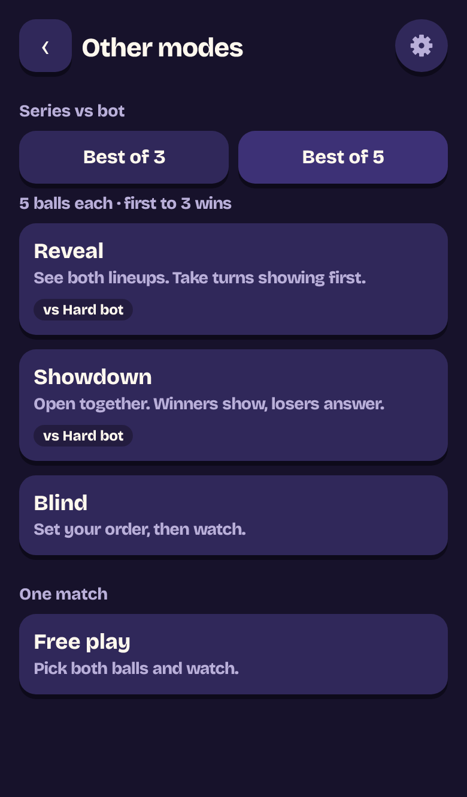                                           | 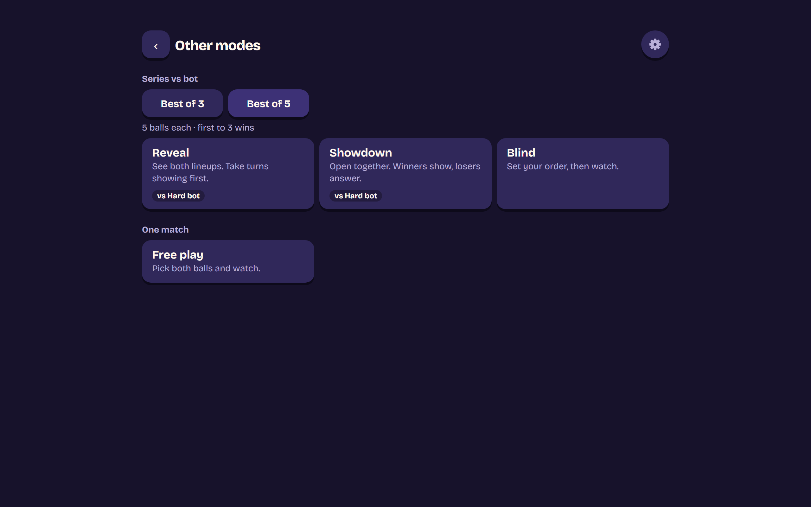  |
| Lineup            | 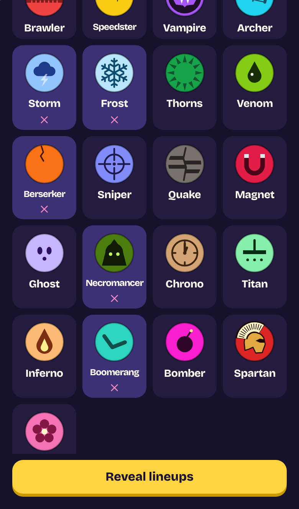                                          | 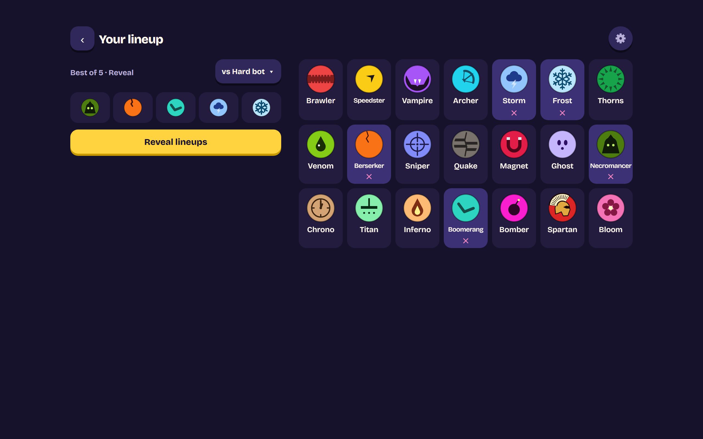 |
| Round 1 pick      | 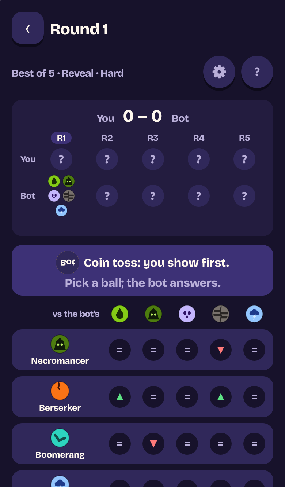 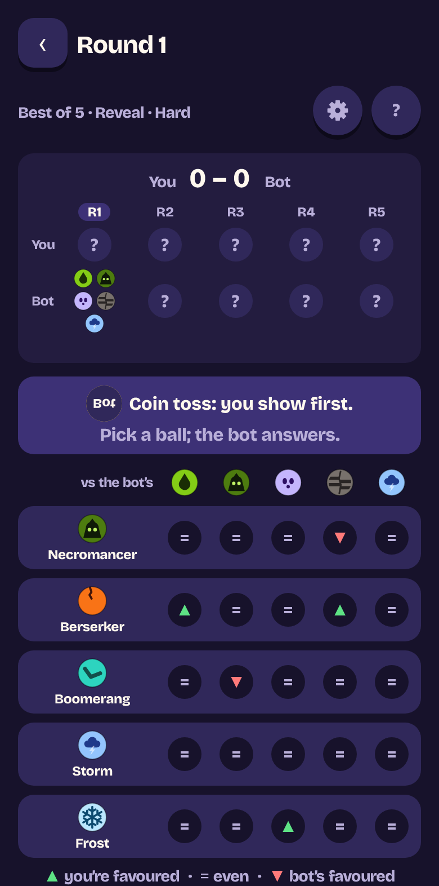    | 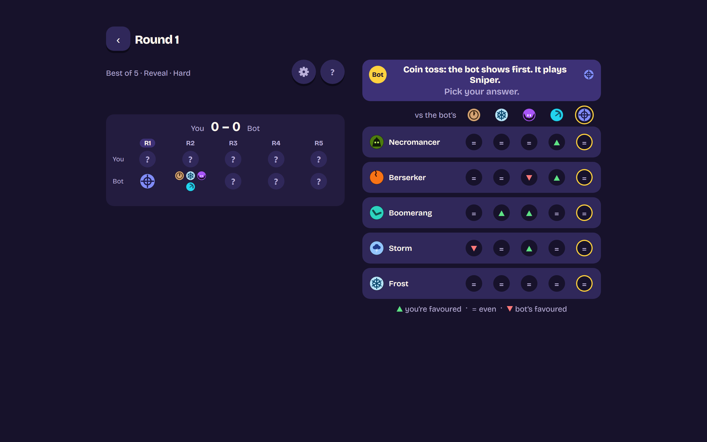   |
| Mid-fight         | 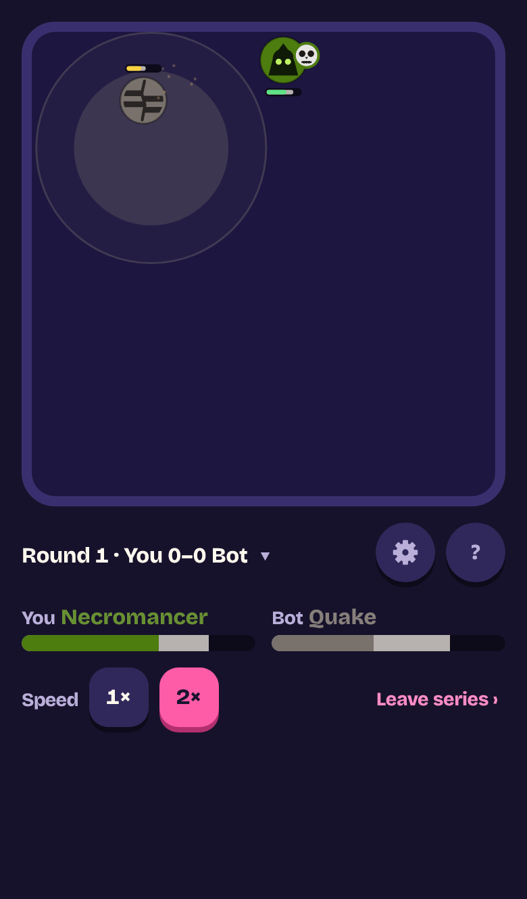 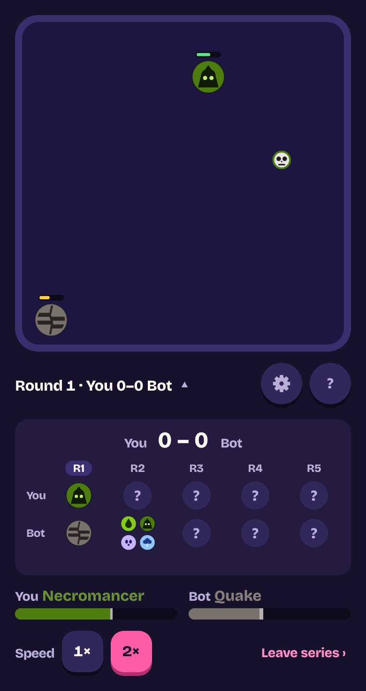 | 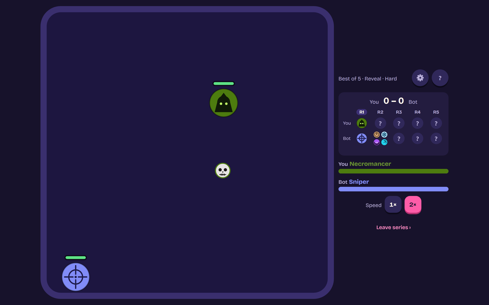  |
| End of the series | 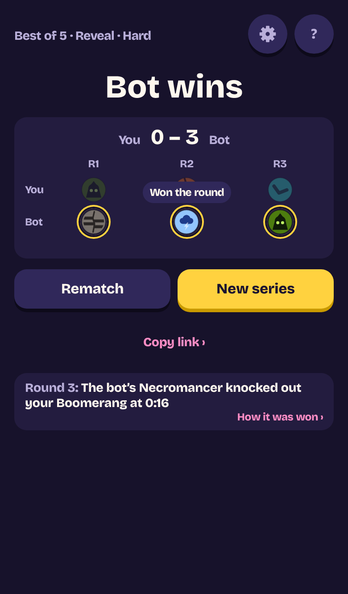                                          | 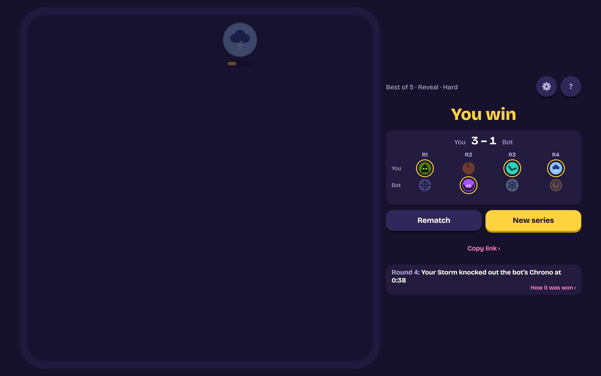 |

## Consequences

- Positive: a longer, more skilful series for players who want one, with every format, bot level,
  link, save and Resume working as they do for Best of 3.
- Positive: Best of 3 links, saves and every Best of 3 bot choice are unchanged, shown by the
  ruleset fingerprint.
- Negative: Reveal now appears twice for Best of 3 (Play and its card on Other modes).
- Negative: a Best of 5 pick screen on a short phone scrolls for its last rows; the browser suite
  takes a few minutes longer with whole Best of 5 series in three engines.
