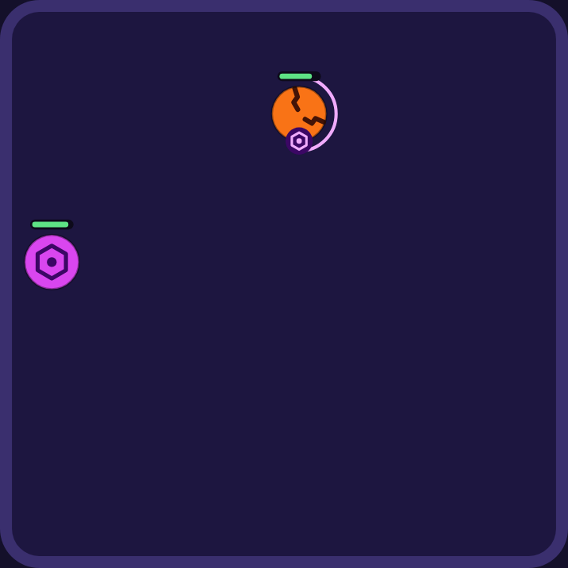
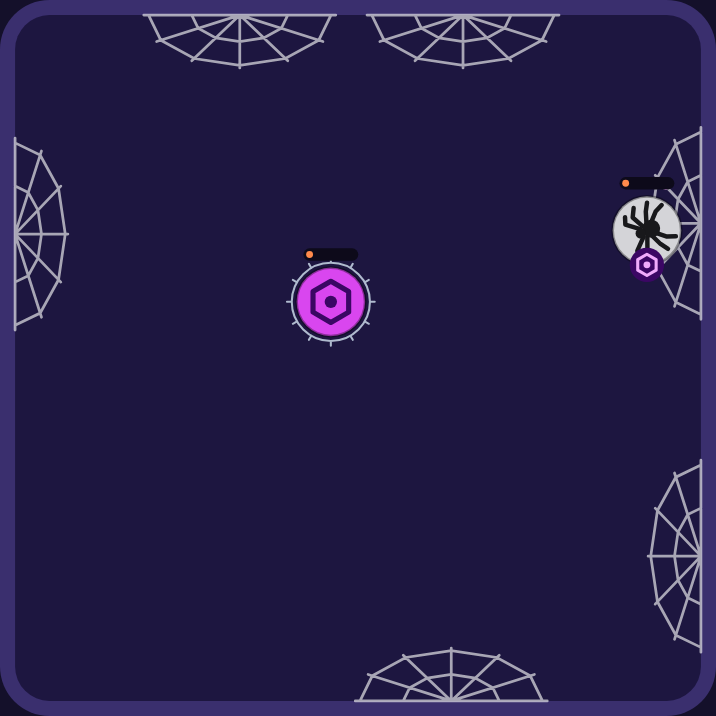
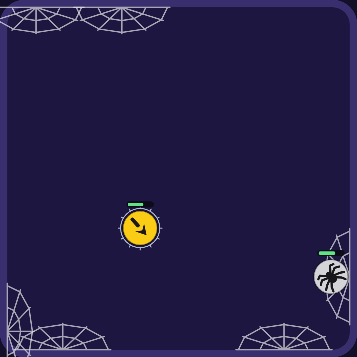

# 0049: The Hex, the Spider and the phasing Ghost (ruleset 13)

> **Scripts:** the measuring scripts this cites (under `scripts/`) were never merged to `main`: they
> lived on the experiment's own branch. The numbers here are the record.

- Status: Accepted
- Date: 2026-11-14
- Amends: ADR 0026 and 0028 (phasing is one rule: a phased ball is aimed at and pulled like any
  other), ADR 0045 (the Ghost's fade is replaced), ADR 0047 (the Spartan's known gap closes)
- Proposal: `docs/experiments/new-balls-proposal-3.md` (measured on `proto/hex-spider-ghost`, ruleset 12)

## Context

Round 3 of new balls proposed the Hex, the Spider, a timed-phasing Ghost and the lane fix. The
owner approved the three balls with the looks in the proposal and left the lane fix out (it stays
parked on `proto/contact-A`): on its own it knocked eight balls off their shape. The retune starts
from ruleset 12's numbers, so none of the proposal's lane-fix numbers carry over (the Storm's 76
health and 790 speed, the 1-health nudges on eleven balls). The Brawler beating nobody and the
Bloom beating too many were accepted up front; a Bloom rework comes next as its own job.

## Decision

### 1. The Hex: its bump curses

Its bump marks the other ball. 180 ticks (3 s) later the mark bursts for a quarter of that ball's
**full** health, rounded (`curseBurstFor`). A bump on a ball already marked does nothing; the
countdown keeps running. The burst is ability damage from its `onTick` hook, so it is no bump:
Thorns' spikes never answer it and a phased Ghost takes none of it. Big balls take big bursts (22
on the Berserker), frail ones small bursts (10 on the Vampire). 66 health, bump 15, speed 770.

Engine: hooks get a read-only `maxHealthOf(ball)`, read from the definition like `isPhased`.

Looks: fuchsia with a dark hexagon sigil and an open eye. The cursed ball wears the hexagon on a
dark badge at its lower edge (clear of its health bar) and a pale fuchsia ring that empties as the
burst comes, flickering in the last 0.6 s (steady with reduced motion; `src/render/curse.ts`).

### 2. The Spider: webs on the walls

Each wall it bounces off gets a web where it touched, reaching 140 each way along the wall. A ball
that bounces off a web takes 3 and is slowed (the Frost's slow) for 390 ticks (6.5 s), once per
bounce. Up to 6 webs, each lasting 720 ticks (12 s); a web spun again on the same stretch is moved
and renewed, not doubled. A phased ball slips through. 71 health, bump 18, speed 770.

Looks: silver with a dark spider seen from above, facing where it goes (a dark ball fails 3:1
against the court). Webs are fans of pale silk on the wall, under the balls, fading over their last
1.5 s (`src/render/webs.ts`); a caught ball shows the usual slow ring.

### 3. The Ghost phases on a rhythm, with a spectral hit

Phased for 60 ticks of every 240 (1 s in 4), from a seeded point in its rhythm. While phased
nothing touches it: it passes through balls, shots, skulls and bombs, and no hit of any kind lands
(`incomingDamageOf`, shown as the gold glance). Passing through a ball deals its spectral hit of
12, once per pass. 65 health, bump 22, speed 770. It replaces the fade of ADR 0045.

Phasing is now one rule for any ball that phases: the rules of ADR 0028 that a phased ball can't be
aimed at or gripped are removed (`nearestTarget` no longer filters it, the Magnet pulls it), and
shots pass through a phased ball instead of being used up on it (`projectiles/resolve.ts`,
`returning.ts`). With the old rules on, the Ghost measured the same within noise. The pass-through
property is unchanged: phasing never changes speed.

### 4. The retune, without the lane fix

Measured with the proposal's harness (`scripts/new-balls/` on the proto branch, with the lane fix
switched off), then confirmed by `pnpm balance` on this branch. With the three balls at their
proposal numbers and nothing else changed, six balls were off their shape: the Frost 1-3, Ghost
2-1, Chrono 4-5, Inferno 2-1, Bloom 7-4 and the Brawler 0-1. Four changes, one number each:

| Ball    | Was       | Now       | Why                                                                                                        |
| ------- | --------- | --------- | ---------------------------------------------------------------------------------------------------------- |
| Quake   | 71 health | 70 health | The Spider beats it (61.6 → 63.3%), and it no longer beats the Chrono (62.3 → 60.9%), so the Chrono is 4-4 |
| Frost   | 79 health | 80 health | It beats the Berserker again (62.2%): 2-3                                                                  |
| Spartan | 44 health | 45 health | It beats the Hex (63.5%): 2-2, closing its known gap                                                       |
| Inferno | speed 770 | speed 740 | The Hex beats it (62.2%), its second loss: 2-2 (still above the Frost's 720)                               |

Tried and dropped: a stronger Spider (72 health or bump 19: it beat everything or lost the Archer
win), a lighter Bloom (48 kept seven wins; 47 put Venom vs Bloom at 77.5%), a stronger Chrono (63:
the Speedster went 3-5), a shorter Hex fuse (165: the Hex went 5-3), and for the Ghost's second
loss: lower health and bump, less phasing, a slower or longer rhythm, faster or slower speed, a
stronger Bomber or Thorns. Every Ghost change left it 2-1 (or pushed Bloom vs Ghost toward 78%).

### 5. The roster's shape, and the exceptions

Three named exceptions change (`scripts/counter-map.ts`, `docs/vision.md`):

- **Ghost: one loss allowed.** While phased nothing touches it, so a quarter of every kind of hit
  misses alike, and only the Bloom's regrowth beats it.
- **Bloom: up to 7 wins (was 5), wins and losses within 3.** Its regrowth heals back hits that
  come in pieces, so it beats both new balls and the phasing Ghost. Accepted until its rework.
- **Brawler: beats nobody.** The even pick's listed win over the Ghost is gone; it is the plain
  default.
- **Removed: the Spartan's exception** (it is 2-2).

No other ball is off its shape. The Quake, Sniper, Storm, Titan, Bomber, Vampire and Berserker
keep their existing allowances, unchanged.

### 6. Text

The approved one-liners wrapped to three lines on the manual at 375 wide, so they are shortened to
fit two (`manual-text.touch.browser.test.ts`): the Hex "Its bump curses: 3 s later it takes a
quarter of its health.", the Spider "Its webs on the walls slow and nip balls that bounce off.",
the Ghost "Phases every 4 s: slips through all, hitting as it goes." Each ball's manual page gets
a folded **How it works** with the real rules and numbers, from a new optional `howItWorks` on the
definition, built from the constants the ability uses so it can't go stale. Any other ball can add
it later with no UI change.

## Measurements (500 seeds, `pnpm balance`)

| Gate                           | Ruleset 12 | Ruleset 13                     |
| ------------------------------ | ---------- | ------------------------------ |
| Each ball overall (45-55%)     | 45.6-52.6  | 45.8 (Speedster)-53.0 (Bomber) |
| Weakest side of any pair (22%) | 23.8       | 23.8                           |
| Highest counter (78%)          | 75.0       | 76.1 (Chrono vs Sniper)        |
| Median fight (12-30 s)         | 15.8 s     | 16.2 s                         |
| Draws (under 5%)               | 0.5%       | 0.5%                           |
| Comebacks (10-20%)             | 19.8%      | 18.9%                          |
| ±5% health (warn 15, fail 20)  | 11.7 pts   | 11.7 pts (Speedster vs Venom)  |
| Grey-zone pairs (warned)       | 40         | 44                             |
| Balls off their shape          | 0          | 0 (with the exceptions above)  |

| Ball   | Overall | Beats                                                    | Loses to                                           |
| ------ | ------: | -------------------------------------------------------- | -------------------------------------------------- |
| Hex    |   51.6% | Frost 69.0, Speedster 65.1, Berserker 64.3, Inferno 62.2 | Vampire 75.5, Bloom 71.2, Ghost 66.0, Spartan 63.5 |
| Spider |   47.7% | Speedster 73.9, Quake 63.3, Chrono 62.8                  | Bloom 67.6, Bomber 62.9, Archer 62.4               |
| Ghost  |   50.3% | Venom 70.9, Hex 66.0                                     | Bloom 73.9                                         |

The Spider keeps its Quake win (63.3%), filling the Quake's missing loss. The Hex's worst ±5% swing
is 10.4 points, the Spider's 11.4. Every pair's label in the counter map is the measured one; four
labels changed on existing pairs (the Ghost no longer loses to the Brawler and Frost nor beats the
Inferno; the Frost now beats the Berserker; Chrono vs Quake is even).

**Phone frames** (`scripts/frame-timing.ts`, 390 x 844, 2x, 4x CPU throttle; the Spider vs
Speedster with six webs, the Hex's bursts on the Berserker and among webs, the Ghost phasing
through the Boomerang and Venom): median 0.6 ms, p95 0.9 ms at 60, 90 and 120 Hz. Every frame
during the fights is under 12 ms. One frame per match goes over 16.7 ms (22-37 ms, growing with
the match's length): the finish, which is the same in matches without any of the new balls (Brawler
vs Storm 24 ms, Titan vs Vampire 22 ms), so it is not from this change; it is recorded as a
follow-up. The script now presses Fight! first: since the ready card (ADR 0037) it had been timing
an idle card.

| Hex curse                     | Last stretch                               | Spider webs                     | Ghost phasing                     |
| ----------------------------- | ------------------------------------------ | ------------------------------- | --------------------------------- |
|  |  |  |  |

Real match moments drawn by the game's renderer on a 358 px court (a 390 px iPhone). The manual's
How it works at 390 wide: [Hex](0049/manual-hex-phone.png),
[Spider](0049/manual-spider-phone.png), [Ghost](0049/manual-ghost-phone.png).

## Consequences

- 23 balls. Links from ruleset 12 and older show the older-version notice (ADR 0022).
- The Spider makes contact fights better to watch: against it, fights with a 10 s+ stretch with
  no damage fall from 32% to 4% (proposal, section 5).
- The Bloom beats seven; its rework is the next balance job (`docs/vision.md`).
- The lane fix still needs its own retune before it can ship.
