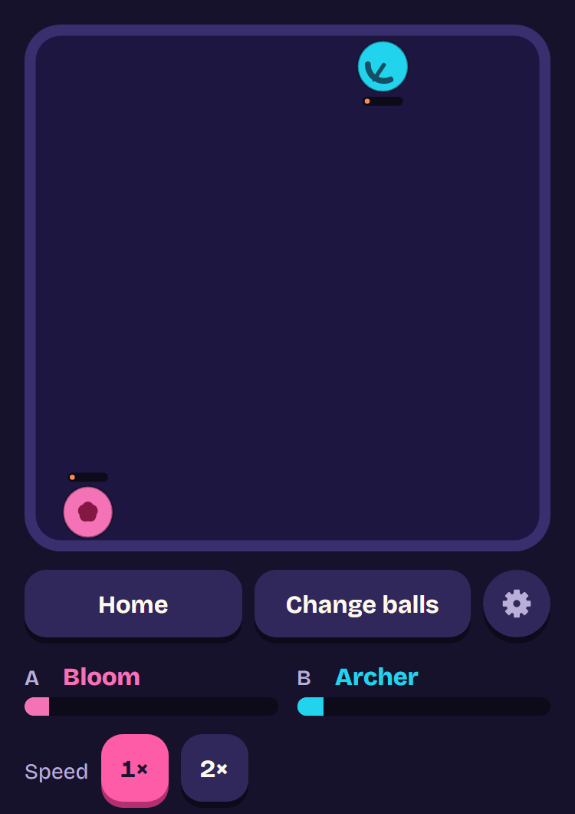
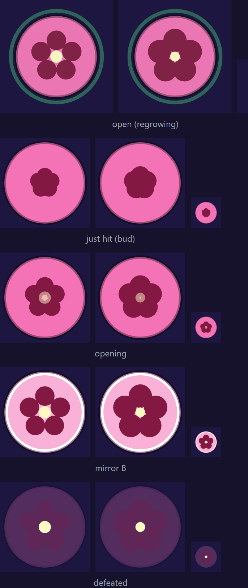

# 0050: The Bloom's patient regrowth, and the Glitch parked (ruleset 14)

- Status: Accepted
- Date: 2026-11-14
- Amends: ADR 0047 (the Bloom's pause after a hit becomes a wait before it regrows), ADR 0049 (the
  Bloom's "up to 7 wins" allowance; the Titan's speed)
- Proposal: `docs/bloom-glitch-proposal.md` on `proto/bloom-glitch` (measured at ruleset 13)

## Context

ADR 0049 accepted the Bloom beating seven balls until its rework. Its regrowth ran all match long
and paused for a second after each hit, so it healed back anything that came in pieces, including
both new balls of ADR 0049 and the phasing Ghost. The rework proposal measured two things together:
a patient Bloom, and a new ball, the Glitch, whose bump switched the other ball's ability off for a
few seconds. The owner approved the Bloom on its own and asked for the Glitch to be parked.

## Decision

### 1. The Bloom regrows only after 2 s untouched

It regrows 1 health every 12 ticks (5 a second), but only once nothing has hit it for 120 ticks
(2 s). Any hit, of any kind (a bump, a shot, a burn, a poison tick, a curse's burst), starts the
wait again. It is the same rule as before with longer numbers (`PAUSE_TICKS` 60 → 120,
`HEAL_EVERY_TICKS` 17 → 12), so no engine change. 52 health (was 49), speed 780 (was 760), bump 21.

One-liner: "Regrows once left alone for 2 s; any hit makes it wait again." Its manual page's "How
it works" is built from the same constants.

**Looks.** A hit closes it into a bud that stays fully shut for the whole wait and opens over the
last third of a second (`REOPEN_TICKS` 10 → 20), so a player can see when it is about to regrow.
Every regrowth is still the heal pulse.

### 2. The Titan: speed 740 → 750

The Titan's one win is the Bloom. At its proposed numbers the pair measured exactly 62.0% at 500
seeds, but 57.3% on CI's 150 seeds (seeds 0-149), so the Titan would have had no win in CI's check.
Seven single-number nudges were measured in memory (`playPair` with an overridden roster, so no
file changed during a run) on every Bloom and Titan pair:

| Nudge               | Titan vs Bloom (500 / 150) | Problem                                         |
| ------------------- | -------------------------- | ----------------------------------------------- |
| None                | 62.0 / 57.3                | Under 62% in CI's check                         |
| Bloom 51 health     | 63.6 / 59.7                | Still under in CI's check                       |
| Bloom 50 health     | 65.2 / 61.7                | Loses its Chrono win; Vampire, Bomber beat it   |
| Bloom bump 20.5     | 64.7 / 61.0                | Under in CI's check; Vampire, Bomber beat it    |
| Bloom speed 770     | 60.4 / 60.3                | Worse                                           |
| Bloom speed 760     | 63.8 / 66.0                | Vampire beats it 62.0: a sixth loss             |
| Titan bump 14.75    | 63.5 / 59.7                | Under in CI's check                             |
| **Titan speed 750** | **65.9 / 69.7**            | None: no other Titan or Bloom pair changes side |

A slightly faster Titan meets the Bloom more often in its grown second half, which is the
mechanical reason the pair exists. Its loss to Thorns stays (65.8% at 500, 62.0% at 150), and no
other Titan pair crosses 62%. The Titan stays one of the slower balls (the Frost is still the
slowest at 720).

### 3. The roster's shape, and the exceptions

The Bloom beats the Berserker, Frost, Ghost and Chrono and loses to the Archer, Boomerang, Inferno,
Venom and Titan: 4-5. Its pairs with the Hex, Spider and Necromancer are now even, and the Inferno
now beats it (its patches burn every half second, so the bud never opens).

- **Bloom: up to 5 losses** replaces "up to 7 wins, within 3": 2-4 wins as usual, 2-5 losses, the
  two within 1 (today 4-5). An allowance now caps wins and losses separately (addendum below), so
  this allows no extra wins. The reason, in
  `scripts/counter-map.ts` and `docs/vision.md`: it regrows only after 2 s untouched, so every ball
  that hits it often wins.
- The Ghost's "one loss" (still the Bloom) and the Brawler's "beats nobody" are unchanged, as are
  the Storm, Titan, Bomber, Berserker, Sniper, Quake and Vampire allowances. No new exception.
- Thin pairs: Frost > Berserker 62.2% and Hex > Inferno 62.2%, unchanged.

Every Bloom pair's label in the counter map is the measured one, with reasons that name the wait.

### 4. The Glitch is parked

The Glitch did not ship, for three reasons measured in the proposal (about 60 configurations):

- **Switching abilities off turns fights into plain stat checks.** With the other ball's ability
  off, the Glitch beats whoever is light and loses to whoever is heavy. Its counters came from
  stats, not from a mechanic a player can watch, against ADR 0010 and 0045.
- **It never beat the phasing Ghost** (54.9% for the Ghost at best). A phased Ghost can't be
  glitched, and solid it is the Glitch's match, so it could not fill the Ghost's known gap.
- **It knocked other balls off their shape.** The closest config (62 health, bump 24, 4 s) put the
  Thorns, Sniper, Speedster and Magnet off shape; stronger configs won nine or more pairs.

Its engine work is kept on `proto/bloom-glitch` (committed, not merged): the glitch status and the
ability clock, a per-ball tick less the ticks its ability was off, through which every cooldown,
rhythm and countdown pauses and the renderer draws paused timers paused. It adds nothing to fights
without a glitch, so it waits there for a future stun or silence ball (`docs/vision.md`).

## Measurements (500 seeds, `pnpm balance`)

| Gate                           | Ruleset 13                     | Ruleset 14                     |
| ------------------------------ | ------------------------------ | ------------------------------ |
| Each ball overall (45-55%)     | 45.8 (Speedster)-53.0 (Bomber) | 45.8 (Speedster)-53.3 (Bomber) |
| Weakest side of any pair (22%) | 23.8                           | 23.8                           |
| Highest counter (78%)          | 76.1 (Chrono vs Sniper)        | 76.1 (Chrono vs Sniper)        |
| Median fight (12-30 s)         | 16.2 s                         | 16.2 s                         |
| Draws (under 5%)               | 0.5%                           | 0.5%                           |
| Comebacks (10-20%)             | 18.9%                          | 18.7%                          |
| ±5% health (warn 15, fail 20)  | 11.7 pts                       | 11.7 pts                       |
| Grey-zone pairs (warned)       | 44                             | 46                             |
| Balls off their shape          | 0                              | 0 (with the exceptions above)  |

CI's check (`pnpm balance:ci`, 150 seeds) passes with Titan vs Bloom at 69.7%.

| Ball  | Overall | Beats                                               | Loses to                                                          |
| ----- | ------: | --------------------------------------------------- | ----------------------------------------------------------------- |
| Bloom |   49.0% | Berserker 72.0, Frost 70.6, Ghost 68.5, Chrono 64.8 | Archer 73.8, Boomerang 73.1, Inferno 72.6, Venom 67.9, Titan 65.9 |
| Titan |   50.0% | Bloom 65.9                                          | Thorns 65.8                                                       |

The Bloom regrows 33 health a match on average (64% of its maximum). Bloom vs Thorns (59.5% for
the Bloom), Speedster (58.6%) and the Vampire and Bomber pairs (60-61% against it) sit in the grey
zone.

| Mid-fight on a phone (375 wide, 2x): Bloom vs Archer, a shut bud | The style guide's Bloom tiles at phone width |
| ---------------------------------------------------------------- | -------------------------------------------- |
|                                    |               |

## Addendum: wins and losses capped separately (2026-11-14)

A shape allowance (`ShapeAllowance` in `scripts/counter-map.ts`) now has its own range of wins and
of losses, plus the gap between them. Before, one range applied to both sides, so the Bloom's "up to
5 losses" also let it beat five. Now it is 2-4 wins and 2-5 losses. Every other exception keeps the
same range on both sides, exactly as before (pinned in `counter-map.test.ts`). No sim change and no
ruleset bump: only the check and the summary's gaps table changed.
