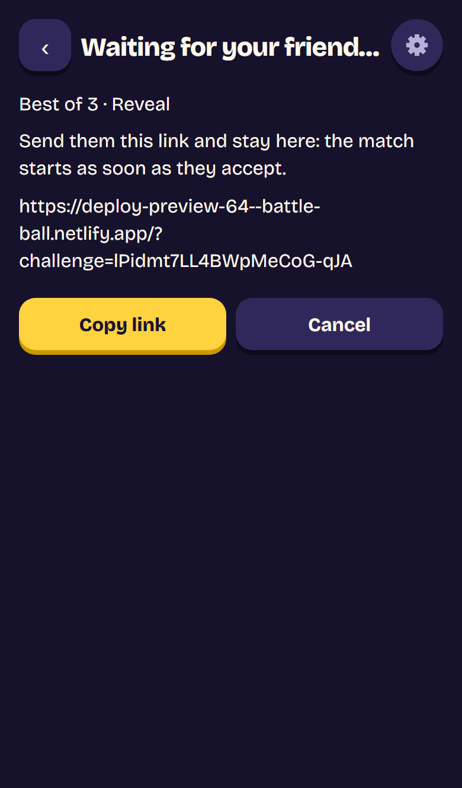
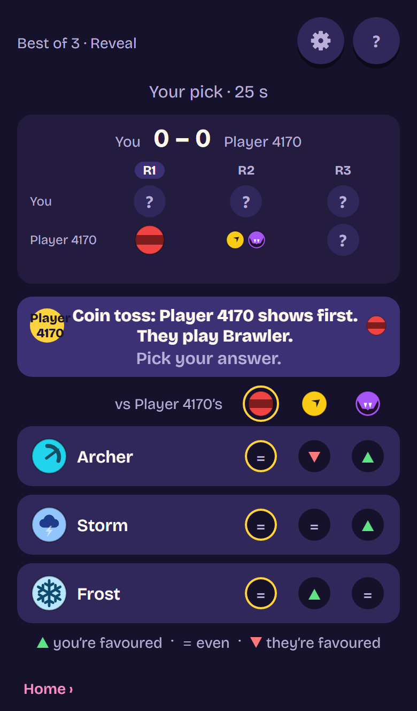
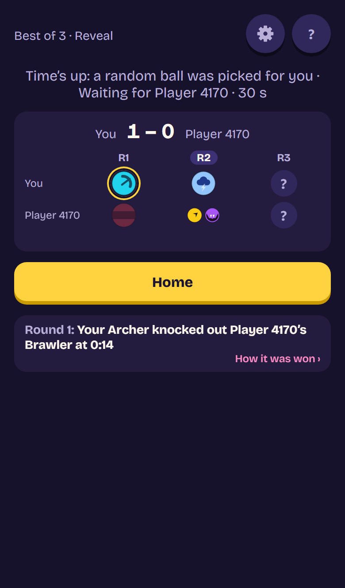
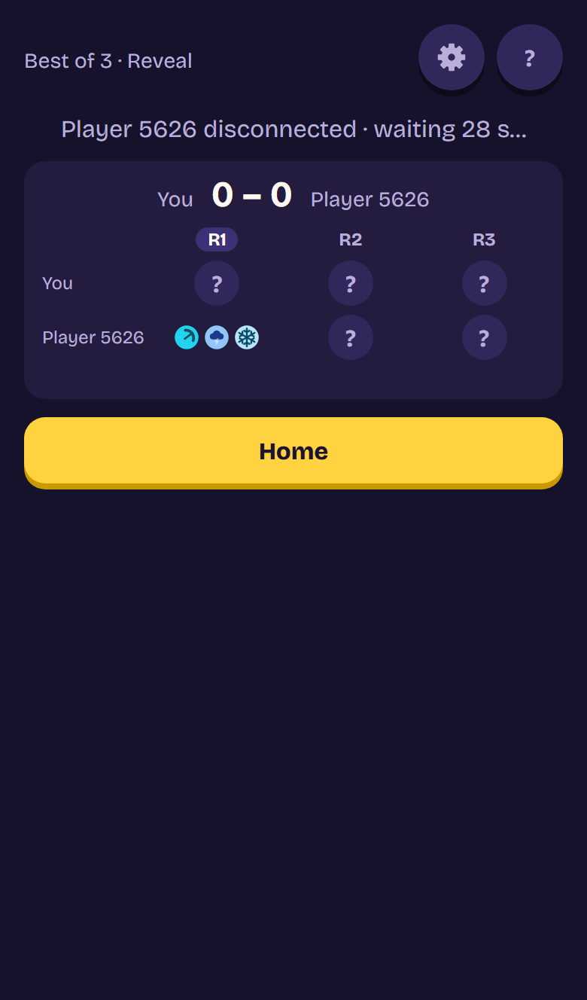

# 0053: Live friend matches

- Status: Accepted (2026-11-15), with the owner's decisions below. Prototyped on
  `proto/live-friend-matches` (draft PR #64, closed unmerged) and measured on staging, then
  rebuilt on `main` in four pull requests (build plan, below).
- Date: 2026-11-15
- Builds on: ADR 0052 (the series machine, friend challenges, `viewOf`, settle on read), ADR 0051
  (secret seeds, commitments, frozen rulesets), ADR 0007 (presentation time), ADR 0027 (no dead ends)
- Amends: ADR 0052 section 3 ("Live PvP later is the same machine with short timers"): it comes
  now, for friend challenges, and play by turns is hidden (kept in the code)

## Context

Friend challenges work end to end on staging, but play by turns is wrong for a friend you have
just sent a link to: one phone watched rounds before the PC did, and nobody is in the match
together. The owner wants live friend matches: both players in the match until it ends, and a
player who leaves loses.

What the owner asked for, as starting points:

- a lobby: "Waiting for your friend…" with the link and Cancel; both go straight in on accept;
- about 30 s per pick, and a random remaining ball when it runs out;
- fights that start at the same moment on both screens, set by the server from database time; the
  next pick opens only after the fight has played on both, and the speed setting can't let one
  player see a result first;
- "Leave and forfeit?" on leaving; "Opponent disconnected, waiting 30 s…" on a drop, a resume if
  they return in time, a forfeit if not;
- the fair-play check, secret seeds and frozen rulesets exactly as they are;
- play by turns kept in the code, hidden.

## What the prototype proved (staging, 2026-11-15)

Two Chromium contexts at 390 × 664 on one PC in New South Wales, against deploy preview 64
(functions in Ohio, database in Sydney: ADR 0052, "functions region"). Script:
`scripts/proto/live-run.ts`. Every run used polling through the existing `/api/v1` routes.

| Run                       | Length | Requests (both players) | Fights | Fight start gap (ms) | Pick → other screen (ms)                        |
| ------------------------- | ------ | ----------------------- | ------ | -------------------- | ----------------------------------------------- |
| Best of 3                 | 194 s  | 141                     | 3      | 47, 60, 153          | 2,047, 3,065                                    |
| Best of 5                 | 281 s  | 235                     | 5      | 250, 40, 37, 160, 34 | 2,049, 1,763, 2,327, 1,308, 2,492, 1,418, 2,541 |
| Best of 3, friend +300 ms | 163 s  | 172                     | 2      | 210, 16              | 1,462, 2,064                                    |

- **Fights start together:** 10 fights, median about 55 ms apart, worst 250 ms. About 200 ms of
  that is the prototype checking the clock every 200 ms; a timer set for the exact moment leaves
  only the clock estimate's error.
- **The clock offset matters:** this PC's clock was 2.97 s off the database's. Without the offset
  estimate (below) two players' fights would start as far apart as their clocks are wrong.
- **A pick reaches the other screen in 1.3-3.1 s** (median about 2.0 s): the pick itself takes
  1.0-1.6 s (four round trips Ohio↔Sydney), then up to one poll period (1 s plus a 0.63 s read)
  before the other page asks.
- **A read takes 630 ms** at the median (p90 700-820 ms, worst 3.3 s on a cold function), all of it
  Ohio↔Sydney.
- **Lobby to match:** 4.2-6.6 s from the friend's Accept to both pages in the series.
- **A pick timer running out** made a random pick for the friend each time, shown as "Time's up: a
  random ball was picked for you".
- **Disconnect:** the other page showed "disconnected" about 6 s after the last heartbeat; a friend
  offline for 14 s came back to the same match; offline for good, the series was settled as a
  forfeit 36 s after the last heartbeat (the winner's page showed it at 54 s, after a round
  already scheduled had played out).

Shortcuts the prototype took, which the real build doesn't: presence in `profiles.last_seen_at`
(one player, one live series), every friend series live, fight lengths replayed and cached per
function instance, Fight! pressed by finding the button, a reconnect mid-fight restarts the fight,
and no "Leave and forfeit?".

| Lobby                                                       | Pick timer                                             | Time ran out                                          | Opponent disconnected                                                 |
| ----------------------------------------------------------- | ------------------------------------------------------ | ----------------------------------------------------- | --------------------------------------------------------------------- |
|  |  |  |  |

## Decision

### The flow, from both sides

**The sender (side A)**

1. Other modes → Online → length → format → lineup → **Send challenge**.
2. **Lobby**: "Waiting for your friend…", the format, the link, Share (or Copy) and **Cancel**. The
   page asks every 2 s (each ask is a heartbeat). Cancel expires the link and goes home.
3. The friend accepts: the page goes straight to the series.

**The friend (side B)**

1. Opens the link: the card names the sender and says "You play live: 30 s a pick". If the sender
   left the lobby more than 60 s ago, the card says "{name} stopped waiting" and offers a
   challenge of their own (no dead end).
2. Lineup without seeing theirs → **Accept challenge** → the series.

**Both, in the series**

1. **Start:** both pages arrive; the first pick's 30 s start once both have been heard from, or
   after a 60 s start window (whoever hasn't arrived loses by forfeit, so a sender stuck in a share
   sheet has a minute).
2. **Pick phase:** "Your pick · 26 s" or "Waiting for Player 4821 · 26 s". Reveal shows and
   answers by turns; Showdown's opener is simultaneous; Blind is lineups only (see decision 4).
3. **Fight:** when a round's picks are complete, the server schedules its Fight! 3 s later. Both
   pages show the pairing on the ready card with "Fight in 3…", and start at the same moment.
   Drawn rounds replay straight on. No Play round button.
4. **Next pick** opens at the server's time for the end of the fight, on both screens at once.
5. **End:** the result and the fair-play ✓, exactly as now.

**Leaving:** Home or Back mid-series asks "Leave and forfeit?" (Stay / Leave). Leave forfeits at
once (`POST /series/:id/forfeit`). Closing the tab is a disconnect.

**Disconnects:** after 6 s without a heartbeat the other player sees "{name} disconnected ·
waiting 24 s…". Back within the grace, the match carries on where it is (a fight under way is
picked up at the point it has reached). Not back: "{name} left the match. You win." Timers don't
pause: a pick that runs out while its player is away is still made at random.

### Timers and grace periods

| Timer          | Value                                  | Why                                                                                                                                                       |
| -------------- | -------------------------------------- | --------------------------------------------------------------------------------------------------------------------------------------------------------- |
| Pick           | 30 s                                   | An answer in Reveal means reading the shown ball and three odds; 30 s leaves time for that plus a slow pick (1.6 s) and keeps a Bo5 under about 6 minutes |
| Lead to Fight! | 3 s                                    | The other page learns of the lock within one poll (≤ 1.6 s) plus a read (≤ 0.8 s at p90); 3 s covers it, and reads as a countdown                         |
| Away after     | 6 s                                    | Four missed polls. The slowest read measured (3.3 s, a cold function) can't trigger it                                                                    |
| Grace          | 30 s                                   | A lift, a tunnel, switching apps to answer a message. Capped at 60 s in all per player per match, so dropping on purpose can't stall a match              |
| Start window   | 60 s                                   | The sender may be in a share sheet or a chat app when the friend accepts; iOS suspends a backgrounded page                                                |
| Lobby          | Live while heard from in the last 60 s | A link whose sender has gone isn't offered as live. It still expires after 7 days                                                                         |

All times are database time (`now()`), as ADR 0051 item 7 asks; a page only shows countdowns.

### Fights at the same moment, and nobody sees a result early

- **The server sets each round's Fight!:** `fight_at = the lock that completed it + 3 s` (or the end
  of the round before, plus 3 s, for Reveal's last round, which needs no pick).
- **Each page knows the database's clock:** every answer carries `X-Now` (database time, 304s
  included). The page keeps the offset from the answer with the shortest round trip of its last
  12 (as NTP does), so the error is at most half that round trip and mostly cancels between two
  players.
- **The next pick opens at `ends_at`:** `fight_at` plus the round's watching time at normal speed,
  stored with the round when the server plays it (`fight_ms`: every attempt's ticks, plus the
  intro, the knockout and an 8% allowance for hit-stops and slow-mo). A test checks it is never
  shorter than the page's own presentation of the golden matches. Picks before `ends_at` are
  refused (`409 too_early`).
- **Speed is 1× in a live fight** (the toggle shows 1×, disabled, with "Live fights play at normal
  speed"). The page shows the result banner no earlier than `ends_at`, so reduced motion (no
  hit-stops, a slightly shorter fight) can't show it first either.
- **`viewOf` sends a round's record only from `ends_at`;** the seeds go out at the lock, because the
  page needs them to fight. **What this can't stop:** a modified page can compute the result from
  the seed at Fight!. It gains nothing: every pick for that round is locked, and the next pick opens
  at the same server time for both. Fair-play rules are unchanged: the seeds are committed at the
  start and checked at the end (ADR 0051).

### Transport: polling now, Supabase Realtime when it pays

**Polling** through the existing routes: `GET /api/v1/series/:id` every second (after the answer,
so about every 1.6 s), with `If-None-Match` (a 304 when nothing moved). Each read is the
heartbeat, written in the same statement as the read. No tokens in JavaScript, no CSP change,
nothing new to run.

- **Good enough now:** picks reach the other player in about 2 s, which a 30 s pick phase absorbs,
  and fights start within a quarter of a second.
- **Cut its cost before launch:** ask every 2 s while it is your pick or a fight is on (only the
  heartbeat matters then) and every 1 s only while waiting on the other player's move: about a
  third fewer requests.
- **Its cost scales with time in a match, not with moves.** That is what makes it the wrong tool at
  scale (below).

|                     | Polling (measured)                      | Supabase Realtime (Broadcast + Presence)                                                                                      | Cloudflare Durable Objects                                                         |
| ------------------- | --------------------------------------- | ----------------------------------------------------------------------------------------------------------------------------- | ---------------------------------------------------------------------------------- |
| Move → other screen | ~2 s (Ohio↔Sydney twice, plus the poll) | ~0.1 s push to Sydney, then one read (~0.6 s)                                                                                 | ~0.1 s: the room is the server                                                     |
| Requests per Bo5    | ~235 function calls                     | ~20 (picks and reads on a poke); presence on the socket                                                                       | One socket per player; ~300 messages                                               |
| What changes        | Nothing                                 | `connect-src` gains the Supabase origin; a socket client (`realtime-js` or a small Phoenix client); the publishable key in JS | The API moves to Workers, or a second origin with cross-site cookies; $5/month     |
| Security            | As today                                | Channels only say "moved, version N"; presence stays our heartbeat (a public channel's presence could be faked)               | Our code, our auth                                                                 |
| Limits (free)       | Netlify credits                         | 200 concurrent connections, 100 messages/s, about 2 M messages/month                                                          | Workers Paid: 1 M requests included                                                |
| When                | Now                                     | Over ~1,000 live matches a month, or when the 2 s feels slow                                                                  | If live ranked arrives, or the API moves to Cloudflare anyway (ADR 0052 section 1) |

**Recommendation:** polling now; a Realtime "poke" (the server broadcasts the new version, the page
reads it) when the trigger above is reached. It changes the client's wait, not the series machine.

### Cost on Netlify (credits: 2 per 10,000 requests, 10 per GB-hour of function compute)

Assuming the default 1 GB functions billed for the read time measured at the client (630 ms, an
upper bound):

- **Measured pace** (picks after 3-12 s): Bo3 141 requests ≈ **0.28 credits**; Bo5 235 ≈ **0.46**.
  Compute is 90% of it, because every request waits on Sydney from Ohio.
- **A human pace with a 1-minute lobby**: about **0.4** (Bo3) and **0.7** (Bo5).
- **Free (300 credits):** after 12 publishes a month (180), about 170 Bo5 or 300 Bo3 live matches,
  deploy previews included (their functions count too). Past 300 the site stops.
- **Personal ($9, 1,000 credits):** about 1,200 Bo5 or 2,000 Bo3 a month after publishes; about a
  third more with the adaptive polling above.
- **At ADR 0052's 10k players × 30 series a month, polling would cost ~150k credits.** Realtime's
  poke brings a Bo5 to about 20 requests (≈ 0.06 credits). That is the reason to move, not latency.

### What changes in the series machine

One migration, expand only:

- `series.live boolean not null default false`; `series.seen_a`, `seen_b timestamptz` (presence per
  series, not per player); `series.started_at` (both arrived); `series.end_reason`
  (`timeout`, `left`, `disconnected`, `start_missed`), so the end says "left the match", not "ran out
  of time"; `series.grace_used_a/b` (the 60 s cap).
- `rounds.fight_at`, `rounds.fight_ms`; `picks.auto boolean` (both pages say "picked at random").
- `challenges.live` and the lobby's `creator_seen_at`.

Rules, all in the existing one-statement writes guarded by `version`:

- **Deadlines:** a live turn's deadline is `ends_at + 30 s` (or the start + 30 s).
- **Settled on read, as today:** a pick that ran out is made at random (`crypto.getRandomValues`,
  never a seed: nothing the opponent can steer, nothing that needs a commitment); an opponent
  silent past the grace loses by forfeit; a missed start window forfeits. The 15-minute sweep still
  settles a series both players abandoned.
- **`verifySeries` is untouched:** an automatic pick is a pick; the finished setup verifies exactly
  as now, under its frozen ruleset.
- **Play by turns stays:** `live = false` takes today's path (24 h turns). Nothing about it changes
  but its entry being hidden.

### What changes in the client

- The lobby (the sender's card), "stopped waiting" on the friend's card, Cancel.
- A live driver beside `online-play.ts`: the clock offset, a timer set for each Fight! (not a
  200 ms check), picking up a fight in progress after a reconnect (step the sim to where it should
  be), automatic replays of draws, the result held until `ends_at`, the countdown line.
- The speed toggle locked at 1× in live fights; "Leave and forfeit?" (the existing
  `leave-confirm.ts`); "Reconnecting…" on the player's own page while their reads fail.
- Polling cadence by phase; an immediate read on `visibilitychange` back to visible.
- `no-dead-end.test.ts` gains the lobby, "stopped waiting", the disconnect and the forfeit states.

### The open queue and Web Push (slice 1 part B)

- **The open queue:** a live queue needs players waiting at the same moment, which a new game
  doesn't have. Proposed: **postpone it** until live friend matches show how many play; then a live
  queue on the same machine (an entry is live while heard from). The by-turns queue stays built
  but hidden, as play by turns does.
- **Web Push:** it existed for 24-hour turns. With live matches it is postponed with the queue; its
  one live use, "Your friend accepted" to a sender whose page is in the background, needs push on
  iOS only from a home-screen web app, so it waits for the Capacitor release.

## Real usage (checked)

- **The share sheet:** the sender shares the link from the lobby and their page goes to the
  background (iOS suspends it). The start window (60 s) and the lobby's 60 s presence cover a quick
  share; a sender who waits in their chat app for a reply loses the start. Test: the sender's page
  hidden for 45 s, then visible, starts the match.
- **A phone call or an app switch mid-match** longer than 36 s loses the match. That is the rule the
  owner asked for; the 60 s grace cap stops abuse of it.
- **Two tabs of one player:** both heartbeat, both may pick; the first lock wins, as today.
- **Retries and double taps:** picks stay idempotent per round and side.
- **A slow network:** a 3 s read never triggers "disconnected" (6 s); a player whose reads all fail
  sees "Reconnecting…", not a frozen screen.
- **School Wi-Fi, one IP:** nothing here keys on IP.
- **Non-English names:** names are only display text in the notices.

## Library and platform behaviour this relies on

- **Netlify Functions:** no state between requests (presence is in the database); every request is
  billed compute while it waits on the database; region Ohio on Free and Personal; preview
  functions bill the same credits.
- **Postgres:** `now()` is the statement's transaction time, the same for the heartbeat, the pick
  and the deadline in one statement; data-modifying CTEs run even when nothing reads them.
- **Supavisor (transaction mode):** one query at a time per connection (ADR 0052); each poll is
  one statement.
- **Browsers:** `setTimeout` is throttled to 1 s or more in background tabs and stopped when iOS
  suspends a page, so a backgrounded page stops heartbeating (this is what "disconnected" detects);
  `requestAnimationFrame` pauses in hidden tabs, so the fight is picked up at its server time on
  return; `fetch` follows `If-None-Match` exactly as sent.
- **The arena:** frames longer than `MAX_FRAME_MS` are clamped, so a stall puts a page behind; the
  next pick still opens at server time, so a stall costs that page only animation.

## Risks

1. **Backgrounded phones forfeit.** Most likely on iPhones in Safari. Watch forfeits by reason and
   platform from the first week.
2. **Latency from Ohio.** Every move costs four round trips across the Pacific; Netlify lets
   Pro choose the region. Realtime fixes the waiting, not the pick's own 1 s.
3. **Cost grows with minutes played.** Fine for a beta on Free or Personal; the trigger for Realtime
   is written above.
4. **Watching time is an estimate.** If `fight_ms` is ever shorter than a page's real fight, the next
   pick opens while that page still shows the knockout. The golden-match test guards it.
5. **A heartbeat write on every poll.** One small `update` per read; fine at beta scale, and it
   moves to the socket's presence with Realtime.

## Build plan (each a PR into `main`)

1. **Schema and machine (M):** the migration; deadlines, automatic picks, forfeits by silence and
   by leaving, the start window, refusing early picks, `fight_at`/`fight_ms`; database tests for
   each, through the pooler.
2. **API (S-M):** the lobby's presence and Cancel, `POST /series/:id/forfeit`, the live view block,
   `X-Now`, the ETag with presence; a rate limit on reads per session.
3. **Client (L):** the lobby, the live driver, 1× fights, Leave and forfeit, the notices; an online
   flow (`pnpm test:online`) with two phones: lobby, a pick running out, a disconnect and return,
   a forfeit (`context.setOffline`).
4. **Hide play by turns, docs (S):** the Online section offers live only; CLAUDE.md, ADR 0052's
   "as built", the measurements kept in `docs/live-measurements.md`.
5. **Later, on its trigger:** adaptive polling before launch; a Realtime poke when live matches pass
   ~1,000 a month.

## Decisions (owner, 2026-11-15)

1. **Polling through `/api/v1` now.** Supabase Realtime comes as a "poke" (the server broadcasts a
   series' new version, the page reads it) **when live matches pass about 1,000 a month, or if the
   delay feels slow.** That is the trigger; nothing else in the series machine changes with it.
2. **The timers as proposed:** 30 s a pick (when it runs out, a random ball from those left, shown
   as such), a 3 s countdown to Fight!, "Opponent disconnected" after about 6 s, 30 s to come
   back, a 60 s start window.
3. **A player away longer than the grace period loses.** Before the match starts both players see
   one short line saying so ("Stay until the end. Leaving for 30 s loses the match."), and "Leave
   and forfeit?" confirms a deliberate leave.
4. **Live in Reveal and Showdown only.** Blind is not offered for live friend matches (the server
   refuses a live Blind link).
5. **The open queue and Web Push wait** until live friend matches have players (ADR 0052's slice
   plan says so).
6. **Live fights play at 1× only**, and the result isn't shown before the server's end time.

### Calls made while building

- **No 60 s cap on the grace period per match.** The proposal capped a player's total time away at
  60 s so dropping on purpose couldn't stall a match. But no timer pauses for a player who is away:
  their pick runs out and is made at random, and the fights go on at their server times. A drop
  stalls nothing, so the cap would add a column and a rule that protect nothing.
- **A round's record is sent at the lock, not held until its end.** The proposal held it until
  `ends_at`; but the round's seed must go out at the lock for the page to fight it, and the seed
  gives the result to anyone who replays it. Holding the record would protect nothing and would make
  the page rebuild the series without it. The page holds what it shows instead: nothing of a round
  (the series bar, the next pick) appears before its `ends_at`.
- **Presence is its own narrow table**, `game.presence` (a row per series and side), not columns on
  the wide series row: a heartbeat every second or two is an `insert … on conflict` there, in the
  same statement as the read, and never touches the row a move's version guard writes.
- **A pick that runs out is locked as of its deadline,** not as of whichever read settled it: both
  pages compute the same fight times, however late the settling read came.
- **A stopped lobby stays stopped.** A live link whose sender hasn't asked for 60 s, or who
  cancelled it, can't come back to life: the friend may already have been told the sender stopped
  waiting. The sender sends a new link.
- **When both players have gone, the one who went quiet first loses** (settled by the 15-minute
  sweep), so the result never depends on who happened to read last.

## Consequences

- Friend matches become something two people do together; play by turns is kept for later.
- The series machine, the seeds, the commitments and `verifySeries` don't change; a live series
  is a series by turns with short deadlines and a clock the server keeps.
- Netlify cost now depends on minutes played; the move to Realtime has a written trigger.
