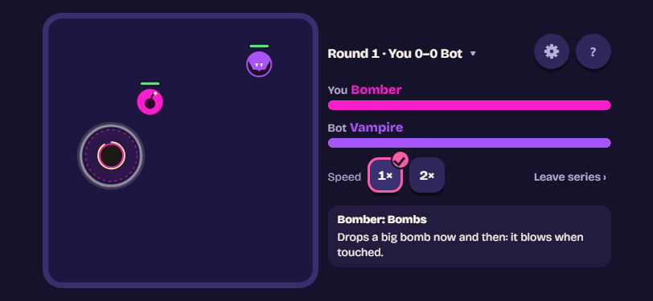

# 0067: The beside layout: any landscape screen, named and checked

- Status: Accepted
- Date: 2026-11-18
- Amends: ADR 0031 (the desktop query is the one desktop query; the beside query is named too)
- Amended by: its addendum of 2026-11-22 (a calm fight on a phone turned sideways)

## Context

ADR 0031 put every desktop rule in one query, `(min-width: 64rem) and (min-aspect-ratio: 5/4)`.
Five stylesheets also have rules under `(min-aspect-ratio: 5/4)` alone, older than ADR 0031: the
stage as a row with the court beside the panel, the health bars stacked, the setup and round-over
screens, home, the manual and the older-link notice (issue #16). They apply to any landscape
screen, so also to a phone turned sideways (812 x 375), which no browser test checked. The issue
asked whether to fold them into the desktop query.

## Decision

Not folded. Folding them makes a landscape phone fall back to the phone column, and at 375 px of
height the column has no room for the court: on home it is squeezed to nothing, and mid-fight the
court, the health bars and the speed control can't all be on screen. The beside layout is the right
one for any landscape screen, so it is a deliberate third layout:

- **Phone** (no query; `not all and (min-aspect-ratio: 5/4)` for a rule that is for phones only):
  the column, the court as wide as the page.
- **Beside** `(min-aspect-ratio: 5/4)`: any landscape screen, a phone turned sideways included. The
  court at the screen's full height, the panel beside it.
- **Desktop** `(min-width: 64rem) and (min-aspect-ratio: 5/4)`: refines beside on large screens
  (the sheet for setup screens, wider columns), per ADR 0031.

Each is written verbatim; `layout-queries.test.ts` fails on any other layout query. The
`browsers-landscape` project (812 x 375, touch) checks home and a Free play fight: the court whole
on screen at full height, the panel to its right, health bars and speed on screen, no sideways
scroll. It fails with the beside rules folded into the desktop query.

## Consequences

- Positive: a phone turned sideways is a layout we mean and test, not an accident.
- Positive: no visual change at any size: the rules stay as they are.
- Negative: one more browser project (one flow, three engines) in CI's "rest" part.

## Addendum (2026-11-22): a calm fight on a phone turned sideways

At 812 x 375, mid-series, the panel held the whole track, two stacked health bars, then speed and
Leave series on rows of their own: speed was cut off and Leave series needed a scroll. Scrolling
the page on a real phone moves the browser's bar, which changes `100dvh`, so the court resized as
the player scrolled. The UX pass (approved 2026-11-22) changes the beside layout only; every rule
sits in the beside query and the desktop query restores today's desktop.

- **The phone's score line** ("Round 1 · You 0–0 Bot ▾") in place of the track while a round is
  fought, the track a tap away, as on a phone (ADR 0039).
- **Speed and Leave series on one row** (`.hud-foot`), as on a phone; a desktop keeps a row each.
- **The panel as wide as the room allows**, `clamp(var(--hud-width), 100vw - 100dvh - 3rem,
22rem)`, so its lines don't wrap.
- **The panel scrolls inside itself** (`max-height: 100%`, `overflow-y: auto`, `overscroll-behavior:
contain`), so the page never scrolls, the browser's bar never moves and the court keeps its size.
  This is an exception to "prefer the page scrolling" (CLAUDE.md), for the beside layout only and
  by the owner's decision: it is the only way to keep the court still. A desktop still scrolls the
  page to a tall panel (ADR 0038).
- **No roster strip on home** beside the court: there is no room for it at 375 px of height; a
  desktop keeps it.
- The ability caption (ADR 0036 addendum of 2026-11-22) is the panel's last row here, in flow
  (an absolutely placed caption would be clipped by the scrolling panel).

Tests: `landscape-series.landscape.browser.test.ts` plays a series round at 812 x 375: the score
line and no track, the court, both bars, speed, Leave series and the score line on screen, speed
and Leave series on one row, the page not taller than the screen and `scrollY` 0, and, with the
track opened and the panel scrolled to its end, `scrollY` still 0 and the court the same size.
Seen failing on the old stylesheets. The desktop flows (`consistency`, `desktop-layout`,
`panel-parts`) are unchanged.

| Before                                                            | After                                                           |
| ----------------------------------------------------------------- | --------------------------------------------------------------- |
|  |  |
|      |      |

Not checked headless: a real phone's browser bar (the resize can't be reproduced there; the fix
removes its cause, page scrolling).
