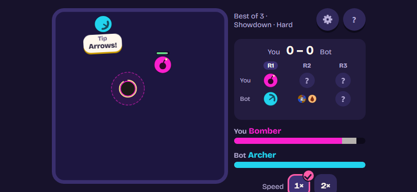
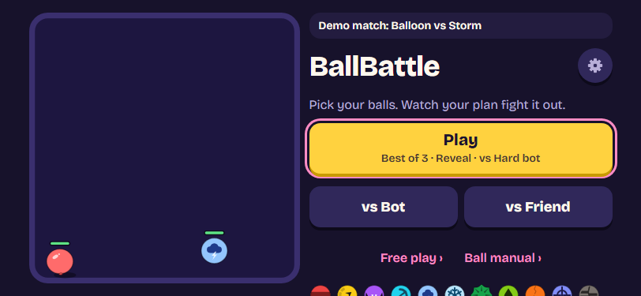
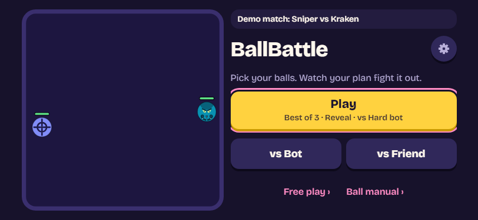
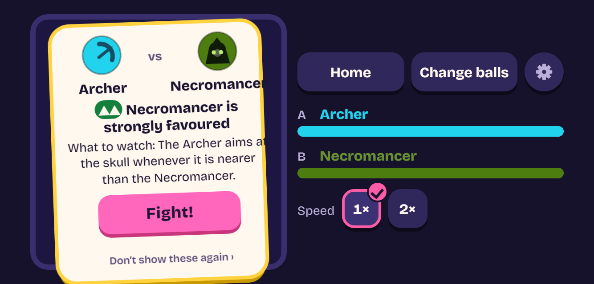
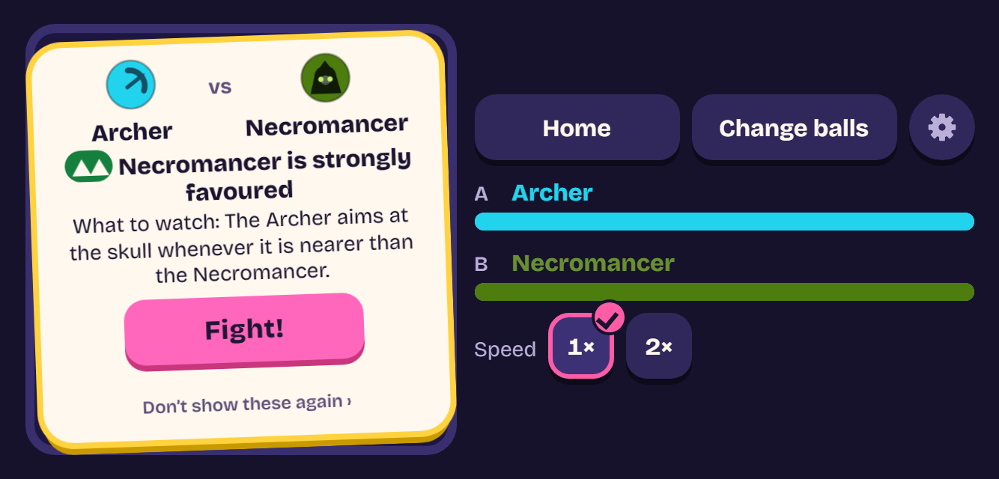
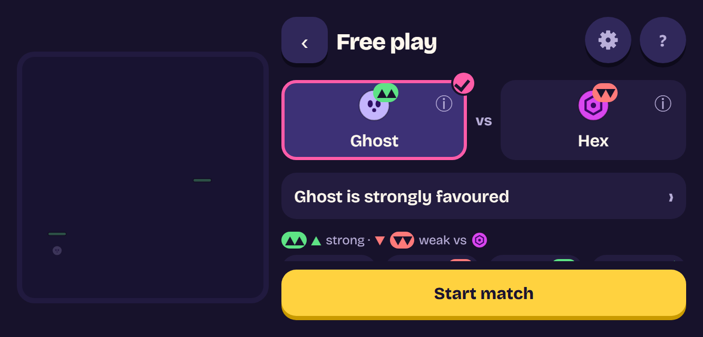
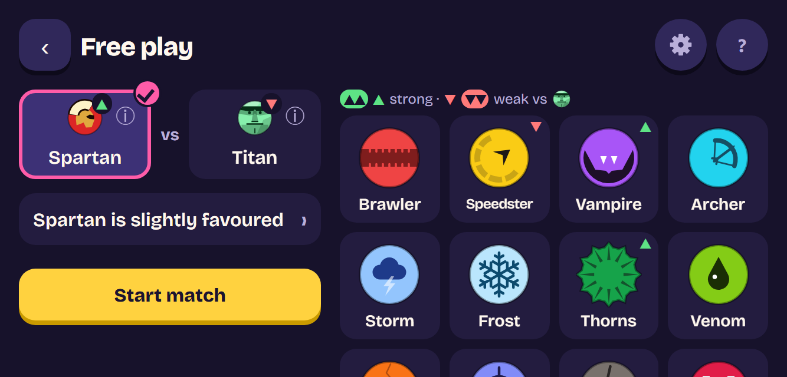

# 0067: The beside layout: any landscape screen, named and checked

- Status: Accepted
- Date: 2026-11-18
- Amends: ADR 0031 (the desktop query is the one desktop query; the beside query is named too)
- Amended by: its addenda of 2026-11-22 (a calm fight on a phone turned sideways; the smallest phone sideways in Safari) and 2026-11-23 (the toss and the picks above the fold; home, the lineup and the rest of the screen walk)

## Context

ADR 0031 put every desktop rule in one query, `(min-width: 64rem) and (min-aspect-ratio: 5/4)`.
Five stylesheets also have rules under `(min-aspect-ratio: 5/4)` alone, older than ADR 0031: the
stage as a row with the court beside the panel, the health bars stacked, the setup and round-over
screens, home, the manual and the older-link notice (issue #16). They apply to any landscape
screen, so also to a phone turned sideways (812 x 375), which no browser test checked. The issue
asked whether to fold them into the desktop query.

## Decision

Not folded. Folding them makes a landscape phone fall back to the phone column, and at 375 px of
height the column has no room for the court: on home it is squeezed to nothing, and mid-fight the
court, the health bars and the speed control can't all be on screen. The beside layout is the right
one for any landscape screen, so it is a deliberate third layout:

- **Phone** (no query; `not all and (min-aspect-ratio: 5/4)` for a rule that is for phones only):
  the column, the court as wide as the page.
- **Beside** `(min-aspect-ratio: 5/4)`: any landscape screen, a phone turned sideways included. The
  court at the screen's full height, the panel beside it.
- **Desktop** `(min-width: 64rem) and (min-aspect-ratio: 5/4)`: refines beside on large screens
  (the sheet for setup screens, wider columns), per ADR 0031.

Each is written verbatim; `layout-queries.test.ts` fails on any other layout query. The
`browsers-landscape` project (812 x 375, touch) checks home and a Free play fight: the court whole
on screen at full height, the panel to its right, health bars and speed on screen, no sideways
scroll. It fails with the beside rules folded into the desktop query.

## Consequences

- Positive: a phone turned sideways is a layout we mean and test, not an accident.
- Positive: no visual change at any size: the rules stay as they are.
- Negative: one more browser project (one flow, three engines) in CI's "rest" part.

## Addendum (2026-11-22): a calm fight on a phone turned sideways

At 812 x 375, mid-series, the panel held the whole track, two stacked health bars, then speed and
Leave series on rows of their own: speed was cut off and Leave series needed a scroll. Scrolling
the page on a real phone moves the browser's bar, which changes `100dvh`, so the court resized as
the player scrolled. The UX pass (approved 2026-11-22) changes the beside layout only; every rule
sits in the beside query and the desktop query restores today's desktop.

- **The phone's score line** ("Round 1 · You 0–0 Bot ▾") in place of the track while a round is
  fought, the track a tap away, as on a phone (ADR 0039).
- **Speed and Leave series on one row** (`.hud-foot`), as on a phone; a desktop keeps a row each.
- **The panel as wide as the room allows**, `clamp(var(--hud-width), 100vw - 100dvh - 3rem,
22rem)`, so its lines don't wrap.
- **The panel scrolls inside itself** (`max-height: 100%`, `overflow-y: auto`, `overscroll-behavior:
contain`), so the page never scrolls, the browser's bar never moves and the court keeps its size.
  This is an exception to "prefer the page scrolling" (CLAUDE.md), for the beside layout only and
  by the owner's decision: it is the only way to keep the court still. A desktop still scrolls the
  page to a tall panel (ADR 0038).
- **No roster strip on home** beside the court: there is no room for it at 375 px of height; a
  desktop keeps it.
- The ability caption (ADR 0036 addendum of 2026-11-22) is the panel's last row here, in flow
  (an absolutely placed caption would be clipped by the scrolling panel).

Tests: `landscape-series.landscape.browser.test.ts` plays a series round at 812 x 375: the score
line and no track, the court, both bars, speed, Leave series and the score line on screen, speed
and Leave series on one row, the page not taller than the screen and `scrollY` 0, and, with the
track opened and the panel scrolled to its end, `scrollY` still 0 and the court the same size.
Seen failing on the old stylesheets. The desktop flows (`consistency`, `desktop-layout`,
`panel-parts`) are unchanged.

| Before                                                            | After                                                           |
| ----------------------------------------------------------------- | --------------------------------------------------------------- |
|  |  |
|      |      |

Not checked headless: a real phone's browser bar (the resize can't be reproduced there; the fix
removes its cause, page scrolling).

## Addendum (2026-11-22): the smallest phone sideways in Safari

On a real iPhone 13 in Safari (owner's test on staging), the beside layout was cramped and cut
off: the ready card's longest lines ran off its right edge ("Necromancer is strongly" clipped) and
the card spilled past the court, and Free play's picker scrolled inside a box beside an empty,
dimmed court that cut tiles in half at its top and bottom. Our 812 x 375 project is a phone with
no browser bar and no notch.

**The size.** In landscape Safari keeps its bar at the top, and a notched iPhone's safe areas take
47 px a side and 21 px at the bottom. From the owner's iPhone 13 screenshots (2000 x 924 px of an
844 x 390 pt screen), Safari's bar ends 63 pt down: the page sees about 844 x 327, the stage about
750 x 290, so the court is about 290 square. An iPhone SE (667 x 375, no notch) is narrower; the
Pro Max is larger on both counts. The new `browsers-landscape-small` project is **667 x 320**, an
SE's width and a 13's usable height (a 288 px court), with touch. Playwright can't make safe areas,
so the size takes them off instead. It runs the two sideways flows above and its own flow.

- **The ready card fits the court.** Beside, its layer's padding is 8 px and the card takes the
  court's width; the pairing's drawings are 36 px (pairing.css; CSS now owns their size, the canvas
  keeps 48 px of pixels); a desktop restores both.
- **Setup screens and the round screen have no court beside them** (as on a phone and, for setup,
  a desktop, ADR 0020): the page scrolls a column `min(40rem, 100%)` wide, the manual's. With
  nothing fighting, the browser's bar moving resizes nothing, so the page scrolling is safe here;
  the inner scroll box beside an empty court was what cut tiles. A desktop keeps the dimmed round
  beside its round screen.
- **Every beside screen opens at its top.** The round screen's first action takes focus without
  scrolling the page beside the court (`BESIDE_LAYOUT`, `src/app/layout-query.ts`, held to the
  CSS by `layout-queries.test.ts`): scrolling to it sliced the header, its gear and ? and the
  track off at the top edge. A phone still scrolls to it.
- **Free play's picker is two columns beside the court**, as on a desktop (the same areas,
  quick-setup.css): the slots, why and Start match in a 16rem column, the legend and the grid
  beside it, the page as wide as the screen. At 667 x 320 two whole rows of tiles show at the top,
  and Start match, sticky in its own column, never covers a tile.
- **The panel beside a fight is exactly as wide as the room**: `--beside-room` (layout.css), the
  width less the stage's padding, the gap and the court, safe areas included (it was `100vw -
100dvh - 3rem`, 32 px short at 667 x 320, where the score line wrapped). Home's panel is at most
  that wide too, so the demo court keeps its full height.
- **Mid-fight rows are 8 px apart** beside (12 on a desktop), so the ability caption, the panel's
  last row, shows whole under speed: the longest (two lines, 77 px) leaves the Free play panel at
  279 of 288 px.

Tests: `beside-tops.landscape.browser.test.ts` (both landscape projects) visits home, the picker,
the vs Bot setup, the lineup, a round and its round screen: at scroll 0 nothing cut off above the
screen, everything reachable, no sideways scroll; and the picker's first row whole above Start
match, which covers no tile at the top, middle or end of the page (seen failing without each
fix: no tile above Start; the round screen scrolled 29 and 216 px). `small-landscape.landscape-small.browser.test.ts` opens the iPhone's pairing (Archer vs
Necromancer, the longest edge line) at 667 x 320: the card inside the court and no part of it
wider than its box, the caption and ring together in the ball's colour and the caption whole
inside the panel, settings inside the screen, and Free play's picker with no inner scroll box, no
court and every name on one line. `landscape.landscape` runs here too (home's court at full
height). Both were seen failing on the old stylesheets. Not checked headless: Safari's own bar
(the size stands in for it).

| Before (667 x 320)                                                          | After                                                                                 |
| --------------------------------------------------------------------------- | ------------------------------------------------------------------------------------- |
|     |                 |
|  |  |

## Addendum (2026-11-23): the toss and the picks above the fold

Seen on the owner's iPhone sideways: Reveal's coin toss opened below the fold (the screen starts at
its top, and under the header and the bar the coin's rise, the coin and the result line took 272
px of a 320 px screen), and between rounds the full track (158 px) pushed the picks below it.

- **The toss beside** (coin-toss.css): the coin is sized from the height left,
  `clamp(56px, (100dvh - 10rem) / 2, 112px)`, and the result line sits beside the coin, level with
  its face at rest, rather than under it. At 667 x 320 the whole toss ends at 291 px; at 812 x 375
  the coin keeps its full 112 px. A desktop keeps the column and its 128 px coin. Live and offline
  alike: it is one part (ADR 0061).
- **The score line between rounds** (series-bar.css): beside, a pick screen reads "Round 2 · You
  1–0 Bot ▾" in place of what is played, as mid-fight, and the track is a tap away. The round
  screen (`phase` between) and round 1's pick (`answer-step`, now marked `data-phase="between"`)
  both. The track opened there closes when the fight starts (its open state is keyed by phase and
  round). At 667 x 320 the banner and the first pick show whole at scroll 0 (round 2's two picks
  whole); a phone and a desktop keep the full track.

Tests: `landscape-toss.landscape.browser.test.ts` (both landscape projects): the coin's stage in the
air and landed, and the result line, whole at scroll 0; then on round 1's pick and round 2's the
score line, no track, the banner and the first pick whole, and the track opened by the line. Live:
`coin-toss.online.test.ts` puts one phone at 667 x 320 and the other at 812 x 375 and checks the
landed toss whole on both at scroll 0. Each was seen failing on the old stylesheets.

## Addendum (2026-11-23): home, the lineup and the rest of the screen walk

From the owner's iPhone 13 sideways and the overnight screen walk at 390 x 664, 667 x 320, 812 x 375
and 1280 x 800. Every sideways change sits in the beside query; a desktop restores its own look.

- **Home scrolls the page**, as every other beside screen: its panel scrolled inside a box whose
  scroll bar clipped Play and the gear. The court is sticky at the top and sized with `100svh`
  (the height with Safari's bar shown, which doesn't change as the bar moves), so it neither moves
  nor resizes while the page scrolls. At 667 x 320 Free play and Ball manual now show without a
  scroll: rows 8 px apart, as mid-fight, and no pitch line (the demo beside it is the pitch).
- **The matchup chart uses the column** (seven a row at 812 x 375, names on one line): Free play's
  beside rules placed `.quick-legend` and `.quick-why` without naming the picker, and the chart,
  which shows the same legend, was pushed into two columns with the grid in the narrow one. The
  rules are scoped to `.quick-setup` now. (Its redesign is a separate proposal.)
- **The lineup is the picker's two columns beside** (as Free play and a desktop): the mode line,
  the tray and Reveal lineups in a 16rem column, the grid beside them from the top; the button,
  sticky in its own column, covers no tile. Two whole rows show at 667 x 320 (was a sliver).
- **The vs Bot and vs Friend setups are two columns beside** (as a desktop): the formats on the
  right show at the top; Choose lineup sticks under the left column. A sticky footer is now above
  what scrolls under it (`z-index: 3`, at every size): a chosen option's check badge stuck out
  over it.
- **Settings mid-fight takes the panel's room** when nowhere by its gear is clear (both sizes):
  from the court's gap to the screen's edge, top to bottom, so the panel's ? and Leave series no
  longer peek out around it; still off the court (`placeMenu`'s `fill`).
- **The account screen ends with Done** beside (it stuck over a fifth of the screen at 667 x 320,
  Add a friend under it); on a desktop sign-in and the account start at the top of the sheet,
  without the short notice's card (a reading screen, ADR 0020).
- **Round 1's score line drops "Round 1 ·"** beside: its header already says it.

Not sideways, from the same walk: a finished match draws no projectiles (a loser's boomerang hung
frozen over the dimmed round at 1280 x 800); a text link's chevron is a no-break space from its
words in `button.css` alone (a flex link dropped the space: "Privacy policy›"); the friends' groups
are 12 px further apart.

Tests: `beside-walk.landscape.browser.test.ts` (both landscape projects): home with no inner scroll
box, its top whole, the court still while the page scrolls, Free play and Ball manual above the
fold; the chart's grid the column's width, six or more a row, no name wrapped; the lineup's whole
first row with names above the fold and Reveal lineups over no tile at the top, middle or end; and
the account's Done over no part of the Friends section. Each part was seen failing without its fix.
`settings-place.test.ts` places the menu over the panel's room at 812 x 375, and
`projectiles.browser.test.ts` draws nothing for a finished match (each failed first).
