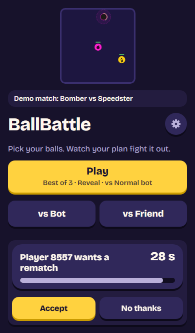
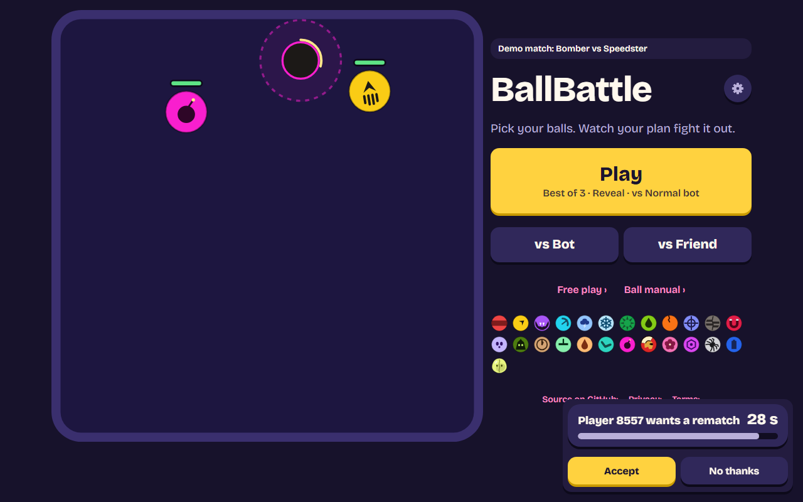
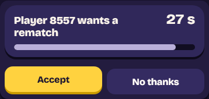

# 0070: Fixes from a playtest on two iPhones: a smooth toss, no flash at Fight!, taps everywhere, a rematch that finds you

- Status: Accepted
- Date: 2026-11-19
- Amends: ADR 0055 (a rematch reaches the other player anywhere, not only on the end screen), ADR
  0061 (the toss keeps time by speed, never by a jump), ADR 0064 (every control sounds, softly)
- Builds on: ADR 0053, 0054 (the live clock and countdown), ADR 0063 (catching up gently)

## Context

The owner played vs Friend on two iPhones (Safari) and vs Bot, and found five things.

1. The coin toss sometimes stuttered or half-restarted, on the first game with someone only.
2. Menus felt dead: only key moments made a sound.
3. After the 3-2-1, a different ready card without the countdown flashed before the fight.
4. A tap on a phone showed nothing ("Leave series" turns pink under a mouse, not a finger).
5. A rematch asked while the other player had gone home reached nobody: they found the end screen
   again with browser Back.

## What caused each

1. **The toss snapped to a moving clock.** A live page's estimate of the server's clock starts on
   one or two slow answers and improves over its first seconds (ADR 0061 measured 170 ms to 1.2 s
   of error then), which is exactly when the toss plays. On every display tick the coin was put
   back on the clock if it was more than 30 ms off, a visible jump; and when the estimate moved
   back across the flip's start, the toss returned to Get ready and flipped again from part-way.
   The live driver is made once per page, so a second game starts on a settled clock: hence the
   first game only. (The first sound and first loading were checked: the audio context is made on
   the first tap, before the toss, and nothing loads lazily.)
2. Sound was designed that way (ADR 0064): every other button was quiet.
3. **The sticker never lifted.** `.ready-lift .ready-card` (specificity 0,2,0) lost to
   `.ready-layer:not([hidden]) .ready-card` (0,3,0), so the lift animation never ran; and the
   start timer emptied the countdown line before releasing the card. For its 180 ms the sticker
   sat still, re-laid out as the pairing alone, then vanished. Every live round did it, both
   phones.
4. iOS Safari applies `:active` only under a touchstart listener, and a tap ends sooner than the
   80 ms press transition shows; most controls had no hover or pressed look at all, and the pick
   row's hover wasn't kept to hover-capable pointers, so it stuck after a tap.
5. Only the end screen asked about a rematch, and only while it showed (it went on polling after
   the player left, but drew nothing).

## Decision

1. **The toss keeps time by speed** (`coin-toss.ts`): a flip under way runs at `catchUpRate`, the
   rate a live fight already uses (0.85-1.5x), until it is on the clock; its stage only moves
   forwards; it runs to its landing rather than being cut short. Both phones still land together.
2. **Every control sounds** (`sound.ts`): a soft `press` (a sine tick, E6 to C6, half the key
   moment's level) on every button, toggle, tab, chip, summary and link, and `back` (the same tick
   stepping down) on Back and Close. Key moments keep their `tap`. A control with a sound of its
   own (a pick's lock, Fight!, Hear it, the sound switch) is `data-sound="own"`: one tap, one
   sound. Through a gate of its own (60 ms apart, quieter in a run, to 40%), on a person's click
   only (`isTrusted`), so Enter and Space sound, a click passed on doesn't, and the home demo never
   does.
3. **The sticker lifts away with its last number** (`ready-card.ts`, `ready-card.css`): the lift
   rule is more specific than the pop, and a showing sticker's line is never emptied; a new one
   starts empty.
4. **A finger lights what it presses** (`press.ts`): the control under a touch is marked
   `data-pressed` after 50 ms (a scroll's touch never lights) or as it lifts, for at least 200 ms,
   and always cleared (on lift, or at once on `pointercancel`). Each control's stylesheet gives the
   mark exactly its hover look (filled controls brighten, rows and summaries take the raised fill,
   links underline, Leave series turns pink), and every hover sits in `(hover: hover)`.
   `press.test.ts` fails on a control without both.
5. **A rematch finds the player** (`rematch-watch.ts`): when a live match ends on a device (its
   end screen, or the answer to Leave and forfeit), the device remembers it for the offer and an
   answer (2.5 minutes, `ballbattle.online.rematch`), across a reload. Away from that end screen it
   asks `GET /series/:id/rematch` every 2 s while something can still happen, and:
   - the one asked sees a floating card on any screen (the pick card: "Player 4821 wants a
     rematch", the seconds, the bar; Accept and No thanks), never over a fight (it waits);
   - Accept takes them straight to the new lineup; the asker's end screen moves them as before,
     and an asker who has gone elsewhere is moved too, once no fight is on;
   - the asker, wherever they are, is told of a no or the time running out, with OK;
   - a player already in another live match or lobby is refused at Accept (`in_a_match`), not after
     building a lineup.

   No new route or migration: the rematch machine is unchanged but for that refusal.

## Real use

- **Both tap Rematch at once** on their end screens: the server agrees (unchanged, tested on two
  hosts). One on the end screen, the other away: the one away sees the notice.
- **Double taps**: Accept and No thanks are busy until answered; the server is idempotent.
- **The time runs out**: the card goes for the one asked; the asker is told.
- **A closed tab**: back within the window, the card shows again; gone for good, the asker hears
  "No rematch: time ran out."
- **Two tabs of one player** both ask; the first answer wins, the other tab follows it.
- **A fight on screen** (Free play, a vs Bot round, any live match): the card waits; a live
  match's own pick phases count, so a player in another live match is never interrupted.

## Library and platform behaviour relied on

- Web Animations: `playbackRate` changes take effect from the current time, never jumping;
  `currentTime` is the animation's own clock; an animation without fill returns to the element's
  style when it ends (the coin's rest pose is the landed one).
- CSS: specificity decides before order; `:not([hidden])` counts as an attribute.
- Pointer events: `pointercancel` fires when the browser takes a touch for scrolling; with touch,
  the target is captured from `pointerdown` to `pointerup`. iOS Safari's `:active` needs a
  touchstart listener (one empty passive listener is added).
- `click` fires for Enter and Space on a button and for Enter on a summary; `isTrusted` is false
  for `element.click()`.
- `localStorage` may throw (private modes): every read and write is guarded, and a broken watch is
  ignored.
- The rematch read is not a heartbeat; it counts toward the read limit (900 per 5 minutes), at
  most 75 reads away from the end screen (every 2 s for 2.5 minutes), fewer than the end
  screen's own every second.

## Tests (each seen failing without its fix)

- `coin-toss.browser.test.ts`: a clock estimate moving back across the flip and forward again;
  the coin never turns back or jumps, and never returns to Get ready. `coin-toss.online.test.ts`:
  two phones whose first answers come back 0.3-1.4 s late; the flips, recorded every frame, never
  step back or jump.
- `ready-card.browser.test.ts`: at Fight! the sticker runs `ready-lift` and shows only its "1"
  until it is gone. `live-match.online.test.ts` records every look of the live card on both phones
  through a whole match: after a number, only "gone".
- `press.test.ts` (every control has a hover look in `(hover: hover)` and the same look pressed),
  `press.touch.browser.test.ts` (real taps in three engines: lit as hovered, for 200 ms, never
  stuck; nothing for a disabled button or a scroll).
- `taps.browser.test.ts`: the key moment's tap unchanged; a softer press elsewhere; Back steps
  down; one sound per tap; quieter in a quick run; Enter; silence when off.
- `rematch-watch.browser.test.ts` (a fake server, three engines), `rematch-text.test.ts`,
  `rematch-watch.test.ts`, `rematch.db.test.ts` (a yes refused while in another live match), and
  `rematch-anywhere.online.test.ts`: the friend in the manual is asked and accepts, both land in
  the same new match; the other way round, after a reload, a no reaches the asker at home.

## Consequences

- The toss, the countdown's end and a tap now look right on a phone; every control is heard.
- A device polls a little longer after a live match ends (at most 2.5 minutes, every 2 s, only
  while the rematch can still move).
- Not verified here: how the soft press sounds on an iPhone speaker over a long session.

| Rematch asked, home (phone)               | Rematch asked, home (desktop)               | No thanks under a finger                  |
| ----------------------------------------- | ------------------------------------------- | ----------------------------------------- |
|  |  |  |
