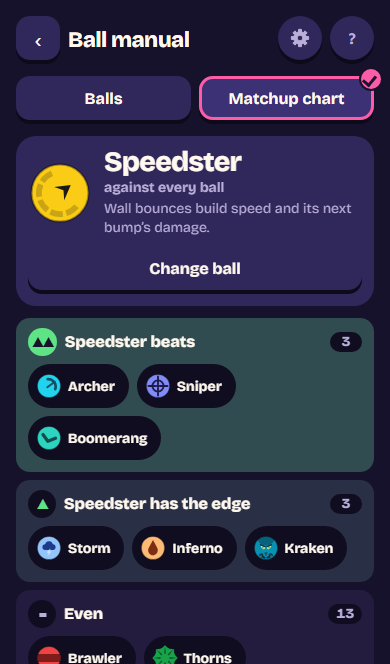
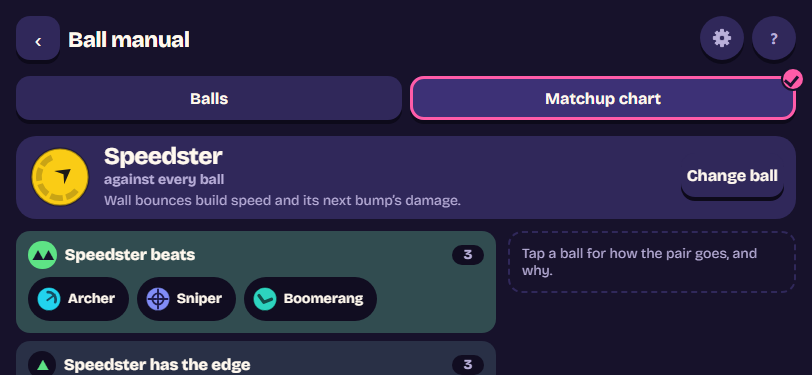
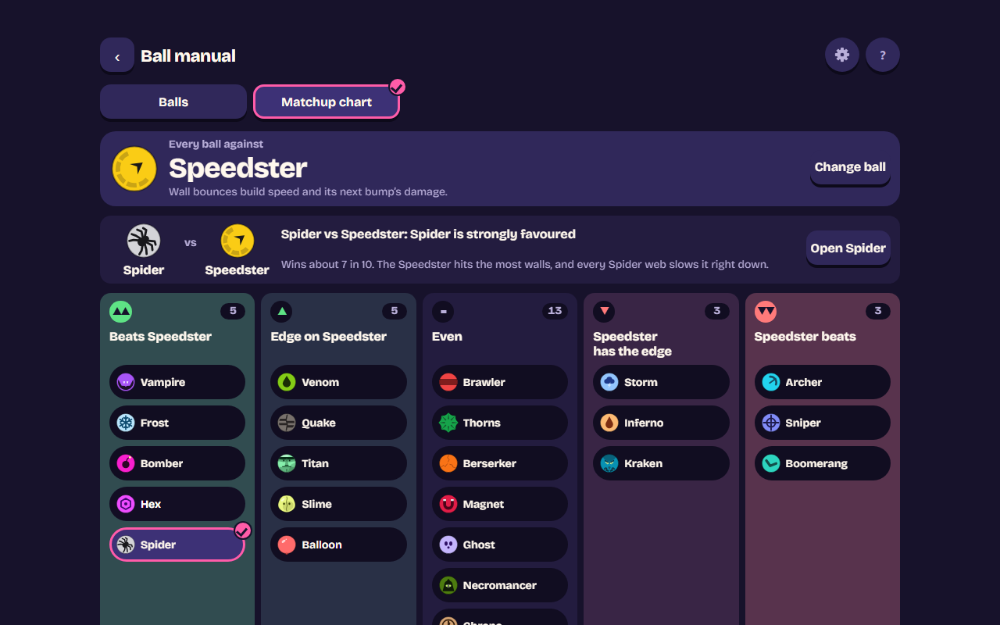

# 0073: Three honest levels, and bots that read them

- Status: Accepted
- Amended by: ADR 0075 (the shape exceptions, ruleset 22), ADR 0076 (the shape is a warning;
  hard limits on strong counters), its addendum of 2026-11-23 (the matchup chart as a spectrum)
- Date: 2026-11-20
- Amends: ADR 0010 (the map labels a level, not only a side), ADR 0022 (an older ruleset whose
  fights are today's still replays), ADR 0024 (a level's odds in words), ADR 0028 addendum and ADR
  0045 group 4 (the bands, the grey zone, NEAR and the shape), ADR 0035 (Normal and Hard read the
  levels)
- Builds on: the owner's decisions of 2026-11-20 and the approved prototype (draft PR #119,
  `docs/experiments/three-levels-proposal.md` on `proto/three-levels`); step 1 of its plan. The 14
  number changes (Batches 1, 1b and 2) come next, in their own ruleset.

## Context

The map said only who was favoured, from 62%. A pair at 58-62% was shown as even (the grey zone),
and a 63% pair looked the same as a 75% one: 48 grey pairs read as "even" while one side won about
six fights in ten, and players could not tell a lean from a counter. The bots read the same two
levels, so Hard valued a 63% and a 75% pair alike (64%), and Normal answered a lean as if it were
even.

## Decision

### 1. Three levels, one rule

Every pair is labelled from the full run (500 seeds, both slot orders) by its better side's win
rate: **65% or more is a strong counter, 58% up to 65% an edge, under 58% even.** The map stores the
label (`level: 'strong' | 'edge'` on every favoured entry) beside its reason; `pnpm balance`
checks it against the run (`scripts/counter-map.ts`, `LEVEL_BANDS`):

| Label  | Fails                     | Warns                        | Passes    |
| ------ | ------------------------- | ---------------------------- | --------- |
| Strong | under 65% or over 78%     | 65-68% or 75-78%             | 68-75%    |
| Edge   | under 58%, or 65% or more | within 1 point of 58% or 65% | 59-64%    |
| Even   | a side at 58% or more     | a side at 55-58%             | under 55% |
| Any    | a side under 22%          |                              |           |

- The bands meet with no gap: every rate passes exactly one label (a test walks 50-78%). There is
  no grey zone and no NEAR in a full run: the label and the check read the same fights, so a pair
  outside its band is mislabelled. Relabel it with a reason, or tune it.
- CI's 150-seed run keeps its noise allowance (three standard errors, NEAR) on the map's labels.
- Ruleset 19's sheet labels as 44 strong, 75 edges, 181 even; the map test reads the committed
  sheet (`docs/balance-matrix.csv`) and fails on any pair labelled otherwise.

### 2. The shape counts strong counters only

Every ball beats 2-4 balls outright and loses to 2-4, the counts within 1. A fifth on one side is
allowed when it comes from the same visible mechanic (`FIFTH_FROM_ONE_MECHANIC`: the Bloom, any
hit shuts its bud). An edge is a small lean a player can't plan a pick around; counted, most balls
would have 6-12 each way and the rule would say nothing. Every ball's 45-55% keeps edges in balance.

17 balls are off that shape today, each allowed exactly its gap with a one-line reason in
`SHAPE_EXCEPTIONS`:

- **Ten for ability tweaks or new balls** (the proposal's search plateaued with them still off):
  the Titan, Ghost, Quake, Slime, Spider, Spartan, Sniper, Inferno, Frost and Boomerang. The
  proposal's eleventh, the Vampire, fits today; its Batch 2 would make it 2/5.
- **Seven for the next run's numbers**, which the proposal's verified run brings to the shape: the
  Archer, Thorns, Magnet, Necromancer, Bomber, Bloom and Battery. That run tightens or drops each.

### 3. A reason for every edge

The 49 pairs that were even and are now edges each have a reason of their own, in the style of
the counter reasons and true to the sim (a blast heals the Vampire nothing; a nip is too small to
rewind), at most 97 characters so it fits the card at 375 px. A test fails on "still to be
written" anywhere, and on a favoured pair whose reason says neither side leans.

### 4. Bots by level (ruleset 20)

- **Easy** unchanged: any ball at random.
- **Normal** ranks by level: a strong counter, then an edge, then even, then an edge against, then
  a strong counter against (`standingOf`, 2 to -2), 60% of the time as before.
- **Hard** values a round at the middle of each level's band: **70 / 60 / 50 / 40 / 30%** (was 64 /
  50 / 36%), so it plays the edges too.

This changes bot choices, so the ruleset is 20 (`f86d0334…`). No fight changed: ruleset 20's known
results are ruleset 19's, match for match.

### 5. Series already played still replay exactly

A series records every pick, the bot's included, and `verifySeries` re-derives each bot pick and
refuses a series whose recorded pick differs. So a new bot alone would make every ruleset-19 link
against Normal or Hard fail, and every series saved for reload be dropped. Instead:

- `SAME_FIGHTS_AS = [19]` (`src/sim/ruleset.ts`): an older ruleset whose fights, roster, series
  rules and seeds are today's. `replaysHere` accepts it wherever only today's was accepted:
  `verifySeries`, the route (a v=19 link replays, no "older link" notice), `restoreSeries`, and the
  online screens.
- Its bots are kept: `botFor(opponent, ruleset)` gives a ruleset-19 series ruleset 19's Normal,
  Hard and first bot, reading its two levels (`src/sim/bot-r19.ts`: today's map with the 49 new
  edges read as even, and Hard's 64 / 50 / 36% written exactly as then). Easy never read the map.
- Proof (`scripts/replayed-rulesets.slow.test.ts`): ruleset 19's frozen known results equal
  today's; 288 series played by ruleset 19's own frozen bundle (every bot, format and length)
  verify here with the same rounds, and today's bots would refuse some of them. The test fails with
  the kept bots removed.
- Online series are unaffected: the server verifies each with its own ruleset's frozen bundle (ADR
  0052).
- The first ruleset that changes a fight (the next run) empties `SAME_FIGHTS_AS` and deletes
  `bot-r19.ts`: from then on ruleset 19 and 20 links show the older-link notice, as ADR 0022 has
  every fight change do.

### 6. On every screen

- Marks: a strong counter is two arrows on a disc filled in its side's colour (▲▲ / ▼▼), an edge
  one arrow on the plain disc (▲ / ▼), even =. Fill and arrow count read without colour. The chart's
  cells are too small for two arrows, so a strong counter there is one arrow on a filled cell.
- Words: "strongly" or "slightly favoured", and the level's odds in words: about 7 in 10, 6 in 10,
  1 in 2 (amends ADR 0024: these are a band's middle, never a measured rate, and move only when a
  pair changes level). Accessible names say the level ("slightly unfavoured against Vampire").
- The pick key is two short lines: whose edge each arrow is ("▲ you're favoured · = even · ▼
  bot's favoured"), then what two arrows mean ("▲▲ strong, about 7 in 10 · one arrow, about 6 in
  10"). The prototype's two lines both repeated "favoured" and "strong / slight"; this says
  direction once and level once, and fits two lines at 375 px.
- Ball page: Strong vs and Weak vs lead with their strong counters, each line led by its mark.
  With edges listed, a list runs to ten lines (the Vampire's Strong vs), so on a desktop an edge's
  line is compact and its reason is the mark's tooltip and the line's description; the entry still
  fits 1280 x 800 (`desktop-layout.wide.browser.test.ts`). A phone shows every reason on its card.
  Hovering a ball underlines its name only, never the mark; "How it works" has its own rounded
  corners, so its hover fill follows the box (square only where it opens).
- **Matchup chart, a fork** (replaced by the addendum of 2026-11-23). On a desktop, the full grid as in the prototype. On a phone, 25
  columns leave 13 px cells, too small to read a level, so the chart shows one ball against all the
  others in the quick setup's grid and key (one component, `matchup-legend.ts`): "Every ball vs
  Thorns", each tile's mark how that ball does against it, a tap explains the pair above the grid,
  and "Change ball" turns the grid into a chooser. The two forms share one selected pair, so turning
  a screen keeps the explanation.

### 7. Nothing behind a series before its first round

In vs Friend on a laptop, the home demo stayed dimmed behind the panel until round 1. A series on
screen was "playing" from its first read, and between rounds a wide screen shows the arena dimmed
(the finished round stays, ADR 0025), so before round 1 it showed whatever the arena last held.
Each series controller already knew whether the arena holds its own world (`shownAt`); the stage
now marks `data-no-round` until it does, and the arena shows nothing then, at every size. Checked
on each live screen: the lobby and challenge are setup screens (no arena); lineups, picks and the
coin toss show nothing; between rounds and at the end the series' own last round stays dimmed; a
rematch is a new series and shows nothing until its round 1. Offline, round 1's pick is a setup
step, so it never showed there.

## Consequences

- `pnpm balance` on ruleset 20: every target passes; 87 pairs are off their aim (WARN), the next
  run's work. `docs/balance-summary.md` groups each ball's opponents five ways and lists strong
  counters and edges; `docs/balance-matrix.csv` labels each pair `A strong`, `B edge` or `even`.
- What picking well is worth barely moves (the proposal's part D): the three-level Hard bot is 1-2
  points harder at best play; the visible gain is honest labels.
- Every new ball adds a level and a reason per pair, and its strong counters must fit the shape.

## Addendum (2026-11-23): the matchup chart as a spectrum

Replaces section 6's "matchup chart, a fork". The fork answered "how does one pair go?" and little
else: the desktop's grid of 31 by 31 cells was hard to read, and the phone's grid of tiles in roster
order made a player hunt for what beats a ball. Of three proposals (a spectrum, a cheat sheet of
strong counters, a check against a lineup), the owner chose the spectrum, polished, with columns on
a desktop.

- **One ball against every other, sorted by outcome**, in five bands said from the chosen ball's
  side, as the pick screens say it to "you" (a green ▲ means you're favoured): Thorns beats, Thorns
  has the edge, Even, Edge on Thorns, Beats Thorns. Each heading carries the band's mark (▲▲ ▲ = ▼
  ▼▼, as the pick rows draw them, the chosen ball's) and a count; the band is a calm tint of its
  marks' colour (`--color-band-*`, precomputed in `tokens.css`, so a browser without `color-mix`
  draws the same). The tint only echoes the words and the mark.
- **The hero** names the chosen ball, large, "against every ball" under it, then its one line; **Change ball** opens Free
  play's ball grid in its place (no scrolling strip: an inner scroll box, and one ball in 31 is
  found faster in the grid). It opens on the first ball in the roster with strong counters both
  ways, so every band shows something.
- **Chips**, not tiles: the ball small and its name, a 44 px target, no mark of its own (the band
  says it). The accessible name says the chosen ball's level against it and who wins those odds
  ("Archer: Thorns slightly unfavoured, Archer wins about 6 in 10"; "Brawler: Thorns strongly
  favoured, Thorns wins about 7 in 10").
- **The reason** (the pairing and the verdict with the chosen ball first, Open <ball>): on a phone under the tapped chip's row, in
  the chip's band; beside, in a sticky panel next to the bands; on a desktop, a strip above the
  columns (and first in the tab order there, as it shows), pinned at the top like a header while
  the page scrolls: solid in the page's colour, a small gap and a hairline under it, so the
  columns pass underneath (2026-11-23: it was see-through, the hint sat over the column headings
  and its page-coloured ring sliced through the columns; `matchup-spectrum-desktop.ts` checks it
  opaque, above the headings at scroll 0, and hiding every heading it passes over). Said once through a status line; Escape
  closes it (focus back on the chip), or closes the chooser (focus back on Change ball).
- **Layouts**: a phone stacks the bands; beside stacks them with the panel; only the desktop query
  sets the five columns, each heading the mark and count on a row and its words under them, two
  lines at most, so the columns' chips start level.
- Removed: `matchup-chart.ts` (the grid), `matchup-one.ts` (the phone form) and
  `matchup-chart.css`. Free play keeps its legend (`matchup-legend.ts`), its marks and its grid as
  they were.

**The point of view flipped (2026-11-23, a beta player).** The chart first said each band from the
balls in it ("Beats Thorns" first, its ▲▲ theirs), the opposite of the pick screens, where the
player's own ball is "you" and green ▲ means you're favoured: reading Thorns' chart, green meant bad
for Thorns. Now the chosen ball is "you" throughout: the headings, the marks and tints (green ▲▲,
what it beats, first; red ▼▼, what beats it, last, so the columns' order on a desktop flips too),
the reason's pairing and verdict and every chip's name. The layout is unchanged.

Tests: `matchup-spectrum-text.test.ts` (every pair in the band of its lean and level, the headings,
the accessible names); `matchup-spectrum.touch` (bands stacked, the reason under the tapped chip's
row and before the next, said once, Escape back to the chip, every chip's name), `.landscape` (both
sideways sizes: stacked, the reason in the panel beside the first band), `.wide` and `.full` (five
columns, the reason's strip above them, no heading past two lines against any ball, and the keyboard
flow). Each failed on the old chart. `beside-walk.landscape` now reads the new chart in place of the
old grid's columns.

| Phone (390 x 664)                                  | Sideways (812 x 375)                                | Desktop (1280 x 800)                                   |
| -------------------------------------------------- | --------------------------------------------------- | ------------------------------------------------------ |
|  |  |  |
