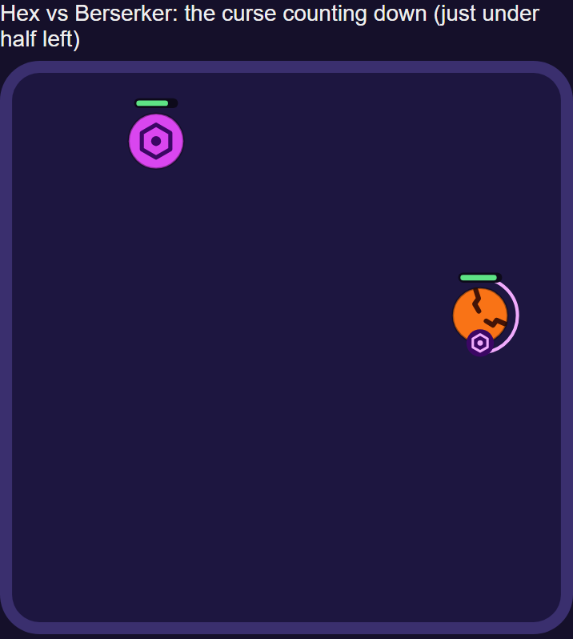
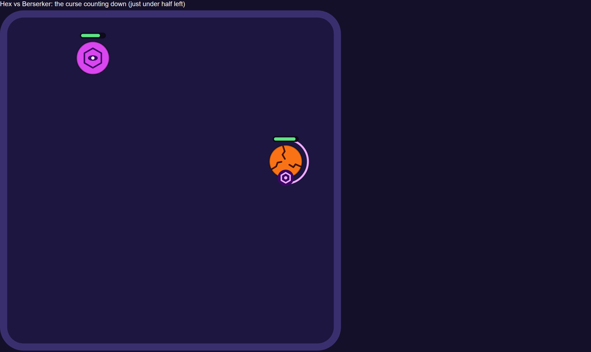
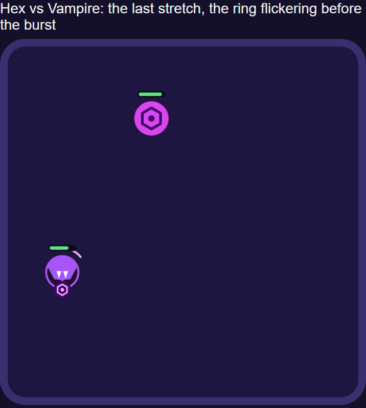
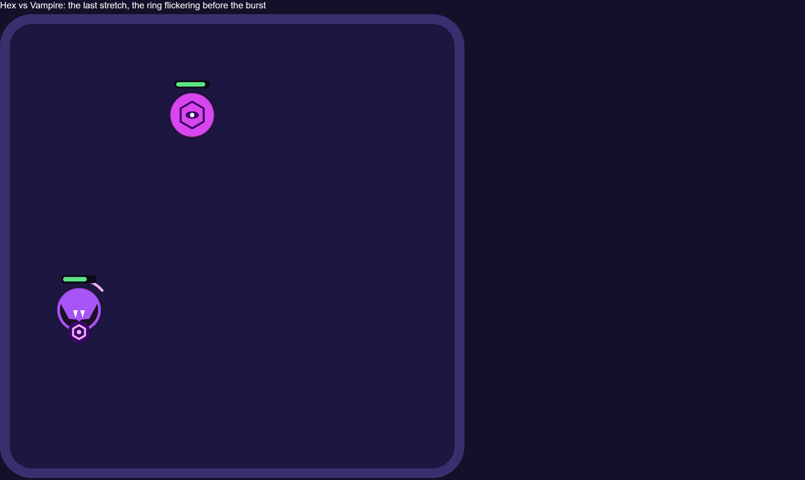
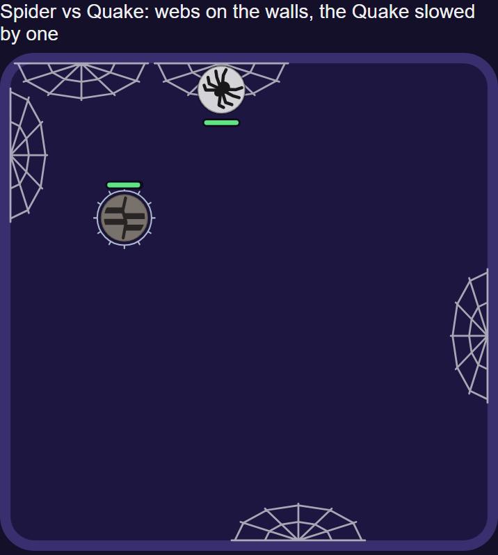
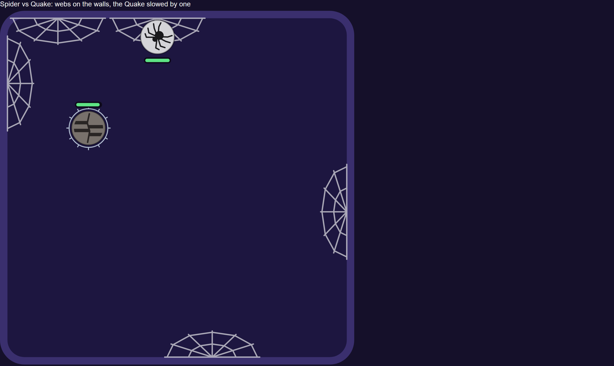
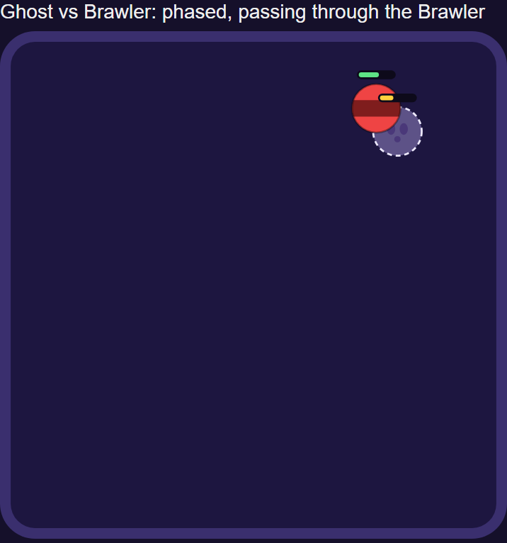
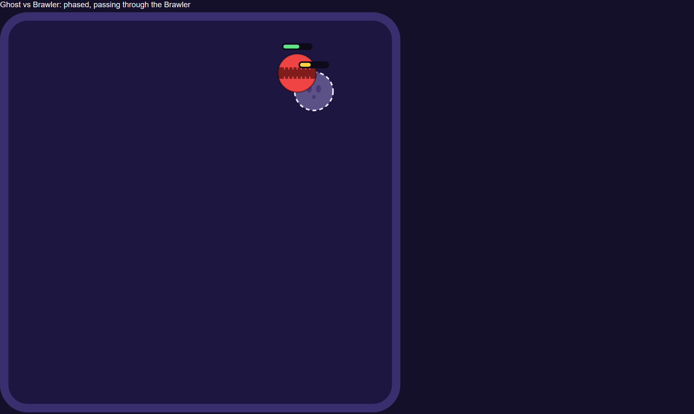

# New balls, round 3: the Hex, the Spider, the Ghost rework and the lane fix

> **Decided (2026-11-14, ADR 0049):** the Hex, the Spider and the Ghost rework shipped in ruleset 13
> without the lane fix, retuned from ruleset 12 (four numbers, not the ones below). The harness and
> runs named here were on `proto/hex-spider-ghost` (commit `b5eaab2`), which is deleted.

Proposal only, measured at ruleset 12 on the branch `proto/hex-spider-ghost` (not for merge), on
2026-11-13. Nothing here is on `main`. Every number is from the real simulation through the
new-ball harness (`scripts/new-balls/`): 150-200 seeds per slot order while tuning, 500 for the
final candidate, with the same ±5% health check as `pnpm balance`.

## In short

- **The Hex works, as reworked by the owner.** Its curse bursts for a quarter of the enemy's full
  health. It loses to the Vampire (75.7%) and beats the Berserker (65.3%), as intended. It loses to
  the Bloom (67.7%), not beats it: the Bloom has only 48 health, so its burst is small and it
  regrows it. On shape at 4-4. The bump-back twist is dropped: it made the Hex lose to almost
  everyone (24-31% overall) instead of separating balls.
- **The Spider works as a slowing ball, not a damage ball.** Webs slow for 6.5 s and nip for 3.
  It beats the Quake (the Quake's missing loss) and the Speedster, and is on shape at 3-2. It also
  beats the Chrono, and no setting separates the two: a Spider strong enough to beat the Quake
  always beats the Chrono by at least as much.
- **The Ghost rework is even, with a thin shape.** Timed phasing plus a spectral hit of 12 takes it
  from 45.6% to 50.6%, 2-1: it beats Venom and the Hex and loses to the Bloom. The Brawler no
  longer beats it (49/51), so the Brawler beats nobody, which the owner accepted.
- **The lane fix is the expensive part.** On its own (with its Storm buff) it knocks 8 balls off
  their shape and is where most of the final candidate's off-shape balls come from.
- **Final candidate: every hard rule passes; 6 balls are off shape** (plus the Brawler at 0-1,
  accepted): the Vampire 2-5, Frost 1-2, Magnet 1-1, Ghost 2-1, Inferno 3-1 and Bloom 6-5. No
  exception has been widened. The closest config is below; the owner decides what to accept.
- **The Spider makes contact fights much better to watch:** fights with a 10 s+ stretch with no
  damage fall from 32% to 4%. The Hex helps less (22%).

**Recommendation:** ship the Hex and the Spider; ship the Ghost rework if its thin shape (2-1) and
the Frost's and Inferno's lost counters are accepted; take the lane fix out of this pass and give it
its own retune later. Details and the alternative at the end.

## 1. Each change on its own

200 seeds per slot order, each against ruleset 12 with everything else unchanged.

| Change                 | Ball itself      | Balls off shape | Hard-rule misses     | Pairs moved |
| ---------------------- | ---------------- | --------------: | -------------------- | ----------: |
| Lane fix alone         | Storm 47.3%      |               8 | Storm vs Chrono 79.5 |     2.5 avg |
| Lane fix + Storm 76 hp | Storm 51.7%      |               9 | none                 |     2.4 avg |
| Ghost rework (final)   | Ghost 50.6%, 1-1 |               4 | none                 |     0.8 avg |
| Hex (final numbers)    | 52.0%, 4-2       |               2 | none                 |           - |
| Spider (final numbers) | 48.7%, 3-2       |               2 | none                 |           - |

- **Lane fix:** the Frost, Venom, Inferno, Archer, Chrono, Titan, Ghost and Vampire go off shape
  (the Ghost to 0-5 at 43.6%, the Bomber to 55.4%). The Storm buff brings the Storm back to about
  50% and Storm vs Chrono to 72-74%, but adds a Storm win over the Bloom.
- **Ghost rework:** the Brawler loses its one win (0-1), the Frost and Inferno each lose a counter
  (the Ghost was the Frost's win and the Inferno's loss).
- **Hex:** the Bloom gains a sixth win (over the Hex); the Hex itself is 4-2. The Vampire gains its
  second win (71.5%) and the Berserker its third loss (63.0%).
- **Spider:** the Chrono gains a fifth loss (4-5) and the Bloom a sixth win. The Quake gains its
  second loss (62.3%).

## 2. The full candidate (500 seeds, ±5% health)

All four changes plus one retune: 23 balls, 253 pairs.

### Hard rules

| Gate                             | Ruleset 12 | Candidate             |
| -------------------------------- | ---------- | --------------------- |
| Each ball overall (45-55%)       | 45.6-52.6  | 45.9-52.6             |
| Weakest side of any pair (22%)   | 23.8       | 24.1                  |
| Highest counter (78%)            | 75.0       | 75.7 (Vampire vs Hex) |
| Median fight (12-30 s)           | 15.8 s     | 16.2 s                |
| Draws (under 5%)                 | 0.5%       | 0.5%                  |
| Comebacks (10-20%)               | 19.8%      | 19.2%                 |
| ±5% health (warn 15, fail 20)    | 11.7 pts   | 11.9 pts              |
| Grey-zone pairs (58-62%, warned) | 40         | 32                    |
| Balls off shape (named gaps)     | 0          | 6 (+ the Brawler)     |

The worst ±5% swing is Speedster vs Venom (45.7 to 57.6 with the Speedster at 105%); the Hex's
worst is 8.6 points and the Spider's 9.1. A 150-seed run like CI's passes every hard rule (weakest
side 25.3%). CI's balance check judges the map's shape, which is labelled from the full run, so it
fails exactly where the full run does until the map and the exceptions are decided.

### The numbers

| Ball   | Final numbers                                                                                                                                        |
| ------ | ---------------------------------------------------------------------------------------------------------------------------------------------------- |
| Hex    | 66 health, bump 15, speed 770; curse on a bump, bursts 180 ticks (3 s) later for 25% of the enemy's full health, rounded                             |
| Spider | 71 health, bump 18, speed 770; up to 6 webs, each 280 long (140 each side), lasting 720 ticks (12 s); a catch nips 3 and slows for 390 ticks (6.5 s) |
| Ghost  | 65 health, bump 22, speed 770; phased 60 ticks of every 240 from a seeded start; spectral hit 12, once per pass                                      |
| Storm  | 76 health (was 74), speed 790 (was 780)                                                                                                              |
| Lane   | A bounce leaves at least 10° off the wall's perpendicular (`proto/contact-A`)                                                                        |

The retune nudges existing balls by one health point each: Brawler 67 (66), Vampire 38 (39), Frost
80 (79), Sniper 77 (78), Quake 69 (71, two points), Necromancer 69 (70), Titan 79 (78), Inferno 73
(74), Boomerang 51 (52), Bomber 59 (62, three points), Bloom 48 (49). The Magnet, Archer, Chrono,
Thorns, Spartan, Venom, Berserker and Speedster are unchanged.

### Each ball

| Ball        | Overall (was) | Shape (was)   | Beats                                                                      | Loses to                                                           |
| ----------- | ------------: | ------------- | -------------------------------------------------------------------------- | ------------------------------------------------------------------ |
| Brawler     |   47.1 (47.9) | 0-1 (1-1)     | -                                                                          | Thorns 71.3                                                        |
| Speedster   |   47.4 (48.3) | 3-3 (3-2)     | Archer 72.5, Boomerang 70.0, Sniper 63.6                                   | Spider 75.4, Frost 66.8, Hex 64.4                                  |
| Vampire     |   49.4 (50.7) | **2-5** (1-4) | Hex 75.7, Berserker 75.0                                                   | Storm 74.4, Spartan 74.2, Boomerang 67.0, Archer 66.2, Bomber 64.3 |
| Archer      |   51.0 (49.2) | 4-3 (3-3)     | Bloom 67.9, Vampire 66.2, Thorns 64.0, Spider 63.8                         | Speedster 72.5, Necromancer 70.3, Berserker 63.5                   |
| Storm       |   50.4 (51.1) | 2-1 (2-1)     | Vampire 74.4, Spartan 68.7                                                 | Chrono 73.0                                                        |
| Frost       |   48.8 (48.8) | **1-2** (2-2) | Speedster 66.8                                                             | Bloom 69.6, Hex 67.9                                               |
| Thorns      |   49.7 (51.1) | 4-3 (3-2)     | Magnet 75.2, Brawler 71.3, Titan 62.9, Berserker 62.3                      | Sniper 66.2, Archer 64.0, Hex 63.1                                 |
| Venom       |   50.7 (50.8) | 2-2 (2-2)     | Bloom 75.4, Chrono 65.9                                                    | Ghost 72.3, Berserker 72.0                                         |
| Berserker   |   50.5 (51.4) | 5-4 (5-2)     | Venom, Quake, Boomerang, Archer, Inferno                                   | Vampire 75.0, Bloom 69.0, Hex 65.3, Thorns 62.3                    |
| Sniper      |   48.2 (48.8) | 1-2 (1-2)     | Thorns 66.2                                                                | Chrono 73.3, Speedster 63.6                                        |
| Quake       |   47.7 (49.9) | 1-2 (2-1)     | Necromancer 63.4                                                           | Berserker 66.8, Spider 65.2                                        |
| Magnet      |   50.4 (49.9) | **1-1** (0-1) | Necromancer 62.6                                                           | Thorns 75.2                                                        |
| Ghost       |   50.6 (45.6) | **2-1** (2-3) | Venom 72.3, Hex 62.9                                                       | Bloom 71.6                                                         |
| Necromancer |   45.9 (47.3) | 2-3 (2-3)     | Archer 70.3, Boomerang 65.2                                                | Inferno 65.6, Quake 63.4, Magnet 62.6                              |
| Chrono      |   47.8 (50.0) | 4-4 (4-4)     | Sniper 73.3, Storm 73.0, Spartan 71.7, Bomber 66.0                         | Inferno 71.8, Venom 65.9, Spider 65.9, Bloom 64.2                  |
| Titan       |   51.7 (50.2) | 1-1 (1-1)     | Bloom 65.2                                                                 | Thorns 62.9                                                        |
| Inferno     |   51.9 (50.8) | **3-1** (2-2) | Chrono 71.8, Necromancer 65.6, Bloom 62.6                                  | Berserker 62.0                                                     |
| Boomerang   |   51.3 (51.3) | 2-3 (3-3)     | Vampire 67.0, Bloom 62.6                                                   | Speedster 70.0, Necromancer 65.2, Berserker 65.1                   |
| Bomber      |   52.6 (52.6) | 1-1 (1-1)     | Vampire 64.3                                                               | Chrono 66.0                                                        |
| Spartan     |   50.7 (49.4) | 2-2 (1-2)     | Vampire 74.2, Hex 62.3                                                     | Chrono 71.7, Storm 68.7                                            |
| Bloom       |   50.4 (49.9) | **6-5** (5-4) | Ghost 71.6, Frost 69.6, Berserker 69.0, Hex 67.7, Spider 65.6, Chrono 64.2 | Venom 75.4, Archer 67.9, Titan 65.2, Inferno 62.6, Boomerang 62.6  |
| Hex         |          51.4 | 4-4           | Frost 67.9, Berserker 65.3, Speedster 64.4, Thorns 63.1                    | Vampire 75.7, Bloom 67.7, Ghost 62.9, Spartan 62.3                 |
| Spider      |          49.0 | 3-2           | Speedster 75.4, Chrono 65.9, Quake 65.2                                    | Bloom 65.6, Archer 63.8                                            |

Bold: off shape today. Nothing is under 22% or over 78%, so there is no MISS pair.

### Gaps closed and opened

| Gap (ruleset 12)                         | Now                                                                                                                                          |
| ---------------------------------------- | -------------------------------------------------------------------------------------------------------------------------------------------- |
| Quake 2-1, needs a loss                  | **Closed**: loses to the Spider (and now beats only the Necromancer, 1-2)                                                                    |
| Spartan 1-2, needs a win                 | **Closed**: beats the Hex (2-2)                                                                                                              |
| Vampire 1-4, needs wins                  | Half: beats the Hex (a second win), but the lane fix adds the Bomber as a fifth loss (2-5)                                                   |
| Berserker beats 5                        | Narrowed: still 5 wins, now 4 losses (the Hex, Thorns)                                                                                       |
| Bloom beats 5                            | **Worse**: 6 wins, it beats both new balls (regrowth eats small nips and small bursts)                                                       |
| Storm, Titan, Bomber: one counter a side | Unchanged (2-1, 1-1, 1-1)                                                                                                                    |
| Sniper 1-2, needs a win                  | Unchanged                                                                                                                                    |
| Chrono                                   | Stays 4-4 (it gains the Spider as a loss, loses the Speedster as a win)                                                                      |
| New: Frost 1-2                           | The reworked Ghost was its second win (now 51/46)                                                                                            |
| New: Inferno 3-1                         | The reworked Ghost was its second loss (now 55/45)                                                                                           |
| New: Ghost 2-1                           | One loss only (the Bloom)                                                                                                                    |
| New: Magnet 1-1                          | With the lane fix it beats the Necromancer 62.6% (58.9% today). At 67 health it loses to the Frost instead and Thorns goes to 77% against it |
| New: Brawler 0-1                         | Accepted by the owner: the plain default beats nobody                                                                                        |

To ship this as it stands, the exceptions would change as follows (none changed yet):

- Vampire: up to 5 losses (from 4).
- Bloom: up to 6 wins (from 5).
- Frost, Ghost and Inferno: one counter on a side.
- Magnet: may beat one ball.
- Brawler: beats nobody.

## 3. The new balls

### Hex: "Its bump curses: 3 s later the mark bursts for a quarter of its health."

One clear thing: a bump lays a mark that bursts 3 s later for a quarter of the marked ball's full
health. A bump on a ball already marked does nothing; the countdown keeps running. It works the same
on any ball, and big balls take big bursts because they are big.

| Counter     | Result | Why (mechanical)                                                           |
| ----------- | -----: | -------------------------------------------------------------------------- |
| ▲ Frost     |   67.9 | 80 health: a burst of 20 every curse, and it is slow to bump back          |
| ▲ Berserker |   65.3 | 86 health: one burst of 22 is one rage, where bumps would give several     |
| ▲ Speedster |   64.4 | 70 health takes 18 a burst, more than its stacks win back                  |
| ▲ Thorns    |   63.1 | 80 health; the curse is not a bump, so its spikes never answer it          |
| ▼ Vampire   |   75.7 | 38 health takes only 10, and it drinks that back with its next bump        |
| ▼ Bloom     |   67.7 | 48 health takes only 12, and it regrows it                                 |
| ▼ Ghost     |   62.9 | Passing through it while phased lays no curse; a burst while phased misses |
| ▼ Spartan   |   62.3 | 44 health takes 11, halved again when its shield is planted                |

Engine need: hooks get `maxHealthOf(ball)` (read-only, from the definition, like `isPhased`). The
Chrono never rewinds a Hex burst: its own is 16, under the rewind's 20. The Hex is sensitive to its
own health (66 to 62 moves it about 5 points), within the ±5% gate (8.6 points).

Measured and dropped: the designed curse with a fixed burst (it beat the Vampire 65-81% and lost to
the Chrono 69-79% in every setting), and the bump-back twist (balls bump at nearly the same rate,
so it only weakened the Hex against everyone).

### Spider: "Webs every wall it touches: a ball that bounces off a web is slowed and nipped."

One clear thing: each wall the Spider bounces off gets a web; any enemy that bounces off a webbed
stretch of wall is slowed (the Frost's slow, 6.5 s) and nipped for 3. Up to 6 webs, each fading
after 12 s; a web spun again on the same stretch is renewed, not doubled.

| Counter     | Result | Why (mechanical)                                                   |
| ----------- | -----: | ------------------------------------------------------------------ |
| ▲ Speedster |   75.4 | The fastest ball hits the most walls, and a slow undoes its stacks |
| ▲ Chrono    |   65.9 | The nips are too small to rewind, like Venom's poison              |
| ▲ Quake     |   65.2 | Slowed, it hits fewer walls, so it sends fewer shockwaves          |
| ▼ Bloom     |   65.6 | It regrows each 3-point nip                                        |
| ▼ Archer    |   63.8 | Its arrows don't care how fast it moves                            |

Measured and dropped: a damage Spider (nips of 7-12: one point of nip moved it 5-8 points and it
crushed or lost to everything), and a Spider that beats the Quake but not the Chrono (no setting of
nip, slow, web size, count, life, health or bump separates them).

Limits chosen for the look: 6 webs, 12 s each, the last 1.5 s fading out; the Vampire was the hoped
loss but measures even (it is not a counter the mechanic creates).

### Ghost rework: "Phases every few seconds: slips through everything and hits as it passes."

One rule: while phased (1 s of every 4, from a seeded start), nothing touches it. It passes through
balls, shots, skulls and bombs, and no hit of any kind lands. Passing through a ball deals its
spectral hit (12, once per pass). Nothing beyond "passes through" was needed:

- The old rules that a phased ball can't be aimed at or gripped are removed (they were dormant in
  `targeting.ts` and `magnet.ts`). With them on, the Ghost measured the same within noise but
  gained a Magnet win; without them the rule is simpler.
- One engine change: shots pass through a phased ball (`projectiles/resolve.ts`,
  `returning.ts`) instead of being used up on it.
- The pass-through safety margin is unchanged: phasing never changes closing speed.

| Counter | Result | Why (mechanical)                                               |
| ------- | -----: | -------------------------------------------------------------- |
| ▲ Venom |   72.3 | Poison ticks that fall while it is phased do nothing           |
| ▲ Hex   |   62.9 | See the Hex                                                    |
| ▼ Bloom |   71.6 | Its damage comes in pieces, and the Bloom regrows between them |

The spectral hit decides it: 0 gives 32.6%, 10 gives 51%, 14 gives 57%. **The Brawler:** Brawler vs
Ghost is now 49/51, so the Brawler beats nobody (accepted). It doesn't naturally beat either new
ball (43/57 against the Hex and 42/57 against the Spider).

## 4. The lane fix and the Storm

The lane fix as kept on `proto/contact-A`. Alone it drops the Storm to 47.3% and puts Storm vs
Chrono at 20.5/79.5. 76 health and speed 790 bring the Storm to 50.4% with Storm vs Chrono at
27.0/73.0 (78 health was 50.7% but left the Chrono at 78%). The Storm stays 2-1.

## 5. Is it more fun to watch?

The longest stretch with no damage in each fight, against the ten contact-only balls (Speedster,
Vampire, Frost, Thorns, Venom, Berserker, Magnet, Titan, Bloom, Ghost), 100 seeds each, final
candidate:

| Ball               | 5 s+ quiet stretch | 10 s+ quiet stretch | What happens per fight     |
| ------------------ | -----------------: | ------------------: | -------------------------- |
| Brawler (baseline) |                80% |                 32% | -                          |
| Hex                |                62% |                 22% | about 2.5 curses, 2 bursts |
| Spider             |                60% |                  4% | about 5.5 web catches      |

The Spider nearly ends long lulls: its webs turn an ordinary wall bounce into an event. The Hex
helps less, and its curse is something to watch for: a ring counting down to a burst.

## 6. The looks

From real matches at the final numbers, drawn by the game's renderer (`looks-preview.html`, dev
only). Phone: a 358 px court, as on a 390 px iPhone. Large: a 720 px court.

- **Hex** (fuchsia, a hexagon sigil with an eye): the cursed ball gets the same hexagon on a dark
  badge at its lower edge (clear of its health bar) and a ring that empties as the burst comes,
  flickering in the last 0.6 s.
- **Spider** (silver, a dark spider seen from above, facing where it goes; a dark ball fails 3:1
  against the court): webs are fans of pale silk against the wall, under the balls. A caught ball
  gets the usual slow ring.
- **Ghost**: phased, it is drawn see-through with a broken outline (the existing look).

| Look                    | Phone                                                    | Large                                                    |
| ----------------------- | -------------------------------------------------------- | -------------------------------------------------------- |
| Hex curse               |               |               |
| Hex curse, last stretch |  |  |
| Spider webs             |             |             |
| Ghost phasing through   |           |           |

Notes: the Hex's fuchsia sits between the Vampire's purple and the Bomber's magenta; it reads apart
in a fight but is the closest colour pair in the picker. A web at a corner draws across the court's
rounded corner a little. Neither ball has a hint, a legend line, a "How it was won" line or a
phone-arena measurement yet; those come with the build.

## 7. Recommendation

**Ship the Hex and the Spider.** Both are on shape, each closes a named gap (the Spartan's win, the
Quake's loss), each does one thing that reads at phone size, and the Spider is the biggest
improvement to watching found so far. Both feed the Bloom (6 wins); that needs an exception or a
Bloom change.

**The Ghost rework:** ship it if a 2-1 Ghost is accepted. It is more fun than the fade (you see it
slip through) and fair at 50.6%, but it takes a counter from the Frost and the Inferno, and the
Brawler's only win.

**Rethink the lane fix in this pass.** It is the source of most of the shape damage (8 balls off on
its own) and of the Vampire's fifth loss, for a modest gain in watching (the worst gap from 50 s to
41 s). Without it (the Hex, the Spider and the Ghost rework, no retune) the roster measures 5 off
plus the Brawler (Frost 1-3, Ghost 2-1, Chrono 4-5, Inferno 2-1, Bloom 7-4) and the Spider loses its
Quake win (61.6%, the grey zone), so leaving it out is not free either. Suggested next step: decide the exceptions
above, then either retune this candidate (with the lane fix) or retune the no-lane version and
bring the lane fix back with its own retune.

## Reproduce

All on `proto/hex-spider-ghost`. The final numbers are in `scripts/new-balls/runs/final3.set`.

```bash
node scripts/new-balls/pairs.ts --all --seeds 500 --set "$(cat scripts/new-balls/runs/final3.set)" --out final.json
node scripts/new-balls/report.ts final.json --base scripts/new-balls/runs/r12-base.json
node scripts/new-balls/sensitivity-all.ts final.json --set "$(cat scripts/new-balls/runs/final3.set)"
node scripts/new-balls/diag.ts spider frost --seeds 100 --set "$(cat scripts/new-balls/runs/final3.set)"
```

Switches: `lane.on=1` (lane fix), `ghost.rework=1` (timed phasing), `aim.skip=1` (the old aim and
grip rules). The search (`search.ts`) changes one number at a time and re-plays only that ball's
pairs; at 150 seeds it reported 5 balls off where 500 seeds showed 13, because many pairs sit within
a point of 62%. The final rounds were run at 500 seeds.
