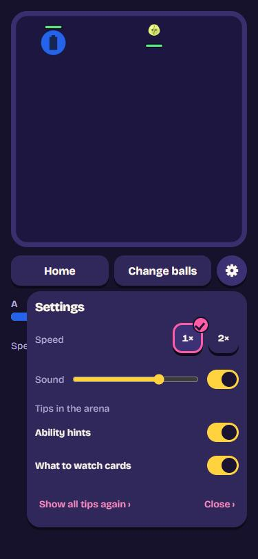
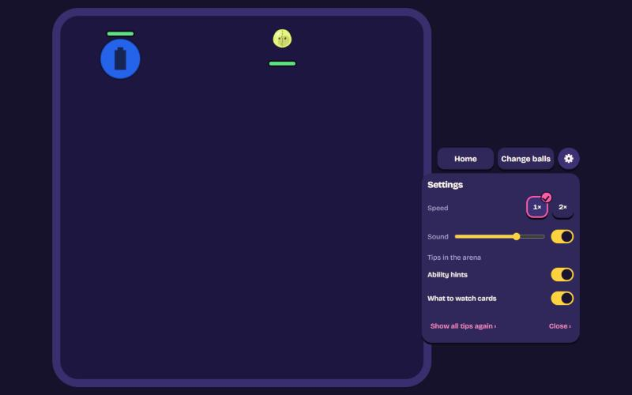

# Sound: proposal (prototype on `proto/sound`, not for main)

## What to try

On the deploy preview, on your iPhone with the silent switch off:

- `/sounds.html`: every sound on a button, plus the bursts a fight makes (a bump rally, an Archer
  volley) through the same limiter a fight uses. A prototype-only page.
- The game: a Free play match (Battery vs Slime, Archer vs Hex) or a Best of 3 vs Bot in Reveal (the
  coin toss, the picks, the series result). Settings has a Sound row: volume and on/off.

Voiced so far: bump, knockout, series won and lost, Get ready / 3-2-1 / Fight!, coin flip and
landing, button tap, pick locked in, and four abilities chosen for range: the **Archer** (a quick
stream: an airy "fwip" and a woody "tock"), the **Hex** (a delayed threat: a quiet wobble when the
curse lands, a hollow whump when it bursts 3 s later), the **Battery** (charge and release: a rising
zip when it stores, a zap into a boom when it lets go), the **Slime** (a transformation: a splat and
two bloops gliding apart). Every other ball is heard through the shared bump, hit and knockout.

 

## Recommendation

**Make every sound in code (Web Audio), not from files.** Each sound is a few oscillators and a
burst of filtered noise, made when it plays.

|                  | Made in code (chosen)                                | Free-licensed files (CC0)                                      |
| ---------------- | ---------------------------------------------------- | -------------------------------------------------------------- |
| Size             | +5.6 kB gzipped script for all of it (measured)      | ~5-15 kB a sound; ~150-400 kB for 25 balls plus shared ones    |
| Load             | Nothing to fetch; ready on the first tap             | Fetch and decode before a sound can play                       |
| CSP              | No change                                            | `connect-src 'self'` covers fetch; `<audio>` needs `media-src` |
| Style            | One family: one scale, one set of envelopes          | Mixed sources sound mixed; hard to make 25 match               |
| Variety, scaling | Pitch and level follow hit strength; repeats vary    | Fixed recordings; variety needs more files                     |
| Licence record   | None needed                                          | Every file's licence recorded in the repo                      |
| Ceiling          | Weaker at realistic sounds (crowds, impacts on wood) | Better for realism                                             |

Sticker Pop isn't realistic: round, bright and toy-like fits synthesis well, and it keeps the game
one small download with a strict CSP. No library: plain Web Audio was enough, so a synth library
(such as Tone.js) would add size for nothing this needs.

**On by default for a first visit**, at 70% volume. Browsers don't let audio start before the
first tap anyway, so nothing ever plays at a cold open; on an iPhone it follows the silent switch;
and the home demo is always silent. Sound is a big part of a game feeling finished, so I'd rather
the first match is heard. The switch is in the gear menu on every screen.

**No background music for now.** Over a Best of 5 a loop gets tiring, it competes with the ability
sounds that tell you a counter is working, and good music is real work (or a licence) to do well.
Worth revisiting as a quiet, optional menu loop once every ball is voiced.

**The full roster:** the engine, the limiter, the settings, the shared sounds and the tests are
built. The remaining 21 balls are about 30-45 minutes each to design, tune by ear and test, so
**2 to 3 days** including a listening pass over whole series at 1x and 2x and an ADR.

## What I found (with evidence)

**The sim is untouched.** No ruleset bump; `git diff main -- src/sim src/golden rulesets src/server`
is empty. Sound reads the arena's tick events the way the effects do (`src/sound/cues.ts`, called
from `arena.ts`'s tick loop), plus read-only ability state where the event alone isn't enough (the
Battery's stored charge, the Hex's curse).

**iPhone Safari.**

- _Starts only after a gesture._ The AudioContext is created on the first tap or key
  (`pointerdown`, `touchend`, `click`, `keydown`; iOS accepts the last three), never before, and
  sounds asked for before then are skipped, never queued. Checked in Chromium: no context before a
  tap, `running` straight after it.
- _The silent switch._ It is respected. Web Audio is "ambient" audio on iOS, which obeys the switch
  and lets the player's own music keep playing; the page also sets `navigator.audioSession.type =
'ambient'` (Safari 16.4+) to make that explicit. Making a web game ignore the switch is possible
  (`'playback'`), but that also stops the player's music, and a browser game shouldn't do either.
  I agree with you: respect it.
- _Backgrounded and back._ The context is suspended when the page hides and resumed when it shows.
  WebKit has open bugs where a context stays "interrupted" after returning (bugs 263627, 276016,
  281955), so the next tap resumes it, and if that fails it is closed and made again. Fights pause
  while hidden anyway, and a live fight that has moved on is caught up silently (below).
- _Low Power Mode._ Audio isn't throttled, but Safari caps the frame rate at 30 fps; sounds are
  started from the frame that shows their moment, so they can land up to ~33 ms late, the same as
  the picture (ADR 0063). **Not verified on a device**: please listen for it on the preview.

**Live matches.**

- _Never delays anything._ Playing a sound schedules a few nodes and returns; it never awaits, and
  any error is swallowed. The countdown and Fight! sounds play from the same timers that change the
  ready card, set for the server's moment (ADR 0054), so both phones hear them when they see them.
- _No burst after a reconnect._ `showAt` plays a live fight on headlessly to the server's moment;
  sound is off for that loop. `src/sound/catch-up.browser.test.ts` joins a fight 12 s in and
  asserts no sound was made, then that a sound plays after; with the catch-up heard instead, it
  fails (three skipped sounds at once).
- _The coin toss_ is heard only from its start: a phone that joins the flip late stays quiet rather
  than playing a ting that doesn't match the coin.

**2x speed and many hits.** A gate on real time (`src/sound/gate.ts`): each sound has a shortest gap
and gets quieter in a run (to 40% at most), and the whole mix holds at most 4 sounds per 120 ms,
strongest first. Fights turn out sparse: through whole matches (`scripts/sound-density.ts`, 20 seeds
a pair), 6 to 18 sounds a match, at most 7 in any second at 2x. The streams the next balls will
voice are mild too: the Quake's waves at most 7 a second at 2x, the Venom's poison 4.

**No clipping.** Every sound rendered offline in Chromium (`src/sound/voices.browser.test.ts`): each
peaks below full scale on its own (this caught the Battery's release at 1.29, now fixed), and the
busiest moment (a knockout, a release, two bumps, an arrow and a burst at once) stays below it only
through the limiter (1.03 without it).

**Reduced motion and accessibility.** Nothing needs to change: reduced motion is about movement,
not sound. Nothing is told only by sound (every sound has its picture), the switch has words for
screen readers, and the volume is a labelled slider.

**Found on the way: the settings menu could cover its own gear.** With no place clear of the court,
its last resort could sit on the gear that closes it. Main had 2 px to spare at 390 × 664; the new
Sound row used them, and the consistency flows caught it. Fixed on this branch (the menu takes the
room above the gear and scrolls inside, as beside a live match), with a unit test. It would also
happen on main with large text, so it is worth landing on its own whatever you decide about sound.

## What you need to decide

1. **The style**: listen on the preview. Too soft, too toy-like, or right?
2. **On by default** for a first visit (my recommendation) or off.
3. **The button tap.** Every button ticks quietly. Some people love that and some don't; it could
   be dropped and keep only the pick and Fight! sounds.
4. **Wall bounces are silent**, on purpose (they are constant and would tire). Say if a fight feels
   too quiet between hits.
5. Whether to go ahead with the full roster (2-3 days), and whether the settings-menu fix should
   land first on its own.
